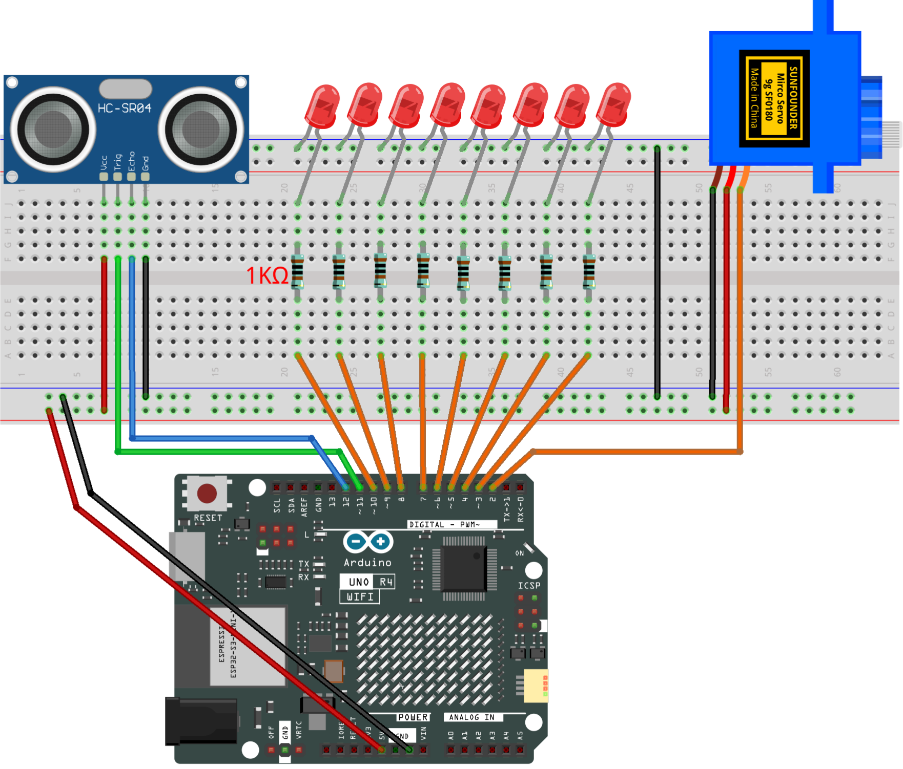

.. _barrier_gate6.0:

Barrier Gate 6.0
==============================================================

.. note::
  
  🌟 Welcome to the SunFounder Facebook Community! Whether you're into Raspberry Pi, Arduino, or ESP32, you'll find inspiration, help ideas here.
   
  - ✅ Be the first to get free learning resources. 
   
  - ✅ Stay updated on new products & exclusive giveaways. 
   
  - ✅ Share your creations and get real feedback.
   
  * 👉 Need faster updates or support? Click [|link_sf_facebook|] join our Facebook community 

  * 👉 Or join our WhatsApp group: Click [|link_sf_whatsapp|]
   
Kit purchase
------------------------

Looking for parts? Check out our all-in-one kits below — packed with components, beginner-friendly guides, and tons of fun.

.. raw:: html

     

.. list-table::
   :widths: 20 20 20
   :header-rows: 1

   * - Name
     - Includes Arduino board
     - PURCHASE LINK
   * - Ultimate Sensor Kit
     - Arduino Uno R4 Minima
     - |link_ultimate_sensor_buy|
   * - Elite Explorer Kit
     - Arduino Uno R4 WiFi
     - |link_elite_buy|
   * - 3 in 1 Ultimate Starter Kit
     - Arduino Uno R4 Minima
     - |link_arduinor4_buy|
   * - Universal Maker Sensor Kit
     - ×
     - |link_umsk_buy|

Course Introduction
------------------------

In this lesson, you'll use an Ultrasonic Sensor, eight LEDs, and a Servo Motor with the Arduino UNO R4 to create an Automatic Barrier Gate system.

When a vehicle approaches, the LEDs light up one by one, and the barrier automatically opens. When the vehicle leaves, the barrier closes, and the LEDs turn off in reverse order.

.. .. raw:: html

..   <iframe width="700" height="394" src="https://www.youtube.com/embed/dH0Zgg6Uj0k?si=CFuYw1t-4MbNgd4k" title="YouTube video player" frameborder="0" allow="accelerometer; autoplay; clipboard-write; encrypted-media; gyroscope; picture-in-picture; web-share" referrerpolicy="strict-origin-when-cross-origin" allowfullscreen></iframe>

.. note::

  If this is your first time working with an Arduino project, we recommend downloading and reviewing the basic materials first.
  
  * :ref:`install_arduino`
  * :ref:`introduce_arduino`

**Required Components**

In this project, we need the following components:

.. list-table::
    :widths: 5 20 5 20
    :header-rows: 1

    *   - SN
        - COMPONENT INTRODUCTION	
        - QUANTITY
        - PURCHASE LINK

    *   - 1
        - Arduino UNO R4 Minima/Arduino UNO R4 WIFI
        - 1
        - |link_unor4_wifi_buy|
    *   - 2
        - USB Type-C cable
        - 1
        - 
    *   - 3
        - Breadboard
        - 1
        - |link_breadboard_buy|
    *   - 4
        - Wires
        - Several
        - |link_wires_buy|
    *   - 5
        - LED
        - several
        - |link_led_buy|
    *   - 6
        - Digital Servo Motor
        - 1
        - |link_motor_buy|
    *   - 7
        - Ultrasonic Sensor Module
        - 1
        - |link_ultrasonic_buy|

**Wiring**

**Common Connections:**

* **Digital Servo Motor**

  - Connect to breadboard’s positive power bus.
  - Connect to breadboard’s negative power bus.
  - Connect to  **2** on the Arduino.

* **Ultrasonic Sensor Module**

  - **Trig:** Connect to **11** on the Arduino.
  - **Echo:** Connect to **12** on the Arduino.
  - **GND:** Connect to breadboard’s negative power bus.
  - **VCC:** Connect to breadboard’s red power bus.

* **LEDs**

  - Connect the LEDs **cathode** to the negative power bus on the breadboard, and the LEDs **anode** to a **1kΩ resistor** then to **3~10** on the Arduino.

**Writing the Code**

.. note::

    * You can copy this code into **Arduino IDE**. 
    * Don't forget to select the board(Arduino UNO R4 Minima/WIFI) and the correct port before clicking the **Upload** button.

.. code-block:: arduino

    #include <Servo.h>

    // Ultrasonic sensor pins
    const int trigPin = 11;
    const int echoPin = 12;

    // LED pins, arranged from first to last
    const int ledPins[] = {10, 9, 8, 7, 6, 5, 4, 3};
    const int LED_COUNT = 8;

    // Servo motor pin
    const int servoPin = 2;
    Servo barrierServo;

    // Distance threshold in centimeters
    const int DETECT_DISTANCE = 15;

    // Servo positions
    const int CLOSED_ANGLE = 0;
    const int OPEN_ANGLE = 90;

    // Timing settings in milliseconds
    const int LED_DELAY = 150;
    const int SERVO_DELAY = 20;

    // Remember the previous vehicle detection state
    bool previousCarDetected = false;

    void setup() {
      // Set up the ultrasonic sensor pins
      pinMode(trigPin, OUTPUT);
      pinMode(echoPin, INPUT);

      // Set up all LED pins and turn them off
      for (int i = 0; i < LED_COUNT; i++) {
        pinMode(ledPins[i], OUTPUT);
        digitalWrite(ledPins[i], LOW);
      }

      // Connect the servo to pin D2
      barrierServo.attach(servoPin);

      // Start with the barrier in the closed position
      barrierServo.write(CLOSED_ANGLE);
    }

    void loop() {
      long duration, distance;

      // Send a short ultrasonic trigger pulse
      digitalWrite(trigPin, LOW);
      delayMicroseconds(2);

      digitalWrite(trigPin, HIGH);
      delayMicroseconds(10);

      digitalWrite(trigPin, LOW);

      // Measure the time taken for the echo to return
      duration = pulseIn(echoPin, HIGH);

      // Convert the echo time into distance in centimeters
      distance = duration * 0.034 / 2;

      // Check if a vehicle is within the detection range
      bool carDetected = (distance > 0 &&
                          distance < DETECT_DISTANCE);

      if (carDetected && !previousCarDetected) {

        // Turn on the LEDs one by one
        turnOnLEDs();

        // Slowly raise the barrier
        moveServo(CLOSED_ANGLE, OPEN_ANGLE);

      } else if (!carDetected && previousCarDetected) {

        // Give the vehicle time to move away
        delay(1000);

        // Slowly lower the barrier
        moveServo(OPEN_ANGLE, CLOSED_ANGLE);

        // Turn off the LEDs in reverse order
        turnOffLEDs();
      }

      // Save the current detection state for the next loop
      previousCarDetected = carDetected;

      delay(300);
    }

    // Turn on all LEDs one by one
    void turnOnLEDs() {
      for (int i = 0; i < LED_COUNT; i++) {

        // Turn on the next LED in the sequence
        digitalWrite(ledPins[i], HIGH);

        delay(LED_DELAY);
      }
    }

    // Turn off all LEDs in reverse order
    void turnOffLEDs() {
      for (int i = LED_COUNT - 1; i >= 0; i--) {

        // Turn off the next LED in the sequence
        digitalWrite(ledPins[i], LOW);

        delay(LED_DELAY);
      }
    }

    // Move the servo gradually between two positions
    void moveServo(int startAngle, int endAngle) {

      if (startAngle < endAngle) {

        // Increase the angle to open the barrier
        for (int angle = startAngle; angle <= endAngle; angle++) {
          barrierServo.write(angle);
          delay(SERVO_DELAY);
        }

      } else {

        // Decrease the angle to close the barrier
        for (int angle = startAngle; angle >= endAngle; angle--) {
          barrierServo.write(angle);
          delay(SERVO_DELAY);
        }
      }
    }
