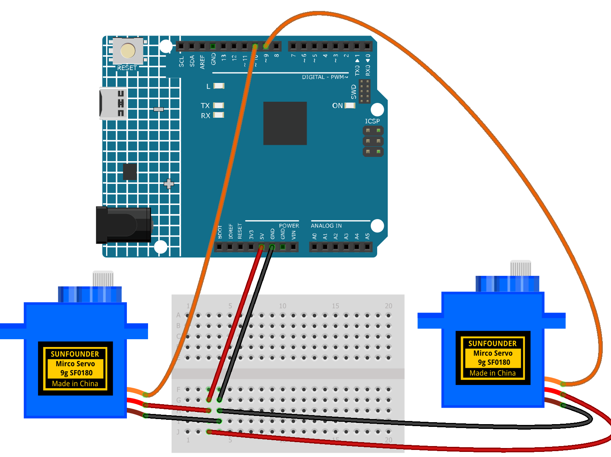

.. _butterflt1.0:

Butterfly 1.0
==============================================================

.. note::
  
  🌟 Welcome to the SunFounder Facebook Community! Whether you're into Raspberry Pi, Arduino, or ESP32, you'll find inspiration, help ideas here.
   
  - ✅ Be the first to get free learning resources. 
   
  - ✅ Stay updated on new products & exclusive giveaways. 
   
  - ✅ Share your creations and get real feedback.
   
  * 👉 Need faster updates or support? Click [|link_sf_facebook|] join our Facebook community 

  * 👉 Or join our WhatsApp group: Click [|link_sf_whatsapp|]
   
Kit purchase
------------------------

Looking for parts? Check out our all-in-one kits below — packed with components, beginner-friendly guides, and tons of fun.

.. image:: img/ultimate_sensor_kit.png
   :width: 100%
   :align: center
   :target: https://www.sunfounder.com/collections/arduino-kits-bundles/products/sunfounder-ultimate-sensor-kit-with-original-arduino-uno-r4-minima?ref=jbzmncle

.. raw:: html

     

.. list-table::
   :widths: 20 20 20
   :header-rows: 1

   * - Name
     - Includes Arduino board
     - PURCHASE LINK
   * - Ultimate Sensor Kit
     - Arduino Uno R4 Minima
     - |link_ultimate_sensor_buy|
   * - Elite Explorer Kit
     - Arduino Uno R4 WiFi
     - |link_elite_buy|
   * - 3 in 1 Ultimate Starter Kit
     - Arduino Uno R4 Minima
     - |link_arduinor4_buy|
   * - Universal Maker Sensor Kit
     - ×
     - |link_umsk_buy|

Course Introduction
------------------------

In this lesson, we will learn how to use two Servo Motors with the Arduino Board to create a butterfly wing flapping effect.

The two servos rotate in opposite directions to move the wings up and down, simulating a butterfly's flapping motion. By adjusting the rotation range and speed, we can customize the wing movements.

.. .. raw:: html
 
..  <iframe width="700" height="394" src="https://www.youtube.com/embed/TZyg7rl6Pag" title="YouTube video player" frameborder="0" allow="accelerometer; autoplay; clipboard-write; encrypted-media; gyroscope; picture-in-picture; web-share" referrerpolicy="strict-origin-when-cross-origin" allowfullscreen></iframe>

.. note::

  If this is your first time working with an Arduino project, we recommend downloading and reviewing the basic materials first.
  
  * :ref:`install_arduino`
  * :ref:`introduce_arduino`

**Required Components**

In this project, we need the following components:

.. list-table::
    :widths: 5 20 5 20
    :header-rows: 1

    *   - SN
        - COMPONENT INTRODUCTION	
        - QUANTITY
        - PURCHASE LINK

    *   - 1
        - Arduino UNO R4 Minima
        - 1
        - |link_unor4_buy|
    *   - 2
        - USB Type-C cable
        - 1
        - 
    *   - 3
        - Breadboard
        - 1
        - |link_breadboard_buy|
    *   - 4
        - Wires
        - Several
        - |link_wires_buy|
    *   - 5
        - Digital Servo Motor
        - 2
        - |link_motor_buy|

**Wiring**

**Common Connections:**

* **Digital Servo Motor 1**

  - Connect to breadboard’s positive power bus.
  - Connect to breadboard’s negative power bus.
  - Connect to **9** on the Arduino.

* **Digital Servo Motor 2**

  - Connect to breadboard’s positive power bus.
  - Connect to breadboard’s negative power bus.
  - Connect to **10** on the Arduino.

**Writing the Code**

.. note::

    * You can copy this code into **Arduino IDE**. 
    * Don't forget to select the board(Arduino UNO R4) and the correct port before clicking the **Upload** button.

.. code-block:: arduino

      #include <Servo.h>

      // Define the servo pins
      const int LEFT_SERVO_PIN = 9;
      const int RIGHT_SERVO_PIN = 10;

      // Create servo objects
      Servo leftServo;
      Servo rightServo;

      // Set the center position
      const int CENTER_ANGLE = 90;

      // Set the wing movement range
      const int FLAP_RANGE = 35;

      // Set the movement speed
      const int FLAP_DELAY = 11;

      // Move both wings in opposite directions
      void moveWings(int offset) {
        int leftAngle = CENTER_ANGLE + offset;
        int rightAngle = CENTER_ANGLE - offset;

        leftServo.write(leftAngle);
        rightServo.write(rightAngle);
      }

      void setup() {
        // Attach the servos
        leftServo.attach(LEFT_SERVO_PIN);
        rightServo.attach(RIGHT_SERVO_PIN);

        // Move wings to the center position
        moveWings(0);

        delay(1000);
      }

      void loop() {
        // Slowly raise the wings
        for (int angle = -FLAP_RANGE; angle <= FLAP_RANGE; angle++) {
          moveWings(angle);
          delay(FLAP_DELAY);
        }

        // Slowly lower the wings
        for (int angle = FLAP_RANGE; angle >= -FLAP_RANGE; angle--) {
          moveWings(angle);
          delay(FLAP_DELAY);
        }
      }
