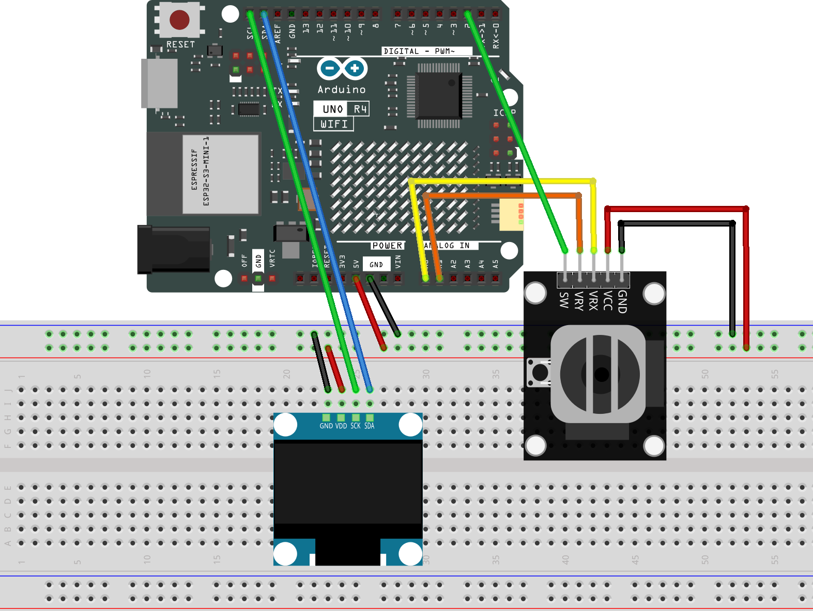

.. _dino_run4.0:

Dino Run4.0
==============================================================

.. note::
  
  🌟 Welcome to the SunFounder Facebook Community! Whether you're into Raspberry Pi, Arduino, or ESP32, you'll find inspiration, help ideas here.
   
  - ✅ Be the first to get free learning resources. 
   
  - ✅ Stay updated on new products & exclusive giveaways. 
   
  - ✅ Share your creations and get real feedback.
   
  * 👉 Need faster updates or support? Click [|link_sf_facebook|] join our Facebook community 

  * 👉 Or join our WhatsApp group: Click [|link_sf_whatsapp|]
   
Kit purchase
------------------------

Looking for parts? Check out our all-in-one kits below — packed with components, beginner-friendly guides, and tons of fun.

.. raw:: html

     

.. list-table::
   :widths: 20 20 20
   :header-rows: 1

   * - Name
     - Includes Arduino board
     - PURCHASE LINK
   * - Ultimate Sensor Kit
     - Arduino Uno R4 Minima
     - |link_ultimate_sensor_buy|
   * - Elite Explorer Kit
     - Arduino Uno R4 WiFi
     - |link_elite_buy|
   * - 3 in 1 Ultimate Starter Kit
     - Arduino Uno R4 Minima
     - |link_arduinor4_buy|
   * - Universal Maker Sensor Kit
     - ×
     - |link_umsk_buy|

Course Introduction
------------------------

In this lesson, you’ll learn how to create a Dino Run Game using an Arduino UNO R4 WiFi, a Joystick Module, and an OLED display. Use the joystick to jump, duck, and speed up while avoiding cacti and flying birds. The OLED displays your score, and you can press the joystick button to restart the game.

.. .. raw:: html

..  <iframe width="700" height="394" src="https://www.youtube.com/embed/wKBOCetLYR0" title="YouTube video player" frameborder="0" allow="accelerometer; autoplay; clipboard-write; encrypted-media; gyroscope; picture-in-picture; web-share" referrerpolicy="strict-origin-when-cross-origin" allowfullscreen></iframe>

.. note::

  If this is your first time working with an Arduino project, we recommend downloading and reviewing the basic materials first.

  * :ref:`install_arduino`
  * :ref:`introduce_arduino`

**Required Components**

In this project, we need the following components:

.. list-table::
    :widths: 5 20 5 20
    :header-rows: 1

    *   - SN
        - COMPONENT INTRODUCTION	
        - QUANTITY
        - PURCHASE LINK

    *   - 1
        - Arduino UNO R4 WIFI
        - 1
        - |link_unor4_buy|
    *   - 2
        - USB Type-C cable
        - 1
        - 
    *   - 3
        - Breadboard
        - 1
        - |link_breadboard_buy|
    *   - 4
        - Wires
        - Several
        - |link_wires_buy|
    *   - 5
        - Joystick Module
        - 1
        - |link_joystick_buy|
    *   - 6
        - OLED Display Module
        - 1
        - |link_oled_buy|

**Wiring**

**Common Connections:**

* **OLED Display Module**

  - **SDA:** Connect to **SDA** on the Arduino.
  - **SCK:** Connect to **SCL** on the Arduino.
  - **GND:** Connect to breadboard’s negative power bus.
  - **VCC:** Connect to breadboard’s red power bus.

* **Joystick Module**

  - **VRX:** Connect to **A0** on the Arduino.
  - **VRY:** Connect to **A1** on the Arduino.
  - **SW:** Connect to **2** on the Arduino.
  - **GND:** Connect to breadboard’s negative power bus.
  - **VCC:** Connect to breadboard’s red power bus.

**Writing the Code**

.. note::

    * You can copy this code into **Arduino IDE**. 
    * To install the library, use the Arduino Library Manager and search for **Adafruit SSD1306** and **Adafruit GFX** and install it.
    * Don't forget to select the board(Arduino UNO R4 Minima/WIFI) and the correct port before clicking the **Upload** button.

.. code-block:: arduino

      /*
        Dino Run 5.0 - Fast & Balanced
        Arduino UNO R4 WiFi / Minima
        OLED: SSD1306 128x64 I2C, address 0x3C
        Joystick: VRx=A0, VRy=A1, SW=D2

        UP: Jump | DOWN: Duck | RIGHT: Boost | SW: Restart
        Libraries: Adafruit GFX, Adafruit SSD1306
      */
      #include <Wire.h>
      #include <Adafruit_GFX.h>
      #include <Adafruit_SSD1306.h>

      #define JOY_X A0
      #define JOY_Y A1
      #define JOY_SW 2
      #define OLED_ADDR 0x3C

      Adafruit_SSD1306 oled(128, 64, &Wire, -1);

      const int GROUND = 55;
      const int DINO_X = 15;
      const int DINO_Y = GROUND - 20;
      const int JOY_LOW = 350;
      const int JOY_HIGH = 700;
      const unsigned long FRAME_MS = 30;

      // Game speed: pixels per frame (30 ms)
      const float NORMAL_SPEED = 5.0f;
      const float BOOST_SPEED = 7.2f;

      // Jump lasts about 0.60 seconds and rises about 27 pixels.
      const float JUMP_POWER = -5.8f;
      const float GRAVITY = 0.62f;

      float dinoY = DINO_Y;
      float velocityY = 0;
      float obstacleX = 140;
      uint8_t obstacleType = 0;  // 0 = cactus, 1 = bird
      unsigned long score = 0;
      unsigned long lastFrame = 0;
      bool gameOver = false;
      bool ducking = false;
      bool wasUp = false;
      bool lastButton = false;
      bool animFrame = false;

      void resetGame() {
        dinoY = DINO_Y;
        velocityY = 0;
        obstacleX = 145;
        obstacleType = 0;
        score = 0;
        gameOver = false;
        ducking = false;
        wasUp = false;
        animFrame = false;
        lastFrame = millis();
      }

      bool onGround() {
        return dinoY >= DINO_Y - 0.01f;
      }

      void drawDino(int x, int y, bool duck, bool step) {
        if (duck) {
          // Compact crouching T-Rex, 24 x 11.
          oled.fillRect(x + 3, y + 4, 13, 5, SSD1306_WHITE);
          oled.fillRect(x + 12, y + 1, 9, 6, SSD1306_WHITE);
          oled.fillRect(x + 19, y + 5, 5, 2, SSD1306_WHITE);
          oled.drawPixel(x + 17, y + 3, SSD1306_BLACK);
          oled.drawFastHLine(x, y + 7, 5, SSD1306_WHITE);
          oled.fillRect(x + 5, y + 9, 4, 2, SSD1306_WHITE);
          oled.fillRect(x + (step ? 15 : 17), y + 9, 4, 2, SSD1306_WHITE);
          return;
        }

        // Mid-sized T-Rex, approximately 22 x 20.
        oled.fillRect(x + 10, y, 10, 8, SSD1306_WHITE);   // head
        oled.fillRect(x + 16, y + 6, 6, 3, SSD1306_WHITE); // snout
        oled.drawPixel(x + 17, y + 2, SSD1306_BLACK);     // eye
        oled.drawFastHLine(x + 17, y + 8, 5, SSD1306_BLACK); // mouth
        oled.fillRect(x + 8, y + 7, 10, 6, SSD1306_WHITE);  // neck
        oled.fillRect(x + 5, y + 10, 11, 6, SSD1306_WHITE); // body
        oled.fillRect(x + 2, y + 12, 5, 3, SSD1306_WHITE);  // tail
        oled.drawPixel(x, y + 11, SSD1306_WHITE);
        oled.fillRect(x + 15, y + 12, 3, 2, SSD1306_WHITE); // tiny arm

        if (step) {
          oled.fillRect(x + 7, y + 16, 3, 4, SSD1306_WHITE);
          oled.fillRect(x + 6, y + 19, 6, 1, SSD1306_WHITE);
          oled.fillRect(x + 13, y + 16, 3, 2, SSD1306_WHITE);
        } else {
          oled.fillRect(x + 7, y + 16, 3, 2, SSD1306_WHITE);
          oled.fillRect(x + 13, y + 16, 3, 4, SSD1306_WHITE);
          oled.fillRect(x + 12, y + 19, 6, 1, SSD1306_WHITE);
        }
      }

      void drawCactus(int x) {
        // Small but recognizable branched cactus, 12 x 16.
        oled.fillRect(x + 5, GROUND - 16, 4, 16, SSD1306_WHITE);
        oled.fillRect(x + 2, GROUND - 10, 3, 3, SSD1306_WHITE);
        oled.fillRect(x + 1, GROUND - 13, 2, 6, SSD1306_WHITE);
        oled.fillRect(x + 9, GROUND - 9, 3, 3, SSD1306_WHITE);
        oled.fillRect(x + 10, GROUND - 12, 2, 6, SSD1306_WHITE);
      }

      void drawBird(int x, bool wingsUp) {
        // Flying obstacle: 20 pixels wide, low enough to duck under.
        const int y = 36;
        oled.fillRect(x + 5, y + 2, 11, 4, SSD1306_WHITE);
        oled.fillRect(x + 15, y + 3, 3, 3, SSD1306_WHITE);
        oled.drawFastHLine(x + 18, y + 4, 2, SSD1306_WHITE);
        oled.drawPixel(x + 16, y + 3, SSD1306_BLACK);
        oled.drawLine(x + 5, y + 4, x, y + 7, SSD1306_WHITE);
        if (wingsUp) {
          oled.drawLine(x + 9, y + 3, x + 5, y - 6, SSD1306_WHITE);
          oled.drawLine(x + 10, y + 3, x + 15, y - 4, SSD1306_WHITE);
        } else {
          oled.drawLine(x + 9, y + 5, x + 6, y + 10, SSD1306_WHITE);
          oled.drawLine(x + 11, y + 5, x + 16, y + 10, SSD1306_WHITE);
        }
      }

      bool hitBox(int ax, int ay, int aw, int ah,
                  int bx, int by, int bw, int bh) {
        return ax < bx + bw && ax + aw > bx &&
              ay < by + bh && ay + ah > by;
      }

      void updateGame(bool up, bool down, bool right) {
        if (gameOver) return;

        // Begin jump only when stick is pushed up again.
        if (up && !wasUp && onGround()) {
          velocityY = JUMP_POWER;
        }
        wasUp = up;

        if (!onGround() || velocityY < 0) {
          dinoY += velocityY;
          velocityY += GRAVITY;
          if (dinoY >= DINO_Y) {
            dinoY = DINO_Y;
            velocityY = 0;
          }
        }

        ducking = down && onGround();
        float speed = right ? BOOST_SPEED : NORMAL_SPEED;
        obstacleX -= speed;
        score += right ? 3 : 2;
        animFrame = !animFrame;

        // Spawn next obstacle after previous one leaves screen.
        if (obstacleX < -24) {
          obstacleX = 138 + random(0, 36);
          obstacleType = (score > 45 && random(0, 3) == 0) ? 1 : 0;
        }

        int x = (int)obstacleX;
        int playerY = ducking ? GROUND - 11 : (int)dinoY;

        // Slightly forgiving hitboxes, matched to smaller sprites.
        int playerX = DINO_X + (ducking ? 3 : 5);
        int playerW = ducking ? 19 : 15;
        int playerHitY = playerY + (ducking ? 3 : 3);
        int playerH = ducking ? 8 : 16;

        if (obstacleType == 0) {
          if (hitBox(playerX, playerHitY, playerW, playerH,
                    x + 3, GROUND - 15, 7, 15)) gameOver = true;
        } else {
          if (hitBox(playerX, playerHitY, playerW, playerH,
                    x + 5, 38, 13, 5)) gameOver = true;
        }
      }

      void renderGame() {
        oled.clearDisplay();
        oled.setTextColor(SSD1306_WHITE);
        oled.setTextSize(1);
        oled.setCursor(0, 0);
        oled.print("DINO RUN");
        oled.setCursor(80, 0);
        oled.print("S:");
        oled.print(score);

        oled.drawFastHLine(0, GROUND, 128, SSD1306_WHITE);
        // A few ground details to give a running effect.
        for (int i = 0; i < 5; i++) {
          int px = (i * 29 + 128 - (score % 29)) % 128;
          oled.drawFastHLine(px, 60 + i % 3, 3, SSD1306_WHITE);
        }

        drawDino(DINO_X, ducking ? GROUND - 11 : (int)dinoY,
                ducking, animFrame);

        int x = (int)obstacleX;
        if (obstacleType == 0) drawCactus(x);
        else drawBird(x, animFrame);

        if (gameOver) {
          oled.fillRect(22, 18, 89, 30, SSD1306_BLACK);
          oled.drawRect(22, 18, 89, 30, SSD1306_WHITE);
          oled.setCursor(36, 24);
          oled.print("GAME OVER");
          oled.setCursor(32, 36);
          oled.print("SW: RESTART");
        }
        oled.display();
      }

      void setup() {
        pinMode(JOY_SW, INPUT_PULLUP);
        analogReadResolution(10);  // Joystick range: 0-1023
        if (!oled.begin(SSD1306_SWITCHCAPVCC, OLED_ADDR)) {
          while (true) delay(1000);
        }
        randomSeed(analogRead(A2));
        resetGame();
        renderGame();
      }

      void loop() {
        bool button = digitalRead(JOY_SW) == LOW;
        if (gameOver && button && !lastButton) resetGame();
        lastButton = button;

        unsigned long now = millis();
        if (now - lastFrame < FRAME_MS) return;
        lastFrame = now;

        int x = analogRead(JOY_X);
        int y = analogRead(JOY_Y);
        bool up = y < JOY_LOW;
        bool down = y > JOY_HIGH;
        bool right = x > JOY_HIGH;

        updateGame(up, down, right);
        renderGame();
      }
