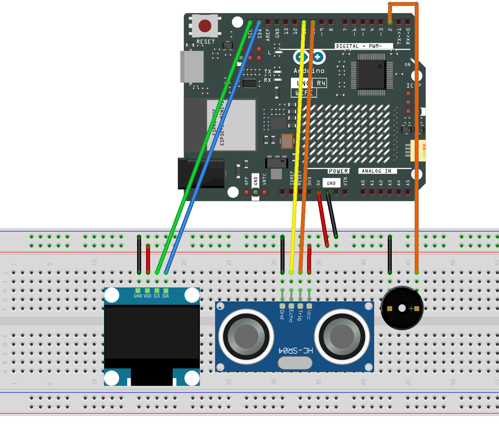

.. _distance_display6.0:

Distance Display 6.0
==============================================================

.. note::
  
  🌟 Welcome to the SunFounder Facebook Community! Whether you're into Raspberry Pi, Arduino, or ESP32, you'll find inspiration, help ideas here.
   
  - ✅ Be the first to get free learning resources. 
   
  - ✅ Stay updated on new products & exclusive giveaways. 
   
  - ✅ Share your creations and get real feedback.
   
  * 👉 Need faster updates or support? Click [|link_sf_facebook|] join our Facebook community 

  * 👉 Or join our WhatsApp group: Click [|link_sf_whatsapp|]
   
Kit purchase
------------------------

Looking for parts? Check out our all-in-one kits below — packed with components, beginner-friendly guides, and tons of fun.

.. raw:: html

     

.. list-table::
   :widths: 20 20 20
   :header-rows: 1

   * - Name
     - Includes Arduino board
     - PURCHASE LINK
   * - Ultimate Sensor Kit
     - Arduino Uno R4 Minima
     - |link_ultimate_sensor_buy|
   * - Elite Explorer Kit
     - Arduino Uno R4 WiFi
     - |link_elite_buy|
   * - 3 in 1 Ultimate Starter Kit
     - Arduino Uno R4 Minima
     - |link_arduinor4_buy|
   * - Universal Maker Sensor Kit
     - ×
     - |link_umsk_buy|

Course Introduction
------------------------

In this project, we use an HC-SR04 ultrasonic sensor, an OLED display, and an active buzzer with the Arduino UNO R4 WiFi to create a distance alarm system.

The OLED displays the measured distance in real time. As an object gets closer, the buzzer beeps faster and sounds continuously when the distance is below 7 cm.

.. .. raw:: html
 
..  <iframe width="700" height="394" src="https://www.youtube.com/embed/ZgshCyLw8Fk?si=ksBdWvVV91WM2iHN" title="YouTube video player" frameborder="0" allow="accelerometer; autoplay; clipboard-write; encrypted-media; gyroscope; picture-in-picture; web-share" referrerpolicy="strict-origin-when-cross-origin" allowfullscreen></iframe>

.. note::

  If this is your first time working with an Arduino project, we recommend downloading and reviewing the basic materials first.
  
  * :ref:`install_arduino`
  * :ref:`introduce_arduino`

**Required Components**

In this project, we need the following components:

.. list-table::
    :widths: 5 20 5 20
    :header-rows: 1

    *   - SN
        - COMPONENT INTRODUCTION	
        - QUANTITY
        - PURCHASE LINK

    *   - 1
        - Arduino UNO R4 WIFI
        - 1
        - |link_unor4_wifi_buy|
    *   - 2
        - USB Type-C cable
        - 1
        - 
    *   - 3
        - Breadboard
        - 1
        - |link_breadboard_buy|
    *   - 4
        - Wires
        - Several
        - |link_wires_buy|
    *   - 5
        - Ultrasonic Sensor Module
        - 1
        - |link_ultrasonic_buy|
    *   - 6
        - OLED Display Module
        - 1
        - |link_oled_buy|
    *   - 7
        - Active Buzzer
        - 1
        - 

**Wiring**

**Common Connections:**

* **OLED Display Module**

  - **SDA:** Connect to **SDA** on the Arduino.
  - **SCK:** Connect to **SCL** on the Arduino.
  - **GND:** Connect to breadboard’s negative power bus.
  - **VCC:** Connect to breadboard’s red power bus.

* **Ultrasonic Sensor Module**

  - **Trig:** Connect to **10** on the Arduino.
  - **Echo:** Connect to **11** on the Arduino.
  - **GND:** Connect to breadboard’s negative power bus.
  - **VCC:** Connect to breadboard’s red power bus.

* **Active Buzzer**

  - **＋:** Connect to **2** on the Arduino.
  - **－:** Connect to breadboard’s negative power bus.

**Writing the Code**

.. note::

    * You can copy this code into **Arduino IDE**. 
    * To install the library, use the Arduino Library Manager and search for **Adafruit SSD1306** and **Adafruit GFX** and install it.
    * Don't forget to select the board(Arduino UNO R4 WIFI) and the correct port before clicking the **Upload** button.

.. code-block:: arduino

      /*
        Arduino Distance Alarm 6.0

        Board: Arduino UNO R4 WiFi
        Components:
        - HC-SR04 Ultrasonic Sensor
        - SSD1306 OLED Display
        - Active Buzzer

        Distance >= 18 cm: Buzzer OFF
        Distance < 18 cm: Slow beeps
        Distance < 12 cm: Fast beeps
        Distance < 7 cm: Continuous beep
      */

      #include <Wire.h>
      #include <Adafruit_GFX.h>
      #include <Adafruit_SSD1306.h>

      // Define pins
      #define TRIG_PIN 10
      #define ECHO_PIN 11
      #define BUZZER_PIN 2

      // OLED settings
      #define SCREEN_WIDTH 128
      #define SCREEN_HEIGHT 64
      #define OLED_RESET -1
      #define OLED_ADDRESS 0x3C

      Adafruit_SSD1306 display(
        SCREEN_WIDTH,
        SCREEN_HEIGHT,
        &Wire,
        OLED_RESET
      );

      // Distance thresholds
      const float SLOW_DISTANCE = 18.0;
      const float FAST_DISTANCE = 12.0;
      const float CONTINUOUS_DISTANCE = 7.0;

      // Buzzer timing
      const unsigned long SLOW_ON_TIME = 200;
      const unsigned long SLOW_OFF_TIME = 500;

      const unsigned long FAST_ON_TIME = 150;
      const unsigned long FAST_OFF_TIME = 150;

      // Sensor timing
      const unsigned long SENSOR_INTERVAL = 100;

      unsigned long lastSensorTime = 0;
      unsigned long lastBuzzerChange = 0;

      // Distance values
      float distance = -1;
      float filteredDistance = -1;

      // Buzzer state
      bool buzzerOn = false;
      int currentMode = -1;

      // Read distance
      float readDistance() {
        digitalWrite(TRIG_PIN, LOW);
        delayMicroseconds(2);

        digitalWrite(TRIG_PIN, HIGH);
        delayMicroseconds(10);
        digitalWrite(TRIG_PIN, LOW);

        unsigned long duration = pulseIn(
          ECHO_PIN,
          HIGH,
          25000
        );

        if (duration == 0) {
          return -1;
        }

        return duration * 0.0343 / 2.0;
      }

      // Update distance with simple filtering
      void updateDistance() {
        float newDistance = readDistance();

        if (newDistance < 0) {
          distance = -1;
          filteredDistance = -1;
          return;
        }

        // Smooth sudden changes
        if (filteredDistance < 0) {
          filteredDistance = newDistance;
        } else {
          filteredDistance =
            filteredDistance * 0.6 +
            newDistance * 0.4;
        }

        distance = filteredDistance;
      }

      // Display distance on OLED
      void updateDisplay() {
        display.clearDisplay();
        display.setTextColor(SSD1306_WHITE);

        display.setTextSize(1);
        display.setCursor(0, 5);
        display.println("Distance Alarm");

        display.drawLine(
          0, 18, 128, 18, SSD1306_WHITE
        );

        if (distance < 0) {
          display.setTextSize(2);
          display.setCursor(12, 30);
          display.println("No Echo");
        } else {
          display.setTextSize(2);
          display.setCursor(0, 30);
          display.print(distance, 1);
          display.print(" CM");
        }

        display.display();
      }

      // Get alarm mode
      int getBuzzerMode() {
        if (distance < 0) return 0;

        if (distance < CONTINUOUS_DISTANCE) {
          return 3;
        }

        if (distance < FAST_DISTANCE) {
          return 2;
        }

        if (distance < SLOW_DISTANCE) {
          return 1;
        }

        return 0;
      }

      // Set buzzer output
      void setBuzzer(bool state) {
        buzzerOn = state;

        digitalWrite(
          BUZZER_PIN,
          state ? HIGH : LOW
        );
      }

      // Control buzzer without delay
      void updateBuzzer(unsigned long now) {
        int mode = getBuzzerMode();

        // Start beeping immediately when mode changes
        if (mode != currentMode) {
          currentMode = mode;
          lastBuzzerChange = now;

          if (mode == 0) {
            setBuzzer(false);
          } else {
            setBuzzer(true);
          }

          return;
        }

        // Safe distance
        if (mode == 0) {
          setBuzzer(false);
          return;
        }

        // Continuous beep below 7 cm
        if (mode == 3) {
          setBuzzer(true);
          return;
        }

        unsigned long onTime;
        unsigned long offTime;

        if (mode == 1) {
          onTime = SLOW_ON_TIME;
          offTime = SLOW_OFF_TIME;
        } else {
          onTime = FAST_ON_TIME;
          offTime = FAST_OFF_TIME;
        }

        unsigned long elapsed =
          now - lastBuzzerChange;

        // Turn off after ON time
        if (buzzerOn && elapsed >= onTime) {
          setBuzzer(false);
          lastBuzzerChange = now;
        }

        // Turn on after OFF time
        else if (!buzzerOn && elapsed >= offTime) {
          setBuzzer(true);
          lastBuzzerChange = now;
        }
      }

      void setup() {
        Serial.begin(9600);

        // Initialize pins
        pinMode(TRIG_PIN, OUTPUT);
        pinMode(ECHO_PIN, INPUT);
        pinMode(BUZZER_PIN, OUTPUT);

        digitalWrite(TRIG_PIN, LOW);
        setBuzzer(false);

        // Initialize OLED
        if (!display.begin(
              SSD1306_SWITCHCAPVCC,
              OLED_ADDRESS
            )) {
          Serial.println("OLED failed!");

          while (true) {
            setBuzzer(false);
            delay(1000);
          }
        }

        display.clearDisplay();
        display.display();

        Serial.println("Distance Alarm Ready!");
      }

      void loop() {
        unsigned long now = millis();

        // Update sensor every 100 ms
        if (now - lastSensorTime >= SENSOR_INTERVAL) {
          lastSensorTime = now;

          updateDistance();
          updateDisplay();

          // Serial Monitor
          Serial.print("Distance: ");

          if (distance < 0) {
            Serial.print("No Echo");
          } else {
            Serial.print(distance, 1);
            Serial.print(" cm");
          }

          Serial.print(" | Mode: ");
          Serial.println(getBuzzerMode());
        }

        // Update buzzer continuously
        updateBuzzer(millis());
      }
