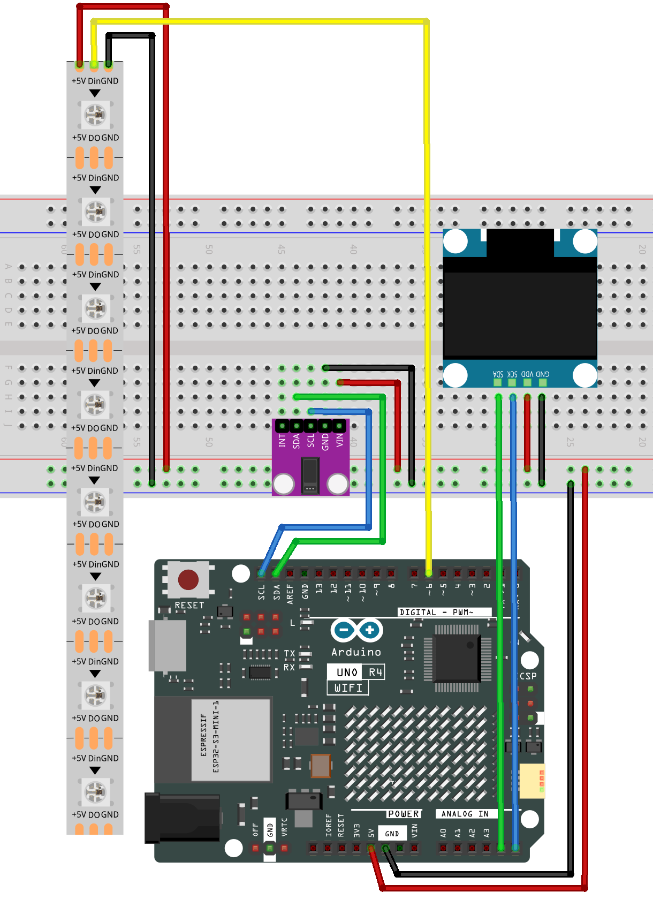

.. _heart_rate_monitor4.0:

Heart rate monitor 4.0
==============================================================

.. note::
  
  🌟 Welcome to the SunFounder Facebook Community! Whether you're into Raspberry Pi, Arduino, or ESP32, you'll find inspiration, help ideas here.
   
  - ✅ Be the first to get free learning resources. 
   
  - ✅ Stay updated on new products & exclusive giveaways. 
   
  - ✅ Share your creations and get real feedback.
   
  * 👉 Need faster updates or support? Click [|link_sf_facebook|] join our Facebook community 

  * 👉 Or join our WhatsApp group: Click [|link_sf_whatsapp|]
   
Kit purchase
------------------------

Looking for parts? Check out our all-in-one kits below — packed with components, beginner-friendly guides, and tons of fun.

.. image:: img/elite_explore_kit.png
   :width: 100%
   :align: center
   :target: https://www.sunfounder.com/collections/arduino-kits-bundles/products/sunfounder-elite-explorer-kit-with-official-arduino-uno-r4-wifi?ref=jbzmncle

.. raw:: html

     

.. list-table::
   :widths: 20 20 20
   :header-rows: 1

   * - Name
     - Includes Arduino board
     - PURCHASE LINK
   * - Ultimate Sensor Kit
     - Arduino Uno R4 Minima
     - |link_ultimate_sensor_buy|
   * - Elite Explorer Kit
     - Arduino Uno R4 WiFi
     - |link_elite_buy|
   * - 3 in 1 Ultimate Starter Kit
     - Arduino Uno R4 Minima
     - |link_arduinor4_buy|
   * - Universal Maker Sensor Kit
     - ×
     - |link_umsk_buy|
  
Course Introduction
------------------------

This Arduino project builds a Heart Rate Monitor using the MAX30102 sensor, an OLED display, and an 8-LED NeoPixel module.

It detects heartbeats and calculates the heart rate in BPM, which is displayed on the OLED. The NeoPixel LEDs light up and turn off one by one with each detected heartbeat, creating a visual heartbeat effect.

.. .. raw:: html

..  <iframe width="700" height="394" src="https://www.youtube.com/embed/sO1tf1UgKJc" title="YouTube video player" frameborder="0" allow="accelerometer; autoplay; clipboard-write; encrypted-media; gyroscope; picture-in-picture; web-share" referrerpolicy="strict-origin-when-cross-origin" allowfullscreen></iframe>

.. note::

  If this is your first time working with an Arduino project, we recommend downloading and reviewing the basic materials first.
  
  * :ref:`install_arduino`
  * :ref:`introduce_arduino`

**Required Components**

In this project, we need the following components:

.. list-table::
    :widths: 5 20 5 20
    :header-rows: 1

    *   - SN
        - COMPONENT INTRODUCTION	
        - QUANTITY
        - PURCHASE LINK

    *   - 1
        - Arduino UNO R4 Minima
        - 1
        - |link_unor4_buy|
    *   - 2
        - USB Type-C cable
        - 1
        - 
    *   - 3
        - Breadboard
        - 1
        - |link_breadboard_buy|
    *   - 4
        - Wires
        - Several
        - |link_wires_buy|
    *   - 5
        - OLED Display Module
        - 1
        - |link_oled_buy|
    *   - 6
        - Pulse Oximeter and Heart Rate Sensor Module (MAX30102)
        - 1
        - |link_heart_rate_buy|
    *   - 7
        - LED Strip
        - 1
        - |link_ws2812_buy|

**Wiring**

**Common Connections:**

* **Pulse Oximeter and Heart Rate Sensor Module (MAX30102)**

  - **SDA:** Connect to **SDA** on the Arduino.
  - **SCL:** Connect to **SCL** on the Arduino.
  - **GND:** Connect to breadboard’s negative power bus.
  - **VIN:** Connect to breadboard’s red power bus.

* **OLED Display Module**

  - **SDA:** Connect to **A4** on the Arduino.
  - **SCK:** Connect to **A5** on the Arduino.
  - **GND:** Connect to breadboard’s negative power bus.
  - **VCC:** Connect to breadboard’s red power bus.

* **LED Strip**

  - **Din:** Connect to **6** on the Arduino.
  - **GND:** Connect to breadboard’s negative power bus.
  - **+5V:** Connect to breadboard’s passive power bus.

**Writing the Code**

.. note::

    * You can copy this code into **Arduino IDE**. 
    * To install the library, use the Arduino Library Manager and search for **Adafruit SSD1306** , **Adafruit GFX** , **MAX30105** and **heartRate** and install it.
    * Don't forget to select the board(Arduino UNO R4 WIFI) and the correct port before clicking the **Upload** button.

.. code-block:: arduino

      #ifdef LED_RED
      #undef LED_RED
      #endif

      #include <Adafruit_GFX.h>
      #include <Adafruit_SSD1306.h>
      #include <Adafruit_NeoPixel.h>
      #include <Wire.h>
      #include "MAX30105.h"
      #include "heartRate.h"

      // =====================================================
      // OLED settings
      // =====================================================
      #define SCREEN_WIDTH 128
      #define SCREEN_HEIGHT 64
      #define OLED_RESET -1
      #define SCREEN_ADDRESS 0x3C

      Adafruit_SSD1306 display(
        SCREEN_WIDTH,
        SCREEN_HEIGHT,
        &Wire,
        OLED_RESET
      );

      // =====================================================
      // NeoPixel settings
      // Arduino UNO R4 WiFi: use D6
      // =====================================================
      #define LED_PIN 6
      #define NUM_LEDS 8

      Adafruit_NeoPixel strip(
        NUM_LEDS,
        LED_PIN,
        NEO_GRB + NEO_KHZ800
      );

      // =====================================================
      // MAX30102 heart rate sensor
      // =====================================================
      MAX30105 particleSensor;

      const byte RATE_SIZE = 4;
      byte rates[RATE_SIZE] = {0, 0, 0, 0};
      byte rateSpot = 0;
      byte validRateCount = 0;

      long lastBeat = 0;
      float beatsPerMinute = 0;
      int beatAvg = 0;

      // =====================================================
      // LED heartbeat animation
      // =====================================================
      enum PulseState {
        PULSE_IDLE,
        PULSE_RISING,
        PULSE_FALLING
      };

      PulseState pulseState = PULSE_IDLE;

      unsigned long pulseTimer = 0;

      // Speed of individual LEDs
      const unsigned long LED_STEP_TIME = 22;

      int ledStep = 0;

      // =====================================================
      // Small heart icon
      // =====================================================
      static const unsigned char PROGMEM beat1_bmp[] = {
        0x03, 0xC0, 0xF0, 0x06, 0x71, 0x8C,
        0x0C, 0x1B, 0x06, 0x18, 0x0E, 0x02,
        0x10, 0x0C, 0x03, 0x10, 0x04, 0x01,
        0x10, 0x04, 0x01, 0x10, 0x40, 0x01,
        0x10, 0x40, 0x01, 0x10, 0xC0, 0x03,
        0x08, 0x88, 0x02, 0x08, 0xB8, 0x04,
        0xFF, 0x37, 0x08, 0x01, 0x30, 0x18,
        0x01, 0x90, 0x30, 0x00, 0xC0, 0x60,
        0x00, 0x60, 0xC0, 0x00, 0x31, 0x80,
        0x00, 0x1B, 0x00, 0x00, 0x0E, 0x00,
        0x00, 0x04, 0x00
      };

      // =====================================================
      // Large heart icon
      // =====================================================
      static const unsigned char PROGMEM beat2_bmp[] = {
        0x01, 0xF0, 0x0F, 0x80, 0x06, 0x1C, 0x38, 0x60,
        0x18, 0x06, 0x60, 0x18, 0x10, 0x01, 0x80, 0x08,
        0x20, 0x01, 0x80, 0x04, 0x40, 0x00, 0x00, 0x02,
        0x40, 0x00, 0x00, 0x02, 0xC0, 0x00, 0x08, 0x03,
        0x80, 0x00, 0x08, 0x01, 0x80, 0x00, 0x18, 0x01,
        0x80, 0x00, 0x1C, 0x01, 0x80, 0x00, 0x14, 0x00,
        0x80, 0x00, 0x14, 0x00, 0x80, 0x00, 0x14, 0x00,
        0x40, 0x10, 0x12, 0x00, 0x40, 0x10, 0x12, 0x00,
        0x7E, 0x1F, 0x23, 0xFE, 0x03, 0x31, 0xA0, 0x04,
        0x01, 0xA0, 0xA0, 0x0C, 0x00, 0xA0, 0xA0, 0x08,
        0x00, 0x60, 0xE0, 0x10, 0x00, 0x20, 0x60, 0x20,
        0x06, 0x00, 0x40, 0x60, 0x03, 0x00, 0x40, 0xC0,
        0x01, 0x80, 0x01, 0x80, 0x00, 0xC0, 0x03, 0x00,
        0x00, 0x60, 0x06, 0x00, 0x00, 0x30, 0x0C, 0x00,
        0x00, 0x08, 0x10, 0x00, 0x00, 0x06, 0x60, 0x00,
        0x00, 0x03, 0xC0, 0x00, 0x00, 0x01, 0x80, 0x00
      };

      // =====================================================
      // Setup
      // =====================================================
      void setup() {
        Serial.begin(9600);

        // UNO R4 WiFi I2C:
        // SDA = A4
        // SCL = A5
        Wire.begin();
        Wire.setClock(400000);

        // ---------------------------------------------------
        // NeoPixel
        // ---------------------------------------------------
        strip.begin();
        strip.setBrightness(100);
        strip.clear();
        strip.show();

        // ---------------------------------------------------
        // OLED
        // ---------------------------------------------------
        if (!display.begin(
              SSD1306_SWITCHCAPVCC,
              SCREEN_ADDRESS
            )) {

          Serial.println("OLED not found");

          while (true);
        }

        display.clearDisplay();
        display.display();

        // ---------------------------------------------------
        // MAX30102
        // ---------------------------------------------------
        if (!particleSensor.begin(
              Wire,
              I2C_SPEED_FAST
            )) {

          Serial.println("MAX30102 not found");

          while (true);
        }

        particleSensor.setup();

        particleSensor.setPulseAmplitudeRed(0x0A);

        particleSensor.setPulseAmplitudeGreen(0);

        Serial.println("Place your finger on the sensor.");
      }

      // =====================================================
      // Main loop
      // =====================================================
      void loop() {

        // Update NeoPixel animation continuously
        updateHeartLED();

        // Read IR value from MAX30102
        long irValue = particleSensor.getIR();

        // ===================================================
        // Finger detected
        // ===================================================
        if (irValue > 50000) {

          if (checkForBeat(irValue)) {

            unsigned long currentBeat = millis();

            // Ignore BPM calculation for the first heartbeat
            if (lastBeat > 0) {

              long delta = currentBeat - lastBeat;

              beatsPerMinute =
                60.0 / (delta / 1000.0);

              if (
                beatsPerMinute > 20 &&
                beatsPerMinute < 255
              ) {

                rates[rateSpot] =
                  (byte)beatsPerMinute;

                rateSpot =
                  (rateSpot + 1) % RATE_SIZE;

                if (validRateCount < RATE_SIZE) {
                  validRateCount++;
                }

                int total = 0;

                for (
                  byte i = 0;
                  i < validRateCount;
                  i++
                ) {
                  total += rates[i];
                }

                beatAvg =
                  total / validRateCount;
              }
            }

            lastBeat = currentBeat;

            // Start LED heartbeat animation
            startHeartLED();

            // ------------------------------------------------
            // OLED display
            // ------------------------------------------------
            display.clearDisplay();

            display.drawBitmap(
              18,
              10,
              beat2_bmp,
              32,
              32,
              SSD1306_WHITE
            );

            display.setTextColor(
              SSD1306_WHITE
            );

            display.setTextSize(2);

            display.setCursor(60, 10);
            display.println("BPM");

            display.setCursor(60, 28);
            display.println(beatAvg);

            display.display();

            // ------------------------------------------------
            // Serial monitor
            // ------------------------------------------------
            Serial.print("IR=");
            Serial.print(irValue);

            Serial.print(", BPM=");
            Serial.print(beatsPerMinute);

            Serial.print(", Avg BPM=");
            Serial.println(beatAvg);
          }
        }

        // ===================================================
        // Finger not detected
        // ===================================================
        else {

          pulseState = PULSE_IDLE;

          strip.clear();
          strip.show();

          lastBeat = 0;
          beatAvg = 0;
          validRateCount = 0;
          rateSpot = 0;

          display.clearDisplay();

          display.setTextSize(1);
          display.setTextColor(
            SSD1306_WHITE
          );

          display.setCursor(30, 5);
          display.println("Please place");

          display.setCursor(30, 15);
          display.println("your finger");

          display.setCursor(30, 25);
          display.println("and wait...");

          display.display();
        }
      }

      // =====================================================
      // Start LED heartbeat animation
      // =====================================================
      void startHeartLED() {

        ledStep = 0;

        strip.clear();
        strip.show();

        pulseState =
          PULSE_RISING;

        pulseTimer = millis();
      }

      // =====================================================
      // Update LED heartbeat animation
      // =====================================================
      void updateHeartLED() {

        unsigned long now = millis();

        // ---------------------------------------------------
        // Light LEDs one by one
        // ---------------------------------------------------
        if (
          pulseState ==
          PULSE_RISING
        ) {

          if (
            now - pulseTimer >=
            LED_STEP_TIME
          ) {

            pulseTimer = now;

            strip.setPixelColor(
              ledStep,
              strip.Color(
                255,
                0,
                0
              )
            );

            strip.show();

            ledStep++;

            // Peak of heartbeat
            if (
              ledStep >=
              NUM_LEDS
            ) {

              ledStep =
                NUM_LEDS - 1;

              pulseState =
                PULSE_FALLING;
            }
          }
        }

        // ---------------------------------------------------
        // Turn LEDs off one by one
        // ---------------------------------------------------
        else if (
          pulseState ==
          PULSE_FALLING
        ) {

          if (
            now - pulseTimer >=
            LED_STEP_TIME
          ) {

            pulseTimer = now;

            strip.setPixelColor(
              ledStep,
              0,
              0,
              0
            );

            strip.show();

            ledStep--;

            if (ledStep < 0) {

              strip.clear();
              strip.show();

              pulseState =
                PULSE_IDLE;
            }
          }
        }
      }