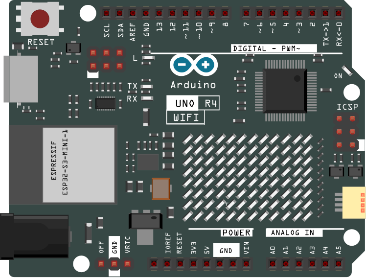

.. _led_matrix2.0:

LED Matrix 2.0
==============================================================

.. note::
  
  🌟 Welcome to the SunFounder Facebook Community! Whether you're into Raspberry Pi, Arduino, or ESP32, you'll find inspiration, help ideas here.
   
  - ✅ Be the first to get free learning resources. 
   
  - ✅ Stay updated on new products & exclusive giveaways. 
   
  - ✅ Share your creations and get real feedback.
   
  * 👉 Need faster updates or support? Click [|link_sf_facebook|] join our Facebook community 

  * 👉 Or join our WhatsApp group: Click [|link_sf_whatsapp|]
   
Kit purchase
------------------------

Looking for parts? Check out our all-in-one kits below — packed with components, beginner-friendly guides, and tons of fun.

.. raw:: html

     

.. list-table::
   :widths: 20 20 20
   :header-rows: 1

   * - Name
     - Includes Arduino board
     - PURCHASE LINK
   * - Ultimate Sensor Kit
     - Arduino Uno R4 Minima
     - |link_ultimate_sensor_buy|
   * - Elite Explorer Kit
     - Arduino Uno R4 WiFi
     - |link_elite_buy|
   * - 3 in 1 Ultimate Starter Kit
     - Arduino Uno R4 Minima
     - |link_arduinor4_buy|
   * - Universal Maker Sensor Kit
     - ×
     - |link_umsk_buy|

Course Introduction
------------------------

In this lesson, we will learn how to use the official Arduino LED Matrix Editor to create animations and display them on the built-in LED matrix of the Arduino UNO R4 WiFi.

.. .. raw:: html

..   <iframe width="700" height="394" src="https://www.youtube.com/embed/QSqUlg9A2Bw?si=oVWRvLZFXQCwasH2" title="YouTube video player" frameborder="0" allow="accelerometer; autoplay; clipboard-write; encrypted-media; gyroscope; picture-in-picture; web-share" referrerpolicy="strict-origin-when-cross-origin" allowfullscreen></iframe>

.. note::

  If this is your first time working with an Arduino project, we recommend downloading and reviewing the basic materials first.
  
  * :ref:`install_arduino`
  * :ref:`introduce_arduino`

**Required Components**

In this project, we need the following components:

.. list-table::
    :widths: 5 20 5 20
    :header-rows: 1

    *   - SN
        - COMPONENT INTRODUCTION	
        - QUANTITY
        - PURCHASE LINK

    *   - 1
        - Arduino UNO R4 WIFI
        - 1
        - |link_unor4_wifi_buy|
    *   - 2
        - USB Type-C cable
        - 1
        - 

**Wiring**

**Writing the Code**

.. note::

    * You can copy this code into **Arduino IDE**. 
    * Don't forget to select the board(Arduino UNO R4 WiFi) and the correct port before clicking the **Upload** button.

.. code-block:: arduino

      /*
        This sketch allows live editing of the matrix pixels using WebSerial
        To test, head to https://ledmatrix-editor.arduino.cc

        The LED Matrix editor is part of Arduino Labs (https://labs.arduino.cc/), and is therefore considered experimental software.

        Don't forget to close any serial monitor already opened.

        See the full documentation here:
        https://docs.arduino.cc/tutorials/uno-r4-wifi/led-matrix  
      */

      #include "Arduino_LED_Matrix.h" // Include the LED_Matrix library

      ArduinoLEDMatrix matrix;        // Create an instance of the ArduinoLEDMatrix class

      void setup() {
        Serial.begin(115200);         // Initialize serial communication at a baud rate of 115200
        matrix.begin();               // Initialize the LED matrix
      }

      // Define an array to hold pixel data for a single frame (4 pixels)
      uint32_t frame[] = {
        0, 0, 0, 0xFFFF
      };

      void loop() {
        // Check if there are at least 12 bytes available in the serial buffer
        if(Serial.available() >= 12){
          // Read 4 bytes from the serial buffer and compose them into a 32-bit value for each element in the frame
          frame[0] = Serial.read() | Serial.read() << 8 | Serial.read() << 16 | Serial.read() << 24;
          frame[1] = Serial.read() | Serial.read() << 8 | Serial.read() << 16 | Serial.read() << 24;
          frame[2] = Serial.read() | Serial.read() << 8 | Serial.read() << 16 | Serial.read() << 24;
          
          // Load and display the received frame data on the LED matrix
          matrix.loadFrame(frame);
        }
      }

**Made Animations**

* |link_animations| to go to the LED Matrix tool.

  .. image:: img/led-matrix-tool.png

* Click the button to connect to the Arduino board via the serial port.

  .. image:: img/upload_animation_button.png

* Next, you can draw your animation in Area 1 and add animation frames in Area 2.

  .. image:: img/drawing.png

* Then click the Play button to see your animation on the Arduino board.

  .. image:: img/paly_button.png

    

