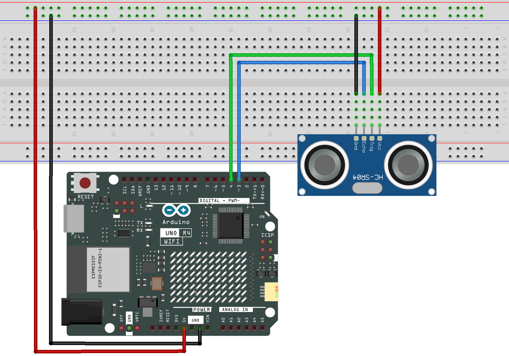

.. _led_matrix3.0:

LED Matrix 3.0
==============================================================

.. note::
  
  🌟 Welcome to the SunFounder Facebook Community! Whether you're into Raspberry Pi, Arduino, or ESP32, you'll find inspiration, help ideas here.
   
  - ✅ Be the first to get free learning resources. 
   
  - ✅ Stay updated on new products & exclusive giveaways. 
   
  - ✅ Share your creations and get real feedback.
   
  * 👉 Need faster updates or support? Click [|link_sf_facebook|] join our Facebook community 

  * 👉 Or join our WhatsApp group: Click [|link_sf_whatsapp|]
   
Kit purchase
------------------------

Looking for parts? Check out our all-in-one kits below — packed with components, beginner-friendly guides, and tons of fun.

.. image:: img/elite_explore_kit.png
   :width: 100%
   :align: center
   :target: https://www.sunfounder.com/collections/arduino-kits-bundles/products/sunfounder-elite-explorer-kit-with-official-arduino-uno-r4-wifi?ref=jbzmncle

.. raw:: html

     

.. list-table::
   :widths: 20 20 20
   :header-rows: 1

   * - Name
     - Includes Arduino board
     - PURCHASE LINK
   * - Ultimate Sensor Kit
     - Arduino Uno R4 Minima
     - |link_ultimate_sensor_buy|
   * - Elite Explorer Kit
     - Arduino Uno R4 WiFi
     - |link_elite_buy|
   * - 3 in 1 Ultimate Starter Kit
     - Arduino Uno R4 Minima
     - |link_arduinor4_buy|
   * - Universal Maker Sensor Kit
     - ×
     - |link_umsk_buy|

Course Introduction
------------------------

In this lesson, we will learn how to use an Ultrasonic Sensor with the Arduino UNO R4 WiFi to display distance measurements on its built-in LED matrix.

When an object is detected within 20 cm, the LED matrix displays the measured distance. Otherwise, it displays "Hi".

.. .. raw:: html

..   <iframe width="700" height="394" src="https://www.youtube.com/embed/QSqUlg9A2Bw?si=oVWRvLZFXQCwasH2" title="YouTube video player" frameborder="0" allow="accelerometer; autoplay; clipboard-write; encrypted-media; gyroscope; picture-in-picture; web-share" referrerpolicy="strict-origin-when-cross-origin" allowfullscreen></iframe>

.. note::

  If this is your first time working with an Arduino project, we recommend downloading and reviewing the basic materials first.
  
  * :ref:`install_arduino`
  * :ref:`introduce_arduino`

**Required Components**

In this project, we need the following components:

.. list-table::
    :widths: 5 20 5 20
    :header-rows: 1

    *   - SN
        - COMPONENT INTRODUCTION	
        - QUANTITY
        - PURCHASE LINK

    *   - 1
        - Arduino UNO R4 WIFI
        - 1
        - |link_unor4_wifi_buy|
    *   - 2
        - USB Type-C cable
        - 1
        - 
    *   - 3
        - Wires
        - Several
        - |link_wires_buy|
    *   - 4
        - Ultrasonic Sensor Module
        - 1
        - |link_ultrasonic_buy|
  
**Wiring**

**Common Connections:**

* **Ultrasonic Sensor Module**

  - **Trig:** Connect to **4** on the Arduino.
  - **Echo:** Connect to **3** on the Arduino.
  - **GND:** Connect to breadboard’s negative power bus.
  - **VCC:** Connect to breadboard’s red power bus.

**Writing the Code**

.. note::

    * You can copy this code into **Arduino IDE**. 
    * Don't forget to select the board(Arduino UNO R4 WiFi) and the correct port before clicking the **Upload** button.

.. code-block:: arduino

      #include "Arduino_LED_Matrix.h"

      ArduinoLEDMatrix matrix;

      #define TRIG_PIN 4
      #define ECHO_PIN 3

      #define LEFT_X 2
      #define RIGHT_X 7
      #define TOP_Y 1

      // Display "Hi" when no object is detected
      byte hi[8][12] = {
        {0,0,0,0,0,0,0,0,0,0,0,0},
        {0,0,1,0,0,0,1,0,0,1,0,0},
        {0,0,1,0,0,0,1,0,0,0,0,0},
        {0,0,1,1,1,1,1,0,0,1,0,0},
        {0,0,1,0,0,0,1,0,0,1,0,0},
        {0,0,1,0,0,0,1,0,0,1,0,0},
        {0,0,1,0,0,0,1,0,0,1,0,0},
        {0,0,0,0,0,0,0,0,0,0,0,0}
      };

      // Store numbers from 0 to 9 as pixel patterns
      byte digits[10][6][3] = {
        {
          {1,1,1},
          {1,0,1},
          {1,0,1},
          {1,0,1},
          {1,0,1},
          {1,1,1}
        },
        {
          {0,1,0},
          {1,1,0},
          {0,1,0},
          {0,1,0},
          {0,1,0},
          {1,1,1}
        },
        {
          {1,1,1},
          {0,0,1},
          {1,1,1},
          {1,0,0},
          {1,0,0},
          {1,1,1}
        },
        {
          {1,1,1},
          {0,0,1},
          {1,1,1},
          {0,0,1},
          {0,0,1},
          {1,1,1}
        },
        {
          {1,0,1},
          {1,0,1},
          {1,1,1},
          {0,0,1},
          {0,0,1},
          {0,0,1}
        },
        {
          {1,1,1},
          {1,0,0},
          {1,1,1},
          {0,0,1},
          {0,0,1},
          {1,1,1}
        },
        {
          {1,1,1},
          {1,0,0},
          {1,1,1},
          {1,0,1},
          {1,0,1},
          {1,1,1}
        },
        {
          {1,1,1},
          {0,0,1},
          {0,0,1},
          {0,0,1},
          {0,0,1},
          {0,0,1}
        },
        {
          {1,1,1},
          {1,0,1},
          {1,1,1},
          {1,0,1},
          {1,0,1},
          {1,1,1}
        },
        {
          {1,1,1},
          {1,0,1},
          {1,1,1},
          {0,0,1},
          {0,0,1},
          {1,1,1}
        }
      };

      byte screen[8][12];

      // Clear the LED matrix before drawing a new number
      void clearScreen() {
        memset(screen, 0, sizeof(screen));
      }

      // Draw a single digit at the selected position
      void drawDigit(int number, int x) {
        for (int y = 0; y < 6; y++) {
          for (int i = 0; i < 3; i++) {
            screen[y + TOP_Y][x + i] = digits[number][y][i];
          }
        }
      }

      // Show the default greeting message
      void showHi() {
        matrix.renderBitmap(hi, 8, 12);
      }

      // Display the measured distance
      void showNumber(int value) {
        clearScreen();

        if (value < 10) {
          // Keep single digits on the right side
          drawDigit(value, RIGHT_X);
        } else {
          // Place tens and ones side by side
          drawDigit(value / 10, LEFT_X);
          drawDigit(value % 10, RIGHT_X);
        }

        matrix.renderBitmap(screen, 8, 12);
      }

      // Measure distance using the ultrasonic sensor
      int getDistance() {
        digitalWrite(TRIG_PIN, LOW);
        delayMicroseconds(2);

        digitalWrite(TRIG_PIN, HIGH);
        delayMicroseconds(10);

        digitalWrite(TRIG_PIN, LOW);

        long duration = pulseIn(ECHO_PIN, HIGH, 30000);

        // Return -1 if no echo signal is received
        if (duration == 0) {
          return -1;
        }

        return duration * 0.034 / 2;
      }

      void setup() {
        matrix.begin();

        pinMode(TRIG_PIN, OUTPUT);
        pinMode(ECHO_PIN, INPUT);
      }

      void loop() {
        int distance = getDistance();

        // Show Hi when nothing is detected
        if (distance == -1 || distance > 20) {
          showHi();
        } else {
          showNumber(distance);
        }

        delay(200);
      }
