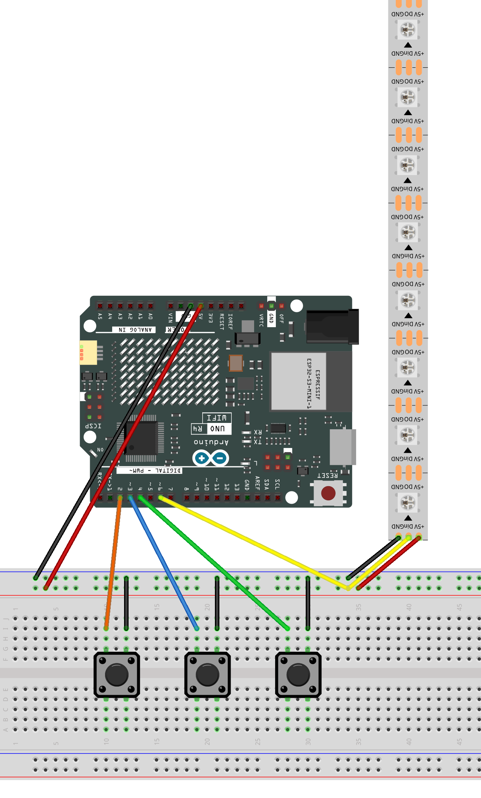

.. _light_shooting1.0_:

Light Shooting 1.0
==============================================================

.. note::
  
  🌟 Welcome to the SunFounder Facebook Community! Whether you're into Raspberry Pi, Arduino, or ESP32, you'll find inspiration, help ideas here.
   
  - ✅ Be the first to get free learning resources. 
   
  - ✅ Stay updated on new products & exclusive giveaways. 
   
  - ✅ Share your creations and get real feedback.
   
  * 👉 Need faster updates or support? Click [|link_sf_facebook|] join our Facebook community 

  * 👉 Or join our WhatsApp group: Click [|link_sf_whatsapp|]
   
Kit purchase
------------------------

Looking for parts? Check out our all-in-one kits below — packed with components, beginner-friendly guides, and tons of fun.

.. image:: img/elite_explore_kit.png
   :width: 100%
   :align: center
   :target: https://www.sunfounder.com/collections/arduino-kits-bundles/products/sunfounder-elite-explorer-kit-with-official-arduino-uno-r4-wifi?ref=jbzmncle

.. raw:: html

     

.. list-table::
   :widths: 20 20 20
   :header-rows: 1

   * - Name
     - Includes Arduino board
     - PURCHASE LINK
   * - Elite Explorer Kit
     - Arduino Uno R4 WiFi
     - |link_elite_buy|
   * - 3 in 1 Ultimate Starter Kit
     - Arduino Uno R4 Minima
     - |link_arduinor4_buy|

Course Introduction
------------------------

In this lesson, we'll create a color shooting game using an 8-LED RGB strip and three buttons with Arduino.

Press the buttons to shoot red, blue, or green lights at randomly colored targets moving along the LED strip. Match the colors to eliminate the targets before they reach the end, or the game is over!

.. .. raw:: html

..  <iframe width="700" height="394" src="https://www.youtube.com/embed/bpoUMNd5bTM" title="YouTube video player" frameborder="0" allow="accelerometer; autoplay; clipboard-write; encrypted-media; gyroscope; picture-in-picture; web-share" referrerpolicy="strict-origin-when-cross-origin" allowfullscreen></iframe>

.. note::

  If this is your first time working with an Arduino project, we recommend downloading and reviewing the basic materials first.
  
  * :ref:`install_arduino`
  * :ref:`introduce_arduino`

**Required Components**

In this project, we need the following components:

.. list-table::
    :widths: 5 20 5 20
    :header-rows: 1

    *   - SN
        - COMPONENT INTRODUCTION	
        - QUANTITY
        - PURCHASE LINK
    
    *   - 1
        - Arduino UNO R4 Minima/Arduino UNO R4 WIFI
        - 1
        - |link_unor4_wifi_buy|
    *   - 2
        - USB Type-C cable
        - 1
        - 
    *   - 3
        - Breadboard
        - 1
        - |link_breadboard_buy|
    *   - 4
        - Wires
        - Several
        - |link_wires_buy|
    *   - 5
        - Button
        - 3
        - |link_button_buy|
    *   - 6
        - LED Strip
        - 1
        - |link_ws2812_buy|

**Wiring**

**Common Connections:**

* **Button**

  - **button red:** Connect to the breadboard’s negative power bus, and the other end to **2** on the Arduino board.
  - **button green:** Connect to the breadboard’s negative power bus, and the other end to **3** on the Arduino board.
  - **button blue:** Connect to the breadboard’s negative power bus, and the other end to **4** on the Arduino board.

* **LED Strip**

  - **Din:** Connect to **6** on the Arduino.
  - **GND:** Connect to breadboard’s negative power bus.
  - **+5V:** Connect to breadboard’s passive power bus.

**Writing the Code**

.. note::

    * You can copy this code into **Arduino IDE**. 
    * To install the library, use the Arduino Library Manager and search for **Adafruit_NeoPixel** and install it.
    * Don't forget to select the board(Arduino UNO R4 WIFI) and the correct port before clicking the **Upload** button.

1. Information writing

.. code-block:: arduino

    /*
      Arduino Color Shooter

      Board: Arduino UNO R4 WiFi
      LED Strip: WS2812B (8 LEDs)

      Buttons:
      D2 - Shoot RED
      D3 - Shoot BLUE
      D4 - Shoot GREEN

      LED Strip:
      DIN - D6

      Game Rules:
      - Random targets spawn continuously at LED 7.
      - Targets move toward LED 0.
      - New targets fill the end without gaps.
      - Matching colors remove the target.
      - Remaining targets close the gaps.
      - Wrong colors leave the target unchanged.
      - Reaching LED 0 ends the game.
      - All LEDs blink red on game over.
      - Press any button to restart.
    */

    #include <Adafruit_NeoPixel.h>

    // ==================== LED Settings ====================

    const int LED_PIN = 6;
    const int LED_COUNT = 8;
    const int BRIGHTNESS = 40;

    Adafruit_NeoPixel strip(
      LED_COUNT,
      LED_PIN,
      NEO_GRB + NEO_KHZ800
    );

    // ==================== Button Settings ====================

    const int RED_BUTTON = 2;
    const int BLUE_BUTTON = 3;
    const int GREEN_BUTTON = 4;

    const unsigned long DEBOUNCE_TIME = 30;

    const int buttonPins[3] = {
      RED_BUTTON,
      BLUE_BUTTON,
      GREEN_BUTTON
    };

    bool lastReading[3] = {
      HIGH, HIGH, HIGH
    };

    bool stableState[3] = {
      HIGH, HIGH, HIGH
    };

    unsigned long lastDebounceTime[3] = {
      0, 0, 0
    };

    // ==================== Color Settings ====================

    enum ColorID {
      NONE,
      RED,
      BLUE,
      GREEN
    };

    const ColorID buttonColors[3] = {
      RED,
      BLUE,
      GREEN
    };

    // ==================== Game Settings ====================

    // Time between projectile movements
    const unsigned long SHOT_INTERVAL = 90;

    // Time between target movements
    const unsigned long TARGET_INTERVAL = 900;

    // Game over blink interval
    const unsigned long BLINK_INTERVAL = 250;

    // ==================== Game Variables ====================

    // Store targets on the LED strip
    ColorID targets[LED_COUNT];

    // Projectile state
    ColorID shotColor = NONE;
    int shotPosition = -1;

    // Game state
    bool gameOver = false;
    int score = 0;

    // Timing variables
    unsigned long lastShotTime = 0;
    unsigned long lastTargetTime = 0;

    // ==================== Color Functions ====================

    // Convert a color ID to RGB
    uint32_t getColor(ColorID color) {

      switch (color) {

        case RED:
          return strip.Color(255, 0, 0);

        case BLUE:
          return strip.Color(0, 0, 255);

        case GREEN:
          return strip.Color(0, 255, 0);

        default:
          return strip.Color(0, 0, 0);
      }
    }

    // Generate a random target color
    ColorID randomTarget() {

      return (ColorID)random(1, 4);
    }

    // ==================== Game Reset ====================

    void resetGame() {

      // Clear all targets
      for (int i = 0; i < LED_COUNT; i++) {
        targets[i] = NONE;
      }

      // Generate the first target at LED 7
      targets[LED_COUNT - 1] = randomTarget();

      // Reset projectile
      shotColor = NONE;
      shotPosition = -1;

      // Reset score and game state
      score = 0;
      gameOver = false;

      // Reset timers
      lastShotTime = millis();
      lastTargetTime = millis();

      // Clear LED strip
      strip.clear();
      strip.show();

      Serial.println("Game Started!");
    }

    // ==================== Target Functions ====================

    // Close gaps between targets
    void compactTargets() {

      ColorID temp[LED_COUNT];

      // Clear temporary array
      for (int i = 0; i < LED_COUNT; i++) {
        temp[i] = NONE;
      }

      // Pack remaining targets toward LED 7
      int index = LED_COUNT - 1;

      for (int i = LED_COUNT - 1; i >= 0; i--) {

        if (targets[i] != NONE) {

          temp[index] = targets[i];
          index--;
        }
      }

      // Copy the compacted targets
      for (int i = 0; i < LED_COUNT; i++) {
        targets[i] = temp[i];
      }
    }

    // ==================== Collision Detection ====================

    void checkCollision() {

      if (shotPosition < 0) {
        return;
      }

      if (targets[shotPosition] == NONE) {
        return;
      }

      // Check whether colors match
      if (shotColor == targets[shotPosition]) {

        // Remove matching target
        targets[shotPosition] = NONE;

        // Increase score
        score++;

        Serial.print("Hit! Score: ");
        Serial.println(score);

        // Close the gap
        compactTargets();

      } else {

        // Wrong color: target survives
        Serial.println("Wrong Color!");
      }

      // Remove projectile after collision
      shotPosition = -1;
      shotColor = NONE;
    }

    // ==================== Shooting Functions ====================

    // Fire a colored projectile
    void shoot(ColorID color) {

      if (gameOver) {
        return;
      }

      // Allow only one projectile at a time
      if (shotPosition >= 0) {
        return;
      }

      // Create projectile at LED 0
      shotColor = color;
      shotPosition = 0;

      lastShotTime = millis();

      // Check immediate collision
      checkCollision();
    }

    // Move projectile toward LED 7
    void updateShot() {

      if (shotPosition < 0 || gameOver) {
        return;
      }

      unsigned long now = millis();

      if (now - lastShotTime < SHOT_INTERVAL) {
        return;
      }

      lastShotTime = now;

      // Move projectile forward
      shotPosition++;

      // Remove projectile if it reaches the end
      if (shotPosition >= LED_COUNT) {

        shotPosition = -1;
        shotColor = NONE;

        return;
      }

      // Check collision at the new position
      checkCollision();
    }

    // ==================== Game Over ====================

    void endGame() {

      gameOver = true;

      // Remove active projectile
      shotPosition = -1;
      shotColor = NONE;

      Serial.println("GAME OVER!");

      Serial.print("Final Score: ");
      Serial.println(score);
    }

    // ==================== Target Movement ====================

    // Move the continuous target queue
    void updateTargets() {

      if (gameOver) {
        return;
      }

      unsigned long now = millis();

      if (now - lastTargetTime < TARGET_INTERVAL) {
        return;
      }

      lastTargetTime = now;

      // Stop if the target has reached LED 0
      if (targets[0] != NONE) {
        endGame();
        return;
      }

      // Move every target toward LED 0
      for (int i = 0; i < LED_COUNT - 1; i++) {

        targets[i] = targets[i + 1];
      }

      // Immediately generate a new target at LED 7
      // This keeps targets continuous
      targets[LED_COUNT - 1] = randomTarget();

      // Check for projectile collision
      checkCollision();

      // Game over when a target reaches LED 0
      if (targets[0] != NONE) {
        endGame();
      }
    }

    // ==================== Button Control ====================

    // Detect button presses with debounce
    void updateButtons() {

      for (int i = 0; i < 3; i++) {

        bool reading = digitalRead(buttonPins[i]);

        if (reading != lastReading[i]) {
          lastDebounceTime[i] = millis();
        }

        if (millis() - lastDebounceTime[i]
            >= DEBOUNCE_TIME) {

          if (reading != stableState[i]) {

            stableState[i] = reading;

            // Detect a button press
            if (stableState[i] == LOW) {

              if (gameOver) {

                // Restart game
                resetGame();

              } else {

                // Fire selected color
                shoot(buttonColors[i]);
              }
            }
          }
        }

        lastReading[i] = reading;
      }
    }

    // ==================== LED Display ====================

    // Display targets and projectile
    void renderGame() {

      strip.clear();

      // Display all targets
      for (int i = 0; i < LED_COUNT; i++) {

        strip.setPixelColor(
          i,
          getColor(targets[i])
        );
      }

      // Display projectile
      if (shotPosition >= 0) {

        strip.setPixelColor(
          shotPosition,
          getColor(shotColor)
        );
      }

      strip.show();
    }

    // Blink all LEDs when the game ends
    void renderGameOver() {

      bool blinkOn =
        (millis() / BLINK_INTERVAL) % 2 == 0;

      uint32_t color = blinkOn
        ? strip.Color(255, 0, 0)
        : strip.Color(0, 0, 0);

      for (int i = 0; i < LED_COUNT; i++) {

        strip.setPixelColor(i, color);
      }

      strip.show();
    }

    // ==================== Setup ====================

    void setup() {

      Serial.begin(115200);

      // Initialize buttons
      for (int i = 0; i < 3; i++) {

        pinMode(buttonPins[i], INPUT_PULLUP);
      }

      // Initialize LED strip
      strip.begin();
      strip.setBrightness(BRIGHTNESS);
      strip.clear();
      strip.show();

      // Initialize random seed
      randomSeed(analogRead(A0) ^ micros());

      // Start the game
      resetGame();
    }

    // ==================== Main Loop ====================

    void loop() {

      // Read button inputs
      updateButtons();

      // Game over animation
      if (gameOver) {

        renderGameOver();
        return;
      }

      // Move the projectile
      updateShot();

      // Move targets and generate a new target
      updateTargets();

      // Update LED strip
      renderGame();
    }
