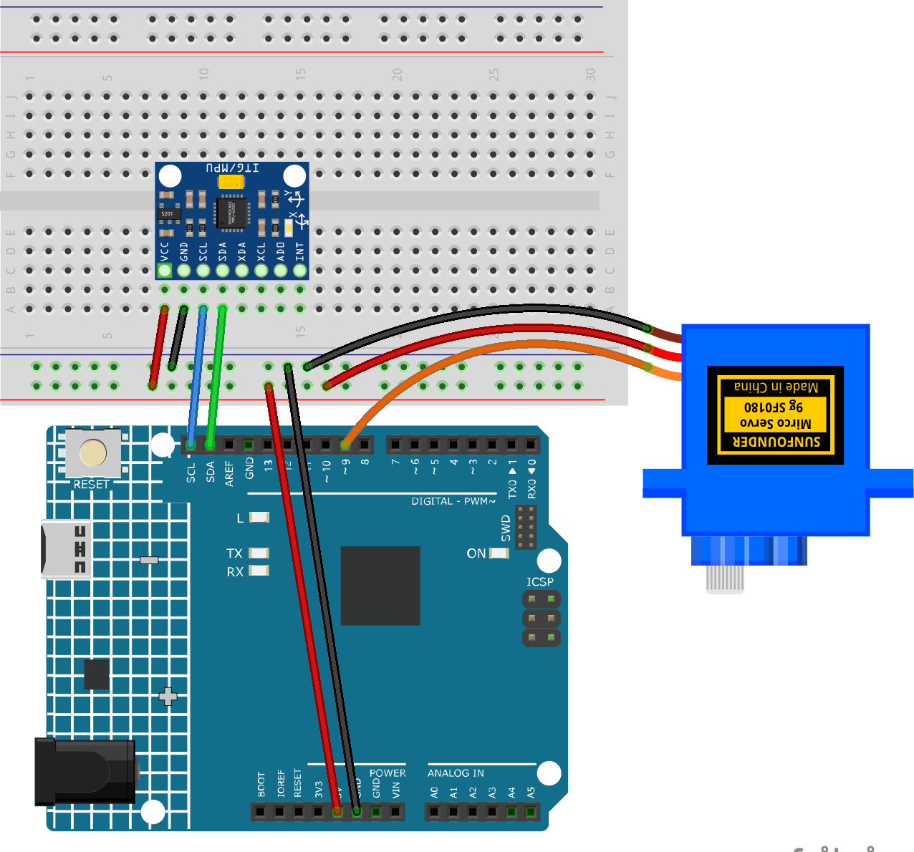

.. _motion_servo:

Motion Servo
==============================================================

.. note::
  
  🌟 Welcome to the SunFounder Facebook Community! Whether you're into Raspberry Pi, Arduino, or ESP32, you'll find inspiration, help ideas here.
   
  - ✅ Be the first to get free learning resources. 
   
  - ✅ Stay updated on new products & exclusive giveaways. 
   
  - ✅ Share your creations and get real feedback.
   
  * 👉 Need faster updates or support? Click [|link_sf_facebook|] join our Facebook community 

  * 👉 Or join our WhatsApp group: Click [|link_sf_whatsapp|]
   
Kit purchase
------------------------

Looking for parts? Check out our all-in-one kits below — packed with components, beginner-friendly guides, and tons of fun.

.. image:: img/ultimate_sensor_kit.png
   :width: 100%
   :align: center
   :target: https://www.sunfounder.com/collections/arduino-kits-bundles/products/sunfounder-ultimate-sensor-kit-with-original-arduino-uno-r4-minima?ref=jbzmncle

.. raw:: html

     

.. list-table::
   :widths: 20 20 20
   :header-rows: 1

   * - Name
     - Includes Arduino board
     - PURCHASE LINK
   * - Ultimate Sensor Kit
     - Arduino Uno R4 Minima
     - |link_ultimate_sensor_buy|
   * - Elite Explorer Kit
     - Arduino Uno R4 WiFi
     - |link_elite_buy|
   * - 3 in 1 Ultimate Starter Kit
     - Arduino Uno R4 Minima
     - |link_arduinor4_buy|
   * - Universal Maker Sensor Kit
     - ×
     - |link_umsk_buy|

Course Introduction
------------------------

In this lesson, you'll learn how to use the MPU6050 module with the Arduino to control a servo motor through horizontal rotation.

As you rotate the MPU6050 left or right, the Arduino reads the Z-axis gyroscope data to calculate the rotation angle. The servo then follows the movement, rotating between 0° and 180° based on the sensor's orientation.

.. .. raw:: html

..  <iframe width="700" height="394" src="https://www.youtube.com/embed/7ZoSPbuH78U" title="YouTube video player" frameborder="0" allow="accelerometer; autoplay; clipboard-write; encrypted-media; gyroscope; picture-in-picture; web-share" referrerpolicy="strict-origin-when-cross-origin" allowfullscreen></iframe>

.. note::

  If this is your first time working with an Arduino project, we recommend downloading and reviewing the basic materials first.

  * :ref:`install_arduino`
  * :ref:`introduce_arduino`

**Required Components**

In this project, we need the following components:

.. list-table::
    :widths: 5 20 5 20
    :header-rows: 1

    *   - SN
        - COMPONENT INTRODUCTION	
        - QUANTITY
        - PURCHASE LINK

    *   - 1
        - Arduino UNO R4 Minima
        - 1
        - |link_unor4_buy|
    *   - 2
        - USB Type-C cable
        - 1
        - 
    *   - 3
        - Breadboard
        - 1
        - |link_breadboard_buy|
    *   - 4
        - Wires
        - Several
        - |link_wires_buy|
    *   - 5
        - Digital Servo Motor
        - 1
        - |link_motor_buy|
    *   - 6
        - MPU6050 Module
        - 1
        - |link_mpu6050_buy|

**Wiring**

**Common Connections:**

* **Digital Servo Motor**

  - Connect to breadboard’s positive power bus.
  - Connect to breadboard’s negative power bus.
  - Connect to **9** on the Arduino.

* **MPU6050**

  - **SDA:** Connect to **SDA** on the Arduino.
  - **SCL:** Connect to **SCL** on the Arduino.
  - **GND:** Connect to breadboard’s negative power bus.
  - **VCC:** Connect to breadboard’s red power bus.

**Writing the Code**

.. note::

    * You can copy this code into **Arduino IDE**. 
    * To install the library, use the Arduino Library Manager and search for **Adafruit MPU6050** , **Adafruit Unified Sensor** and install it.
    * Don't forget to select the board(Arduino UNO R4 WIFI) and the correct port before clicking the **Upload** button.

.. code-block:: arduino

      /*
        MPU6050 Horizontal Motion-Controlled Servo

        Board: Arduino UNO R4 WiFi
        Sensor: MPU6050 (GY-521)
        Servo: SG90

        Rotate the MPU6050 horizontally to
        control the servo from 0 to 180 degrees.

        Initial position: 90 degrees
        Rotate left: Servo moves toward 0 degrees
        Rotate right: Servo moves toward 180 degrees

        Keep the sensor still during startup.
      */

      #include <Wire.h>
      #include <Adafruit_MPU6050.h>
      #include <Adafruit_Sensor.h>
      #include <Servo.h>
      #include <math.h>

      // Create sensor and servo objects
      Adafruit_MPU6050 mpu;
      Servo myServo;

      // Servo settings
      const int SERVO_PIN = 9;
      const int CENTER_ANGLE = 90;
      const int MIN_ANGLE = 0;
      const int MAX_ANGLE = 180;

      // Change to -1 to reverse the direction
      const int DIRECTION = 1;

      // Ignore small gyro noise (degrees per second)
      const float GYRO_DEADBAND = 0.5;

      // Angle variables
      float yawAngle = 0;
      float gyroOffsetZ = 0;

      // Timing variables
      unsigned long previousTime = 0;
      unsigned long lastPrintTime = 0;

      void setup() {
        Serial.begin(115200);

        Wire.begin();

        // Initialize MPU6050
        if (!mpu.begin()) {
          Serial.println("MPU6050 not found!");

          while (true) {
            delay(100);
          }
        }

        // Configure MPU6050
        mpu.setAccelerometerRange(MPU6050_RANGE_2_G);
        mpu.setGyroRange(MPU6050_RANGE_250_DEG);
        mpu.setFilterBandwidth(MPU6050_BAND_21_HZ);

        // Initialize servo
        myServo.attach(SERVO_PIN);
        myServo.write(CENTER_ANGLE);

        Serial.println("Keep MPU6050 still...");
        delay(1000);

        // Calibrate Z-axis gyroscope
        float gyroSum = 0;

        for (int i = 0; i < 500; i++) {
          sensors_event_t a, g, temp;

          mpu.getEvent(&a, &g, &temp);

          gyroSum += g.gyro.z;

          delay(3);
        }

        // Calculate gyroscope offset
        gyroOffsetZ = gyroSum / 500.0;

        // Set initial horizontal angle to zero
        yawAngle = 0;

        previousTime = micros();

        Serial.println("Calibration complete!");
        Serial.println("Rotate MPU6050 horizontally.");
      }

      void loop() {
        sensors_event_t a, g, temp;

        // Read MPU6050
        mpu.getEvent(&a, &g, &temp);

        // Calculate elapsed time
        unsigned long currentTime = micros();

        float dt = (currentTime - previousTime)
                  / 1000000.0;

        previousTime = currentTime;

        if (dt <= 0 || dt > 0.1) {
          delay(10);
          return;
        }

        // Read Z-axis gyroscope
        // Convert radians/sec to degrees/sec
        float gyroZ = (g.gyro.z - gyroOffsetZ)
                      * 180.0 / PI;

        // Ignore small sensor noise
        if (abs(gyroZ) < GYRO_DEADBAND) {
          gyroZ = 0;
        }

        // Calculate horizontal rotation angle
        yawAngle += gyroZ * dt;

        // Map horizontal rotation to servo angle
        float targetAngle =
          CENTER_ANGLE + yawAngle * DIRECTION;

        // Limit servo movement
        int servoAngle = constrain(
          (int)round(targetAngle),
          MIN_ANGLE,
          MAX_ANGLE
        );

        // Control servo
        myServo.write(servoAngle);

        // Print values every 100 ms
        if (millis() - lastPrintTime >= 100) {
          lastPrintTime = millis();

          Serial.print("Yaw Angle: ");
          Serial.print(yawAngle, 1);

          Serial.print(" | Servo Angle: ");
          Serial.println(servoAngle);
        }

        delay(10);
      }
