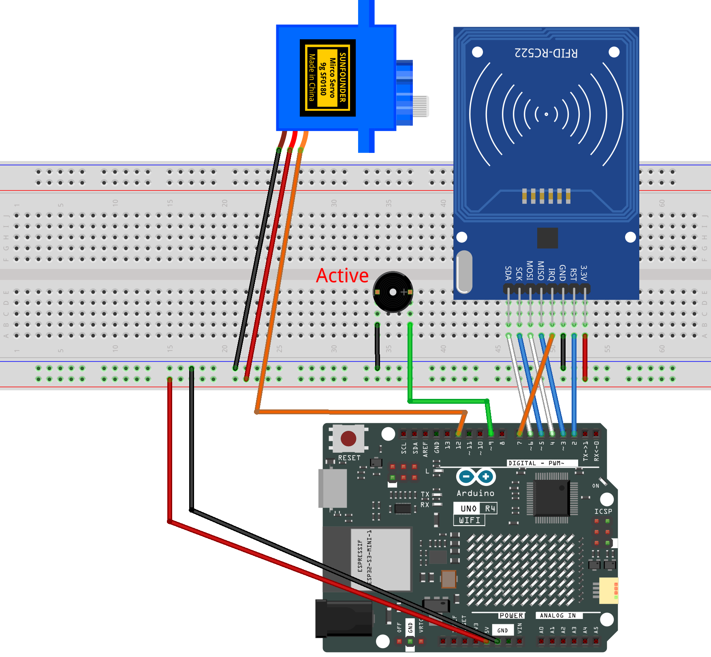

.. _rfid_access12.0_:

RFID Access12.0
==============================================================

.. note::
  
  🌟 Welcome to the SunFounder Facebook Community! Whether you're into Raspberry Pi, Arduino, or ESP32, you'll find inspiration, help ideas here.
   
  - ✅ Be the first to get free learning resources. 
   
  - ✅ Stay updated on new products & exclusive giveaways. 
   
  - ✅ Share your creations and get real feedback.
   
  * 👉 Need faster updates or support? Click [|link_sf_facebook|] join our Facebook community 

  * 👉 Or join our WhatsApp group: Click [|link_sf_whatsapp|]
   
Kit purchase
------------------------

Looking for parts? Check out our all-in-one kits below — packed with components, beginner-friendly guides, and tons of fun.

.. raw:: html

     

.. list-table::
   :widths: 20 20 20
   :header-rows: 1

   * - Name
     - Includes Arduino board
     - PURCHASE LINK
   * - Elite Explorer Kit
     - Arduino Uno R4 WiFi
     - |link_elite_buy|
   * - Inventor Lab Kit
     - Arduino Uno R3
     - |link_inventorkit_buy|

Course Introduction
------------------------

In this lesson, you'll use an RFID Module, a Servo Motor, and a Buzzer with the Arduino UNO R4 to create an RFID Door Lock system.

When an RFID card is scanned, the buzzer sounds. If the card is authorized, the door automatically opens and closes after 2 seconds. Unauthorized cards are rejected with a warning beep.

.. .. raw:: html

..  <iframe width="700" height="394" src="https://www.youtube.com/embed/7w71sX6TuF0?si=6o3hQ6xL69N3OazE" title="YouTube video player" frameborder="0" allow="accelerometer; autoplay; clipboard-write; encrypted-media; gyroscope; picture-in-picture; web-share" referrerpolicy="strict-origin-when-cross-origin" allowfullscreen></iframe>

.. note::

  If this is your first time working with an Arduino project, we recommend downloading and reviewing the basic materials first.
  
  * :ref:`install_arduino`
  * :ref:`introduce_arduino`

**Required Components**

In this project, we need the following components:

.. list-table::
    :widths: 5 20 5 20
    :header-rows: 1

    *   - SN
        - COMPONENT INTRODUCTION	
        - QUANTITY
        - PURCHASE LINK

    *   - 1
        - Arduino UNO R4 Minima/Arduino UNO R4 WIFI
        - 1
        - |link_unor4_wifi_buy|
    *   - 2
        - USB Type-C cable
        - 1
        - 
    *   - 3
        - Breadboard
        - 1
        - |link_breadboard_buy|
    *   - 4
        - Wires
        - Several
        - |link_wires_buy|
    *   - 5
        - Active Buzzer
        - 1
        - 
    *   - 6
        - MFRC522 Module
        - 1
        - |link_mfrc522_module_buy|
    *   - 7
        - Digital Servo Motor
        - 1
        - |link_motor_buy|

**Wiring**

**Common Connections:**

* **MFRC522 Module**

  - **IRQ:** Connect to **7** on the ESP32.
  - **SDA:** Connect to **6** on the ESP32.
  - **SCK:** Connect to **5** on the ESP32.
  - **MOSI:** Connect to **4** on the ESP32.
  - **MISO:** Connect to **3** on the ESP32.
  - **GND:** Connect to breadboard’s negative power bus.
  - **RST:** Connect to **2** on the ESP32.
  - **3.3V:** Connect to breadboard’s passive power bus.

* **Digital Servo Motor**

  - Connect to breadboard’s positive power bus.
  - Connect to breadboard’s negative power bus.
  - Connect to  **12** on the Arduino.

* **Active Buzzer**

  - **＋:** Connect to **9** on the Arduino.
  - **－:** Connect to breadboard’s negative power bus.

**Writing the Code**

.. note::

    * You can copy this code into **Arduino IDE**. 
    * The ``RFID1`` library is used here. You can click here :download:`RFID1.zip </_static/RFID1.zip>` to download it.
    * Don't forget to select the board(Arduino UNO R4 WIFI) and the correct port before clicking the **Upload** button.

.. code-block:: arduino

    #include <rfid1.h>
    #include <Servo.h>

    // Number of UID bytes used for the card ID.
    #define ID_LEN 4

    /* Servo */
    const int servoPin = 11;
    const int CLOSED_ANGLE = 90;  // Door closed position
    const int OPEN_ANGLE = 0;     // Door open position

    /* Buzzer */
    const int buzPin = 9;

    /* Card authorization */
    // UID of the card that was just read.
    uchar userIdRead[ID_LEN] = {0};

    // UID of the allowed card. Replace with your own card's UID.
    uchar userId[ID_LEN] = {0x36, 0xE2, 0xC4, 0xF7};

    // 0 = not approved, 1 = approved
    bool approved = 0;

    RFID1 rfid;
    Servo doorServo;

    void setup() {
      Serial.begin(9600);

      pinMode(buzPin, OUTPUT);

      doorServo.attach(servoPin);
      doorServo.write(CLOSED_ANGLE);
      delay(500);  // Let the servo reach the closed position

      // RFID pin order: IRQ, SCK, MOSI, MISO, SDA, RST
      rfid.begin(7, 5, 4, 3, 6, 2);
      rfid.init();

      Serial.println("start");
    }

    void loop() {
      // Try to read a card only when access is not approved.
      if (approved == 0) {
        approved = rfidRead();

        // Clear the stored UID for the next read.
        for (int i = 0; i < ID_LEN; i++) {
          userIdRead[i] = 0;
        }
      }

      // If the card was approved, open the door.
      if (approved == 1) {
        openDoor();
        approved = 0;
      }
    }

    // Beep the buzzer a number of times.
    void beep(int duration, int times) {
      for (int i = 0; i < times; i++) {
        digitalWrite(buzPin, HIGH);
        delay(duration);
        digitalWrite(buzPin, LOW);
        delay(100);
      }
    }

    // Play a sound pattern for an accepted or rejected card.
    void verifyPrint(bool result) {
      if (result == true) {
        beep(100, 3);  // Authorized: three short beeps
        delay(400);
      } else {
        beep(500, 1);  // Denied: one long beep
        delay(400);
      }
    }

    // Open the door, wait, then close it.
    void openDoor() {
      doorServo.write(OPEN_ANGLE);
      delay(500);   // Wait for the servo to open

      delay(2000);  // Keep the door open for about 2 seconds

      doorServo.write(CLOSED_ANGLE);
      delay(500);   // Wait for the servo to close
    }

    // Read a card and check whether its UID is allowed.
    bool rfidRead() {
      getId();

      // Assume a card was read if the first UID byte is nonzero.
      if (userIdRead[0] != 0) {
        return idVerify();
      }

      return 0;
    }

    // Read the card UID and store it in userIdRead.
    void getId() {
      uchar status;
      uchar str[MAX_LEN];

      // Check whether a card is in the RFID field.
      status = rfid.request(PICC_REQIDL, str);

      if (status != MI_OK) {
        return;  // No card found
      } else {
        // Read the card UID.
        status = rfid.anticoll(str);

        Serial.println("");
        Serial.print("Reading Card ID: ");

        if (status == MI_OK) {
          // Copy the first 4 UID bytes and print them.
          for (int i = 0; i < ID_LEN; i++) {
            userIdRead[i] = str[i];

            Serial.print("0x");
            Serial.print(userIdRead[i], HEX);
            Serial.print(", ");
          }
        }

        delay(500);
        rfid.halt();  // Put the card to sleep so it is not read again right away
        beep(150, 1); // Short beep means a card was read
      }
    }

    // Compare the read UID with the allowed UID.
    bool idVerify() {
      for (int i = 0; i < ID_LEN; i++) {
        if (userIdRead[i] != userId[i]) {
          verifyPrint(0);  // UID does not match
          return 0;
        }
      }

      verifyPrint(1);  // All UID bytes match
      return 1;
    }