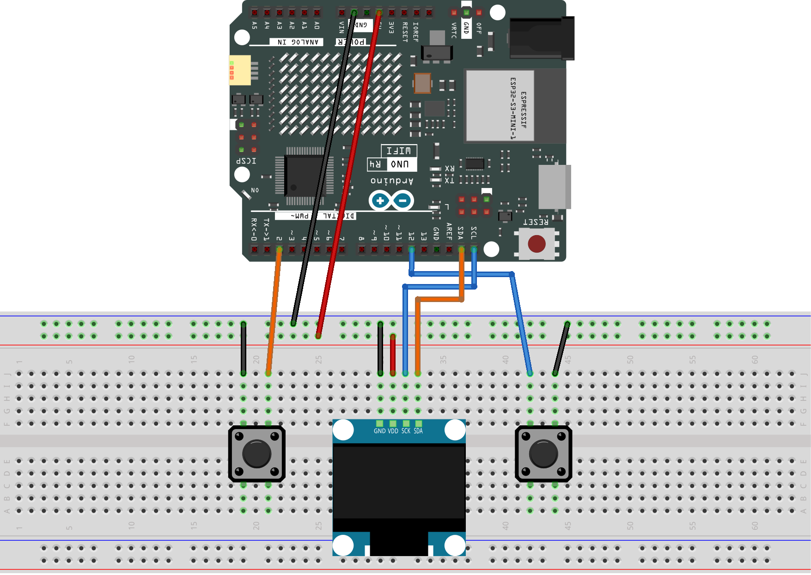

.. _roboeyes_2.0:

RoboEyes 2.0
==============================================================

.. note::
  
  🌟 Welcome to the SunFounder Facebook Community! Whether you're into Raspberry Pi, Arduino, or ESP32, you'll find inspiration, help ideas here.
   
  - ✅ Be the first to get free learning resources. 
   
  - ✅ Stay updated on new products & exclusive giveaways. 
   
  - ✅ Share your creations and get real feedback.
   
  * 👉 Need faster updates or support? Click [|link_sf_facebook|] join our Facebook community 

  * 👉 Or join our WhatsApp group: Click [|link_sf_whatsapp|]
   
Kit purchase
------------------------

Looking for parts? Check out our all-in-one kits below — packed with components, beginner-friendly guides, and tons of fun.

.. image:: img/elite_explore_kit.png
   :width: 100%
   :align: center
   :target: https://www.sunfounder.com/collections/arduino-kits-bundles/products/sunfounder-elite-explorer-kit-with-official-arduino-uno-r4-wifi?ref=jbzmncle

.. raw:: html

     

.. list-table::
   :widths: 20 20 20
   :header-rows: 1

   * - Name
     - Includes Arduino board
     - PURCHASE LINK
   * - Ultimate Sensor Kit
     - Arduino Uno R4 Minima
     - |link_ultimate_sensor_buy|
   * - Elite Explorer Kit
     - Arduino Uno R4 WiFi
     - |link_elite_buy|
   * - 3 in 1 Ultimate Starter Kit
     - Arduino Uno R4 Minima
     - |link_arduinor4_buy|
   * - Universal Maker Sensor Kit
     - ×
     - |link_umsk_buy|

Course Introduction
------------------------

In this lesson, we’ll create interactive robot eyes using an SSD1306 OLED Display, the RoboEyes library, and two push buttons with Arduino.

The OLED eyes will automatically blink, while the buttons let you switch between different expressions, change looking directions, and trigger special confused and laughing animations.

.. .. raw:: html

..  <iframe width="700" height="394" src="https://www.youtube.com/embed/7pZ717-XMPE" title="YouTube video player" frameborder="0" allow="accelerometer; autoplay; clipboard-write; encrypted-media; gyroscope; picture-in-picture; web-share" referrerpolicy="strict-origin-when-cross-origin" allowfullscreen></iframe>

.. note::

  If this is your first time working with an Arduino project, we recommend downloading and reviewing the basic materials first.

  * :ref:`install_arduino`
  * :ref:`introduce_arduino`

**Required Components**

In this project, we need the following components:

.. list-table::
    :widths: 5 20 5 20
    :header-rows: 1

    *   - SN
        - COMPONENT INTRODUCTION	
        - QUANTITY
        - PURCHASE LINK

    *   - 1
        - Arduino UNO R4 WIFI
        - 1
        - |link_unor4_wifi_buy|
    *   - 2
        - USB Type-C cable
        - 1
        - 
    *   - 3
        - Breadboard
        - 1
        - |link_breadboard_buy|
    *   - 4
        - Wires
        - Several
        - |link_wires_buy|
    *   - 5
        - OLED Display Module
        - 1
        - |link_oled_buy|
    *   - 6
        - Button
        - 2
        - |link_button_buy|

**Wiring**

**Common Connections:**

* **OLED Display Module**

  - **SDA:** Connect to **SDA** on the Arduino.
  - **SCK:** Connect to **SCL** on the Arduino.
  - **GND:** Connect to breadboard’s negative power bus.
  - **VCC:** Connect to breadboard’s red power bus.

* **Button 1**

  - Connect to breadboard’s negative power bus.
  - Connect to **2** on the Arduino.

* **Button 2**

  - Connect to breadboard’s negative power bus.
  - Connect to **12** on the Arduino.

**Writing the Code**

.. note::

    * You can copy this code into **Arduino IDE**. 
    * To install the library, use the Arduino Library Manager and search for **Adafruit_GFX** and **Adafruit SSD1306** and **FluxGarage_RoboEyes** and install it.
    * Don't forget to select the board(Arduino UNO R4 Minima) and the correct port before clicking the **Upload** button.

.. code-block:: arduino

        #include <Wire.h>
        #include <Adafruit_GFX.h>
        #include <Adafruit_SSD1306.h>
        #include <FluxGarage_RoboEyes.h>

        // Set the OLED screen size and I2C address
        #define SCREEN_WIDTH 128
        #define SCREEN_HEIGHT 64
        #define OLED_RESET -1
        #define OLED_ADDRESS 0x3C

        // Create the OLED display object
        Adafruit_SSD1306 display(
          SCREEN_WIDTH,
          SCREEN_HEIGHT,
          &Wire,
          OLED_RESET
        );

        // Create the RoboEyes object
        RoboEyes<Adafruit_SSD1306> roboEyes(display);

        // Connect the red button to pin 2
        const int RED_BUTTON_PIN = 2;

        // Connect the blue button to pin 12
        const int BLUE_BUTTON_PIN = 12;

        // Store the previous state of each button
        bool lastRedState = HIGH;
        bool lastBlueState = HIGH;

        // Keep track of the current expression
        // 0 = Normal
        // 1 = Happy
        // 2 = Tired
        // 3 = Angry
        int expressionStep = 0;

        // Keep track of the current looking direction
        // 0 = Center
        // 1 = Left
        // 2 = Right
        // 3 = Up
        // 4 = Down
        int directionStep = 0;

        // Keep track of the special animation
        // 0 = Confused
        // 1 = Laugh
        int specialStep = 0;

        // Make sure a two-button press only triggers once
        bool specialTriggered = false;

        // Change to the next expression
        void changeExpression() {

          expressionStep++;

          // Go back to Normal after Angry
          if (expressionStep > 3) {
            expressionStep = 0;
          }

          switch (expressionStep) {

            case 0:
              roboEyes.setMood(DEFAULT);
              break;

            case 1:
              roboEyes.setMood(HAPPY);
              break;

            case 2:
              roboEyes.setMood(TIRED);
              break;

            case 3:
              roboEyes.setMood(ANGRY);
              break;
          }
        }

        // Change to the next looking direction
        void changeDirection() {

          directionStep++;

          // Go back to Center after Down
          if (directionStep > 4) {
            directionStep = 0;
          }

          switch (directionStep) {

            case 0:
              roboEyes.setPosition(DEFAULT);
              break;

            case 1:
              roboEyes.setPosition(W);
              break;

            case 2:
              roboEyes.setPosition(E);
              break;

            case 3:
              roboEyes.setPosition(N);
              break;

            case 4:
              roboEyes.setPosition(S);
              break;
          }
        }

        // Play a special animation
        void playSpecialAnimation() {

          // Look forward before starting the animation
          roboEyes.setPosition(DEFAULT);

          if (specialStep == 0) {

            // Play the confused animation
            roboEyes.setMood(DEFAULT);
            roboEyes.anim_confused();

            // Play Laugh the next time both buttons are pressed
            specialStep = 1;

          } else {

            // Play the laughing animation
            roboEyes.setMood(HAPPY);
            roboEyes.anim_laugh();

            // Play Confused the next time both buttons are pressed
            specialStep = 0;
          }
        }

        void setup() {

          // Use the Arduino's built-in pull-up resistors for the buttons
          pinMode(RED_BUTTON_PIN, INPUT_PULLUP);
          pinMode(BLUE_BUTTON_PIN, INPUT_PULLUP);

          // Start the OLED display
          if (!display.begin(SSD1306_SWITCHCAPVCC, OLED_ADDRESS)) {
            while (true);
          }

          // Clear anything already shown on the screen
          display.clearDisplay();
          display.display();

          // Start RoboEyes with a maximum frame rate of 60 FPS
          roboEyes.begin(SCREEN_WIDTH, SCREEN_HEIGHT, 60);

          // Set the size and shape of both eyes
          roboEyes.setWidth(36, 36);
          roboEyes.setHeight(36, 36);
          roboEyes.setBorderradius(8, 8);
          roboEyes.setSpacebetween(10);

          // Blink automatically at slightly random intervals
          roboEyes.setAutoblinker(ON, 3, 1);

          // Start with a normal expression looking forward
          roboEyes.setMood(DEFAULT);
          roboEyes.setPosition(DEFAULT);
        }

        void loop() {

          // Update RoboEyes continuously to keep the animation smooth
          roboEyes.update();

          // Read the current state of both buttons
          bool redState = digitalRead(RED_BUTTON_PIN);
          bool blueState = digitalRead(BLUE_BUTTON_PIN);

          // If both buttons are pressed, play a special animation
          if (redState == LOW && blueState == LOW) {

            // Only trigger once for each two-button press
            if (!specialTriggered) {
              playSpecialAnimation();
              specialTriggered = true;
            }

          } else {

            // Allow another special animation after both buttons are released
            if (redState == HIGH && blueState == HIGH) {
              specialTriggered = false;
            }

            // Press the red button to change the expression
            if (redState == LOW && lastRedState == HIGH) {
              changeExpression();
            }

            // Press the blue button to change the looking direction
            if (blueState == LOW && lastBlueState == HIGH) {
              changeDirection();
            }
          }

          // Save the current button states for the next loop
          lastRedState = redState;
          lastBlueState = blueState;

          // A short delay helps prevent accidental repeated button presses
          delay(10);
        }
