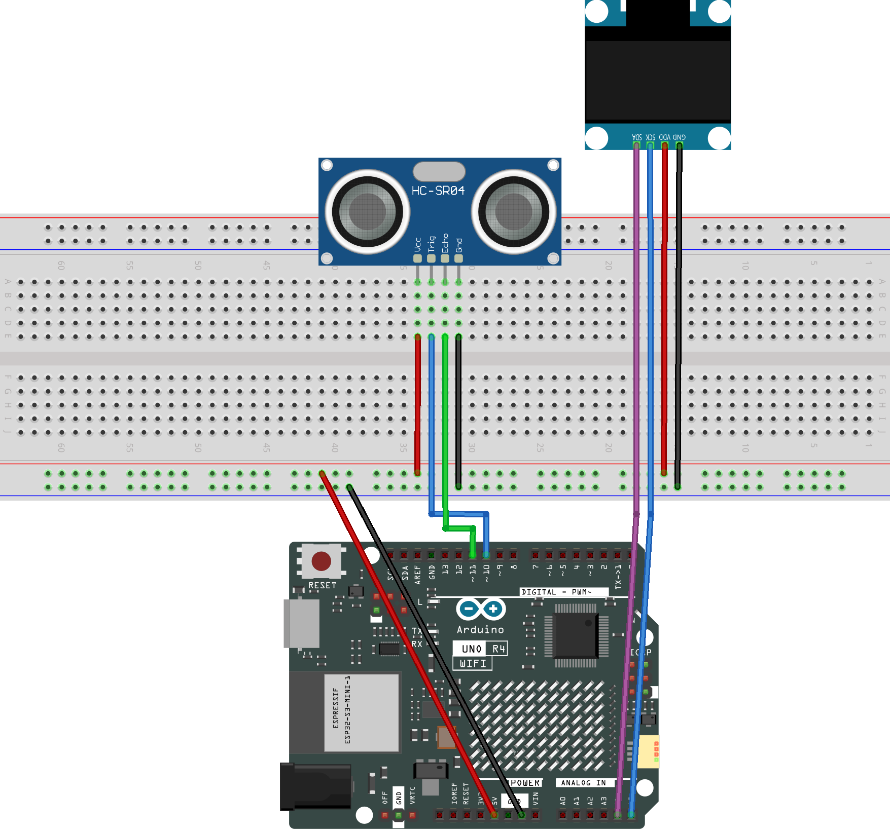

.. _roboeyes_3.0:

RoboEyes 3.0
==============================================================

.. note::
  
  🌟 Welcome to the SunFounder Facebook Community! Whether you're into Raspberry Pi, Arduino, or ESP32, you'll find inspiration, help ideas here.
   
  - ✅ Be the first to get free learning resources. 
   
  - ✅ Stay updated on new products & exclusive giveaways. 
   
  - ✅ Share your creations and get real feedback.
   
  * 👉 Need faster updates or support? Click [|link_sf_facebook|] join our Facebook community 

  * 👉 Or join our WhatsApp group: Click [|link_sf_whatsapp|]
   
Kit purchase
------------------------

Looking for parts? Check out our all-in-one kits below — packed with components, beginner-friendly guides, and tons of fun.

.. image:: img/elite_explore_kit.png
   :width: 100%
   :align: center
   :target: https://www.sunfounder.com/collections/arduino-kits-bundles/products/sunfounder-elite-explorer-kit-with-official-arduino-uno-r4-wifi?ref=jbzmncle

.. raw:: html

     

.. list-table::
   :widths: 20 20 20
   :header-rows: 1

   * - Name
     - Includes Arduino board
     - PURCHASE LINK
   * - Ultimate Sensor Kit
     - Arduino Uno R4 Minima
     - |link_ultimate_sensor_buy|
   * - Elite Explorer Kit
     - Arduino Uno R4 WiFi
     - |link_elite_buy|
   * - 3 in 1 Ultimate Starter Kit
     - Arduino Uno R4 Minima
     - |link_arduinor4_buy|
   * - Universal Maker Sensor Kit
     - ×
     - |link_umsk_buy|

Course Introduction
------------------------

In this lesson, we’ll create interactive robot eyes using an SSD1306 OLED Display, the RoboEyes library, and an ultrasonic sensor with Arduino.

The ultrasonic sensor detects distance, while the OLED eyes automatically change between normal, happy, tired, and angry expressions based on how close an object is.

.. .. raw:: html

..  <iframe width="700" height="394" src="https://www.youtube.com/embed/7pZ717-XMPE" title="YouTube video player" frameborder="0" allow="accelerometer; autoplay; clipboard-write; encrypted-media; gyroscope; picture-in-picture; web-share" referrerpolicy="strict-origin-when-cross-origin" allowfullscreen></iframe>

.. note::

  If this is your first time working with an Arduino project, we recommend downloading and reviewing the basic materials first.

  * :ref:`install_arduino`
  * :ref:`introduce_arduino`

**Required Components**

In this project, we need the following components:

.. list-table::
    :widths: 5 20 5 20
    :header-rows: 1

    *   - SN
        - COMPONENT INTRODUCTION	
        - QUANTITY
        - PURCHASE LINK

    *   - 1
        - Arduino UNO R4 WIFI
        - 1
        - |link_unor4_wifi_buy|
    *   - 2
        - USB Type-C cable
        - 1
        - 
    *   - 3
        - Breadboard
        - 1
        - |link_breadboard_buy|
    *   - 4
        - Wires
        - Several
        - |link_wires_buy|
    *   - 5
        - OLED Display Module
        - 1
        - |link_oled_buy|
    *   - 6
        - Ultrasonic Sensor Module
        - 1
        - |link_ultrasonic_buy|

**Wiring**

**Common Connections:**

* **OLED Display Module**

  - **SDA:** Connect to **A4** on the Arduino.
  - **SCK:** Connect to **A5** on the Arduino.
  - **GND:** Connect to breadboard’s negative power bus.
  - **VCC:** Connect to breadboard’s red power bus.

* **Ultrasonic Sensor Module**

  - **Trig:** Connect to **10** on the Arduino.
  - **Echo:** Connect to **11** on the Arduino.
  - **GND:** Connect to breadboard’s negative power bus.
  - **VCC:** Connect to breadboard’s red power bus.

**Writing the Code**

.. note::

    * You can copy this code into **Arduino IDE**. 
    * To install the library, use the Arduino Library Manager and search for **Adafruit_GFX** and **Adafruit SSD1306** and **FluxGarage_RoboEyes** and install it.
    * Don't forget to select the board(Arduino UNO R4 Minima/WIFI) and the correct port before clicking the **Upload** button.

.. code-block:: arduino

      #include <Wire.h>
      #include <Adafruit_GFX.h>
      #include <Adafruit_SSD1306.h>
      #include <FluxGarage_RoboEyes.h>

      // OLED screen size and I2C address
      #define SCREEN_WIDTH 128
      #define SCREEN_HEIGHT 64
      #define OLED_RESET -1
      #define OLED_ADDRESS 0x3C

      // Create the OLED display
      Adafruit_SSD1306 display(
        SCREEN_WIDTH,
        SCREEN_HEIGHT,
        &Wire,
        OLED_RESET
      );

      // Create the RoboEyes object
      RoboEyes<Adafruit_SSD1306> roboEyes(display);

      // Ultrasonic sensor pins
      const int TRIG_PIN = 10;
      const int ECHO_PIN = 11;

      // Distance limits in centimeters
      const float ANGRY_DISTANCE = 8.0;
      const float TIRED_DISTANCE = 14.0;
      const float HAPPY_DISTANCE = 20.0;

      // Measure the distance every 70 ms
      const unsigned long MEASURE_INTERVAL = 70;

      // Laugh every 2 seconds while Happy
      const unsigned long HAPPY_INTERVAL = 2000;

      // Look left or right every 1.2 seconds while Tired
      const unsigned long TIRED_INTERVAL = 1200;

      // The four RoboEyes states
      enum EyeState {
        DEFAULT_STATE,
        HAPPY_STATE,
        TIRED_STATE,
        ANGRY_STATE
      };

      // Store the current and previous states
      EyeState currentState = DEFAULT_STATE;
      EyeState lastState = DEFAULT_STATE;

      // Store the measured distance
      float distance = 999;

      // Store timing values
      unsigned long lastMeasureTime = 0;
      unsigned long lastAnimationTime = 0;

      // Keep track of the Tired eye movement
      int tiredStep = 0;

      void setup() {
        Serial.begin(9600);

        // Set the ultrasonic sensor pins
        pinMode(TRIG_PIN, OUTPUT);
        pinMode(ECHO_PIN, INPUT);

        // Start the OLED display
        if (!display.begin(SSD1306_SWITCHCAPVCC, OLED_ADDRESS)) {
          Serial.println("OLED initialization failed!");
          while (true);
        }

        Serial.println("OLED initialization OK!");

        display.clearDisplay();
        display.display();

        // Start RoboEyes at up to 30 FPS
        roboEyes.begin(SCREEN_WIDTH, SCREEN_HEIGHT, 30);

        // Set the size and shape of the eyes
        roboEyes.setWidth(36, 36);
        roboEyes.setHeight(36, 36);
        roboEyes.setBorderradius(8, 8);
        roboEyes.setSpacebetween(10);

        // Make RoboEyes blink automatically
        roboEyes.setAutoblinker(ON, 3, 1);

        // Start with normal eyes in the center
        roboEyes.setMood(DEFAULT);
        roboEyes.setPosition(DEFAULT);
      }

      void loop() {
        unsigned long currentTime = millis();

        // Measure distance only every 70 ms
        if (currentTime - lastMeasureTime >= MEASURE_INTERVAL) {
          lastMeasureTime = currentTime;

          distance = measureDistance();

          // Show the distance in the Serial Monitor
          if (distance == 999) {
            Serial.println("Distance: NO ECHO");
          } else {
            Serial.print("Distance: ");
            Serial.print(distance);
            Serial.println(" cm");
          }

          // Choose a state based on the distance
          if (distance > 0 && distance <= ANGRY_DISTANCE) {
            currentState = ANGRY_STATE;
          }
          else if (distance <= TIRED_DISTANCE) {
            currentState = TIRED_STATE;
          }
          else if (distance <= HAPPY_DISTANCE) {
            currentState = HAPPY_STATE;
          }
          else {
            currentState = DEFAULT_STATE;
          }

          // Update the eyes only when the state changes
          if (currentState != lastState) {
            changeExpression();
            lastState = currentState;
          }
        }

        // Keep running the animation
        runAnimation();

        // Refresh RoboEyes as often as possible
        roboEyes.update();
      }

      // Measure distance with the ultrasonic sensor
      float measureDistance() {
        // Send a short trigger pulse
        digitalWrite(TRIG_PIN, LOW);
        delayMicroseconds(2);

        digitalWrite(TRIG_PIN, HIGH);
        delayMicroseconds(10);

        digitalWrite(TRIG_PIN, LOW);

        // Measure how long the echo takes to return
        unsigned long duration = pulseIn(ECHO_PIN, HIGH, 25000);

        // Return 999 if no echo is received
        if (duration == 0) {
          return 999;
        }

        // Convert the echo time to centimeters
        return duration * 0.0343 / 2.0;
      }

      // Change the expression for the new state
      void changeExpression() {
        tiredStep = 0;
        lastAnimationTime = millis();

        switch (currentState) {

          case HAPPY_STATE:
            // Happy eyes stay centered and laugh
            roboEyes.setMood(HAPPY);
            roboEyes.setPosition(DEFAULT);
            roboEyes.anim_laugh();

            Serial.println("State: HAPPY");
            break;

          case TIRED_STATE:
            // Tired eyes look from side to side
            roboEyes.setMood(TIRED);
            roboEyes.setPosition(DEFAULT);

            Serial.println("State: TIRED");
            break;

          case ANGRY_STATE:
            // Angry eyes stay in the center
            roboEyes.setMood(ANGRY);
            roboEyes.setPosition(DEFAULT);

            Serial.println("State: ANGRY");
            break;

          default:
            // Normal eyes stay in the center
            roboEyes.setMood(DEFAULT);
            roboEyes.setPosition(DEFAULT);

            Serial.println("State: DEFAULT");
            break;
        }
      }

      // Run the movement for each state
      void runAnimation() {
        unsigned long currentTime = millis();

        // Laugh every 2 seconds while Happy
        if (currentState == HAPPY_STATE) {
          roboEyes.setPosition(DEFAULT);

          if (currentTime - lastAnimationTime >= HAPPY_INTERVAL) {
            lastAnimationTime = currentTime;
            roboEyes.anim_laugh();
          }
        }

        // Look left and right while Tired
        else if (currentState == TIRED_STATE) {
          if (currentTime - lastAnimationTime >= TIRED_INTERVAL) {
            lastAnimationTime = currentTime;

            if (tiredStep == 0) {
              roboEyes.setPosition(W);
            }
            else {
              roboEyes.setPosition(E);
            }

            tiredStep++;

            if (tiredStep > 1) {
              tiredStep = 0;
            }
          }
        }

        // Keep Angry eyes in the center
        else if (currentState == ANGRY_STATE) {
          roboEyes.setPosition(DEFAULT);
        }

        // Keep normal eyes in the center
        else {
          roboEyes.setPosition(DEFAULT);
        }
      }