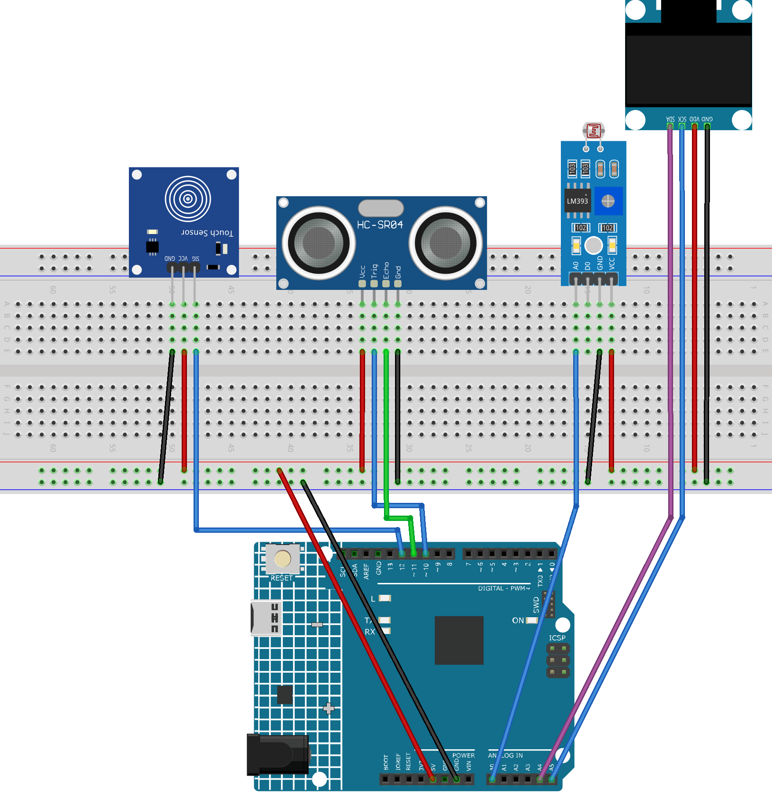

.. _roboeyes_4.0:

RoboEyes 4.0
==============================================================

.. note::
  
  🌟 Welcome to the SunFounder Facebook Community! Whether you're into Raspberry Pi, Arduino, or ESP32, you'll find inspiration, help ideas here.
   
  - ✅ Be the first to get free learning resources. 
   
  - ✅ Stay updated on new products & exclusive giveaways. 
   
  - ✅ Share your creations and get real feedback.
   
  * 👉 Need faster updates or support? Click [|link_sf_facebook|] join our Facebook community 

  * 👉 Or join our WhatsApp group: Click [|link_sf_whatsapp|]
   
Kit purchase
------------------------

Looking for parts? Check out our all-in-one kits below — packed with components, beginner-friendly guides, and tons of fun.

.. image:: img/ultimate_sensor_kit.png
   :width: 100%
   :align: center
   :target: https://www.sunfounder.com/collections/arduino-kits-bundles/products/sunfounder-ultimate-sensor-kit-with-original-arduino-uno-r4-minima?ref=jbzmncle

.. raw:: html

     

.. list-table::
   :widths: 20 20 20
   :header-rows: 1

   * - Name
     - Includes Arduino board
     - PURCHASE LINK
   * - Ultimate Sensor Kit
     - Arduino Uno R4 Minima
     - |link_ultimate_sensor_buy|
   * - Elite Explorer Kit
     - Arduino Uno R4 WiFi
     - |link_elite_buy|
   * - 3 in 1 Ultimate Starter Kit
     - Arduino Uno R4 Minima
     - |link_arduinor4_buy|
   * - Universal Maker Sensor Kit
     - ×
     - |link_umsk_buy|

Course Introduction
------------------------

In this lesson, we’ll create interactive robot eyes using an SSD1306 OLED Display, the RoboEyes library, a light sensor, an ultrasonic sensor, and a touch sensor with Arduino.

The robot eyes react to light and distance by changing expressions and entering sleep mode, while touch interactions trigger confused, happy, and laughing animations.

.. .. raw:: html

..  <iframe width="700" height="394" src="https://www.youtube.com/embed/7pZ717-XMPE" title="YouTube video player" frameborder="0" allow="accelerometer; autoplay; clipboard-write; encrypted-media; gyroscope; picture-in-picture; web-share" referrerpolicy="strict-origin-when-cross-origin" allowfullscreen></iframe>

.. note::

  If this is your first time working with an Arduino project, we recommend downloading and reviewing the basic materials first.

  * :ref:`install_arduino`
  * :ref:`introduce_arduino`

**Required Components**

In this project, we need the following components:

.. list-table::
    :widths: 5 20 5 20
    :header-rows: 1

    *   - SN
        - COMPONENT INTRODUCTION	
        - QUANTITY
        - PURCHASE LINK

    *   - 1
        - Arduino UNO R4
        - 1
        - |link_arduinor4_buy|
    *   - 2
        - USB Type-C cable
        - 1
        - 
    *   - 3
        - Breadboard
        - 1
        - |link_breadboard_buy|
    *   - 4
        - Wires
        - Several
        - |link_wires_buy|
    *   - 5
        - OLED Display Module
        - 1
        - |link_oled_buy|
    *   - 6
        - Ultrasonic Sensor Module
        - 1
        - |link_ultrasonic_buy|
    *   - 7
        - Touch Sensor Module
        - 1
        - |link_touch_buy|
    *   - 8
        - Photoresistor Module
        - 1
        - |link_photoresistor_module_buy|

**Wiring**

**Common Connections:**

* **OLED Display Module**

  - **SDA:** Connect to **A4** on the Arduino.
  - **SCK:** Connect to **A5** on the Arduino.
  - **GND:** Connect to breadboard’s negative power bus.
  - **VCC:** Connect to breadboard’s red power bus.

* **Ultrasonic Sensor Module**

  - **Trig:** Connect to **10** on the Arduino.
  - **Echo:** Connect to **11** on the Arduino.
  - **GND:** Connect to breadboard’s negative power bus.
  - **VCC:** Connect to breadboard’s red power bus.

* **Photoresistor Module**

  - **A0:** Connect to **A0** on the Arduino.
  - **GND:** Connect to breadboard’s negative power bus.
  - **VCC:** Connect to breadboard’s red power bus.

* **Touch Sensor Module**

  - **SIG:** Connect to **12** on the Arduino.
  - **GND:** Connect to breadboard’s negative power bus.
  - **VCC:** Connect to breadboard’s red power bus.

**Writing the Code**

.. note::

    * You can copy this code into **Arduino IDE**. 
    * To install the library, use the Arduino Library Manager and search for **Adafruit_GFX** and **Adafruit SSD1306** and **FluxGarage_RoboEyes** and install it.
    * Don't forget to select the board(Arduino UNO R4 Minima/WIFI) and the correct port before clicking the **Upload** button.

.. code-block:: arduino

      #include <Wire.h>
      #include <Adafruit_GFX.h>
      #include <Adafruit_SSD1306.h>
      #include <FluxGarage_RoboEyes.h>

      // OLED screen size and I2C address
      #define SCREEN_WIDTH 128
      #define SCREEN_HEIGHT 64
      #define OLED_RESET -1
      #define OLED_ADDRESS 0x3C

      // Create the OLED display object
      Adafruit_SSD1306 display(
        SCREEN_WIDTH,
        SCREEN_HEIGHT,
        &Wire,
        OLED_RESET
      );

      // Create the RoboEyes object
      RoboEyes<Adafruit_SSD1306> roboEyes(display);

      // Light sensor analog pin
      const int LIGHT_PIN = A0;

      // Ultrasonic sensor pins
      const int TRIG_PIN = 10;
      const int ECHO_PIN = 11;

      // Touch sensor digital pin
      const int TOUCH_PIN = 12;

      // Light sensor thresholds
      // A larger value means the environment is darker
      const int DIM_THRESHOLD = 400;
      const int DARK_THRESHOLD = 650;

      // Eye heights for normal, dim, and sleep modes
      const int NORMAL_HEIGHT = 36;
      const int DIM_HEIGHT = 20;
      const int SLEEP_HEIGHT = 5;

      // Store the current and target eye heights
      int currentEyeHeight = NORMAL_HEIGHT;
      int targetEyeHeight = NORMAL_HEIGHT;

      // Change the eye height one step at a time
      unsigned long lastEyeUpdate = 0;
      const unsigned long EYE_MOVE_INTERVAL = 60;

      // Store the latest valid distance
      float distance = 999;

      // Measure distance every 80 milliseconds
      unsigned long lastDistanceMeasure = 0;
      const unsigned long DISTANCE_INTERVAL = 80;

      // Move the worried eyes left and right
      unsigned long lastWorriedMove = 0;
      const unsigned long WORRIED_INTERVAL = 1200;

      bool worriedLookLeft = true;

      // Store the previous touch sensor state
      bool lastTouchState = LOW;

      // Touch interaction timing
      unsigned long lastTouchTime = 0;
      unsigned long lastTouchTriggerTime = 0;

      const unsigned long TOUCH_COOLDOWN = 180;
      const unsigned long CONFUSED_DURATION = 900;
      const unsigned long HAPPY_DURATION = 2500;

      // Touch interaction stages
      enum TouchStage {
        TOUCH_NONE,
        TOUCH_CONFUSED,
        TOUCH_HAPPY
      };

      TouchStage touchStage = TOUCH_NONE;

      // Store when the current touch stage started
      unsigned long touchStageStartTime = 0;

      // Track sleep and wake-up modes
      bool sleepScreenDrawn = false;
      bool wakingUp = false;

      // Track whether automatic blinking is enabled
      bool blinkEnabled = true;

      // Store the previous distance state
      // -1 forces the expression to refresh
      int lastDistanceState = -1;

      // Light sensor states
      enum LightState {
        NORMAL_LIGHT,
        DIM_LIGHT,
        DARK_LIGHT
      };

      LightState currentLightState = NORMAL_LIGHT;

      // Distance-based RoboEyes states
      enum DistanceState {
        DISTANCE_NORMAL,
        DISTANCE_HAPPY,
        DISTANCE_WORRIED,
        DISTANCE_ANGRY
      };

      void setup() {
        // Set the sensor pin directions
        pinMode(TRIG_PIN, OUTPUT);
        pinMode(ECHO_PIN, INPUT);
        pinMode(TOUCH_PIN, INPUT);

        // Start the OLED display
        if (!display.begin(SSD1306_SWITCHCAPVCC, OLED_ADDRESS)) {
          while (true);
        }

        display.clearDisplay();
        display.display();

        // Start RoboEyes with a maximum frame rate of 60 FPS
        roboEyes.begin(
          SCREEN_WIDTH,
          SCREEN_HEIGHT,
          60
        );

        // Set the basic eye size and shape
        roboEyes.setWidth(36, 36);
        roboEyes.setHeight(
          NORMAL_HEIGHT,
          NORMAL_HEIGHT
        );
        roboEyes.setBorderradius(8, 8);
        roboEyes.setSpacebetween(10);

        // Blink automatically about every 3 seconds
        roboEyes.setAutoblinker(ON, 3, 1);
        blinkEnabled = true;

        // Start with normal eyes in the center
        roboEyes.setMood(DEFAULT);
        roboEyes.setPosition(DEFAULT);
      }

      void loop() {
        unsigned long currentTime = millis();

        // Read the light sensor
        int lightValue = analogRead(LIGHT_PIN);

        // Update the light mode
        updateLightState(lightValue);

        // Measure the distance at a fixed interval
        if (
          currentTime - lastDistanceMeasure
          >= DISTANCE_INTERVAL
        ) {
          lastDistanceMeasure = currentTime;

          float newDistance = measureDistance();

          // Keep the previous distance if no echo is received
          if (newDistance != 999) {
            distance = newDistance;
          }
        }

        // Read the touch sensor
        bool touchState = digitalRead(TOUCH_PIN);

        // Detect a new touch when the signal changes from LOW to HIGH
        if (
          touchState == HIGH &&
          lastTouchState == LOW
        ) {
          if (
            currentLightState != DARK_LIGHT &&
            !wakingUp &&
            currentTime - lastTouchTriggerTime
              >= TOUCH_COOLDOWN
          ) {
            lastTouchTriggerTime = currentTime;

            handleNewTouch(currentTime);
          }
        }

        lastTouchState = touchState;

        // Dark mode has the highest priority
        if (currentLightState == DARK_LIGHT) {
          handleSleepMode();
        }

        // Finish waking up before other interactions
        else if (wakingUp) {
          handleWakeUpMode();
        }

        // Run the touch interaction
        else if (touchStage != TOUCH_NONE) {
          handleTouchMode(currentTime);
        }

        // Otherwise, react to the ultrasonic sensor
        else {
          handleDistanceMode(currentTime);
        }
      }

      // Start or continue a touch interaction
      void handleNewTouch(unsigned long currentTime) {

        // The first touch plays the confused animation
        if (touchStage == TOUCH_NONE) {
          touchStage = TOUCH_CONFUSED;

          touchStageStartTime = currentTime;
          lastTouchTime = currentTime;

          targetEyeHeight = NORMAL_HEIGHT;

          roboEyes.setMood(DEFAULT);
          roboEyes.setPosition(DEFAULT);

          enableBlink();

          roboEyes.anim_confused();

          lastDistanceState = -1;
        }

        // A second touch during Confused changes directly to Happy
        else if (touchStage == TOUCH_CONFUSED) {
          touchStage = TOUCH_HAPPY;

          touchStageStartTime = currentTime;
          lastTouchTime = currentTime;

          roboEyes.setMood(HAPPY);
          roboEyes.setPosition(DEFAULT);
        }

        // More touches while Happy play the laugh animation
        else if (touchStage == TOUCH_HAPPY) {
          lastTouchTime = currentTime;

          roboEyes.anim_laugh();
        }
      }

      // Run the current touch animation
      void handleTouchMode(unsigned long currentTime) {
        sleepScreenDrawn = false;

        // Keep the eyes fully open during interaction
        targetEyeHeight = NORMAL_HEIGHT;

        updateEyeHeight();

        // Play Confused first
        if (touchStage == TOUCH_CONFUSED) {
          roboEyes.update();

          // Change to Happy after the confused animation
          if (
            currentTime - touchStageStartTime
            >= CONFUSED_DURATION
          ) {
            touchStage = TOUCH_HAPPY;

            touchStageStartTime = currentTime;
            lastTouchTime = currentTime;

            roboEyes.setMood(HAPPY);
            roboEyes.setPosition(DEFAULT);
          }
        }

        // Stay Happy until the touch timer ends
        else if (touchStage == TOUCH_HAPPY) {
          roboEyes.update();

          // Return to distance control after no touch for 2.5 seconds
          if (
            currentTime - lastTouchTime
            >= HAPPY_DURATION
          ) {
            touchStage = TOUCH_NONE;

            // Refresh the distance expression
            lastDistanceState = -1;
          }
        }
      }

      // Choose the light mode from the sensor value
      void updateLightState(int lightValue) {
        LightState previousLightState =
          currentLightState;

        // Dark environment
        if (lightValue >= DARK_THRESHOLD) {
          currentLightState = DARK_LIGHT;
        }

        // Dim environment
        else if (lightValue >= DIM_THRESHOLD) {
          currentLightState = DIM_LIGHT;
        }

        // Normal lighting
        else {
          currentLightState = NORMAL_LIGHT;
        }

        // Start the wake-up animation after leaving darkness
        if (
          previousLightState == DARK_LIGHT &&
          currentLightState != DARK_LIGHT
        ) {
          wakingUp = true;

          touchStage = TOUCH_NONE;

          roboEyes.setMood(DEFAULT);
          roboEyes.setPosition(DEFAULT);

          disableBlink();

          lastDistanceState = -1;
        }
      }

      // Slowly close the eyes and show the sleep symbols
      void handleSleepMode() {
        touchStage = TOUCH_NONE;
        wakingUp = false;

        // Keep the sleeping eyes centered
        roboEyes.setMood(DEFAULT);
        roboEyes.setPosition(DEFAULT);

        // Do not blink while sleeping
        disableBlink();

        targetEyeHeight = SLEEP_HEIGHT;

        updateEyeHeight();

        // Keep refreshing while the eyes are closing
        if (currentEyeHeight > SLEEP_HEIGHT) {
          sleepScreenDrawn = false;

          roboEyes.update();
        }

        // Draw the final sleeping screen only once
        else {
          if (!sleepScreenDrawn) {
            roboEyes.update();

            drawSleepSymbols();

            sleepScreenDrawn = true;
          }
        }

        lastDistanceState = -1;
      }

      // Slowly open the eyes after leaving darkness
      void handleWakeUpMode() {
        sleepScreenDrawn = false;

        // Keep the eyes centered while waking up
        roboEyes.setMood(DEFAULT);
        roboEyes.setPosition(DEFAULT);

        disableBlink();

        // Open the eyes completely
        targetEyeHeight = NORMAL_HEIGHT;

        updateEyeHeight();

        roboEyes.update();

        // Return to normal control when fully open
        if (currentEyeHeight >= NORMAL_HEIGHT) {
          wakingUp = false;

          enableBlink();

          lastDistanceState = -1;
        }
      }

      // Change the expression based on ultrasonic distance
      void handleDistanceMode(unsigned long currentTime) {
        sleepScreenDrawn = false;

        enableBlink();

        // Make the eyes smaller in dim light
        if (currentLightState == DIM_LIGHT) {
          targetEyeHeight = DIM_HEIGHT;
        }
        else {
          targetEyeHeight = NORMAL_HEIGHT;
        }

        updateEyeHeight();

        int currentDistanceState;

        // Very close objects make the eyes Angry
        if (
          distance > 0 &&
          distance <= 8.0
        ) {
          currentDistanceState =
            DISTANCE_ANGRY;
        }

        // A closer object makes the eyes look worried
        else if (distance <= 14.0) {
          currentDistanceState =
            DISTANCE_WORRIED;
        }

        // A nearby object makes the eyes Happy
        else if (distance <= 20.0) {
          currentDistanceState =
            DISTANCE_HAPPY;
        }

        // Farther objects keep the normal expression
        else {
          currentDistanceState =
            DISTANCE_NORMAL;
        }

        // Only change the expression when the state changes
        if (
          currentDistanceState
          != lastDistanceState
        ) {
          lastDistanceState =
            currentDistanceState;

          if (
            currentDistanceState
            == DISTANCE_NORMAL
          ) {
            roboEyes.setMood(DEFAULT);
            roboEyes.setPosition(DEFAULT);
          }

          else if (
            currentDistanceState
            == DISTANCE_HAPPY
          ) {
            roboEyes.setMood(HAPPY);
            roboEyes.setPosition(DEFAULT);
          }

          else if (
            currentDistanceState
            == DISTANCE_WORRIED
          ) {
            roboEyes.setMood(TIRED);

            worriedLookLeft = true;

            roboEyes.setPosition(W);

            lastWorriedMove = currentTime;
          }

          else if (
            currentDistanceState
            == DISTANCE_ANGRY
          ) {
            roboEyes.setMood(ANGRY);
            roboEyes.setPosition(DEFAULT);
          }
        }

        // Move the worried eyes from side to side
        if (
          currentDistanceState
          == DISTANCE_WORRIED
        ) {
          if (
            currentTime - lastWorriedMove
            >= WORRIED_INTERVAL
          ) {
            lastWorriedMove = currentTime;

            if (worriedLookLeft) {
              roboEyes.setPosition(E);
            }
            else {
              roboEyes.setPosition(W);
            }

            worriedLookLeft =
              !worriedLookLeft;
          }
        }

        roboEyes.update();
      }

      // Turn automatic blinking on
      void enableBlink() {
        if (!blinkEnabled) {
          roboEyes.setAutoblinker(
            ON,
            3,
            1
          );

          blinkEnabled = true;
        }
      }

      // Turn automatic blinking off
      void disableBlink() {
        if (blinkEnabled) {
          roboEyes.setAutoblinker(
            OFF,
            3,
            1
          );

          blinkEnabled = false;
        }
      }

      // Move the eye height smoothly toward the target
      void updateEyeHeight() {
        unsigned long currentTime = millis();

        if (
          currentTime - lastEyeUpdate
          >= EYE_MOVE_INTERVAL
        ) {
          lastEyeUpdate = currentTime;

          bool heightChanged = false;

          // Close the eyes one pixel at a time
          if (
            currentEyeHeight
            > targetEyeHeight
          ) {
            currentEyeHeight--;

            heightChanged = true;
          }

          // Open the eyes one pixel at a time
          else if (
            currentEyeHeight
            < targetEyeHeight
          ) {
            currentEyeHeight++;

            heightChanged = true;
          }

          // Only update RoboEyes when the height really changes
          if (heightChanged) {
            roboEyes.setHeight(
              currentEyeHeight,
              currentEyeHeight
            );
          }
        }
      }

      // Measure distance with the ultrasonic sensor
      float measureDistance() {
        // Send a 10 microsecond trigger pulse
        digitalWrite(TRIG_PIN, LOW);
        delayMicroseconds(2);

        digitalWrite(TRIG_PIN, HIGH);
        delayMicroseconds(10);

        digitalWrite(TRIG_PIN, LOW);

        // Measure how long the echo signal stays HIGH
        unsigned long duration =
          pulseIn(
            ECHO_PIN,
            HIGH,
            25000
          );

        // Return 999 when no echo is received
        if (duration == 0) {
          return 999;
        }

        // Convert the echo time to centimeters
        return duration * 0.0343 / 2.0;
      }

      // Draw two z symbols beside the sleeping eyes
      void drawSleepSymbols() {
        display.setTextColor(SSD1306_WHITE);

        // Small z
        display.setTextSize(1);
        display.setCursor(105, 15);
        display.print("z");

        // Large z
        display.setTextSize(2);
        display.setCursor(115, 0);
        display.print("z");

        display.display();
      }