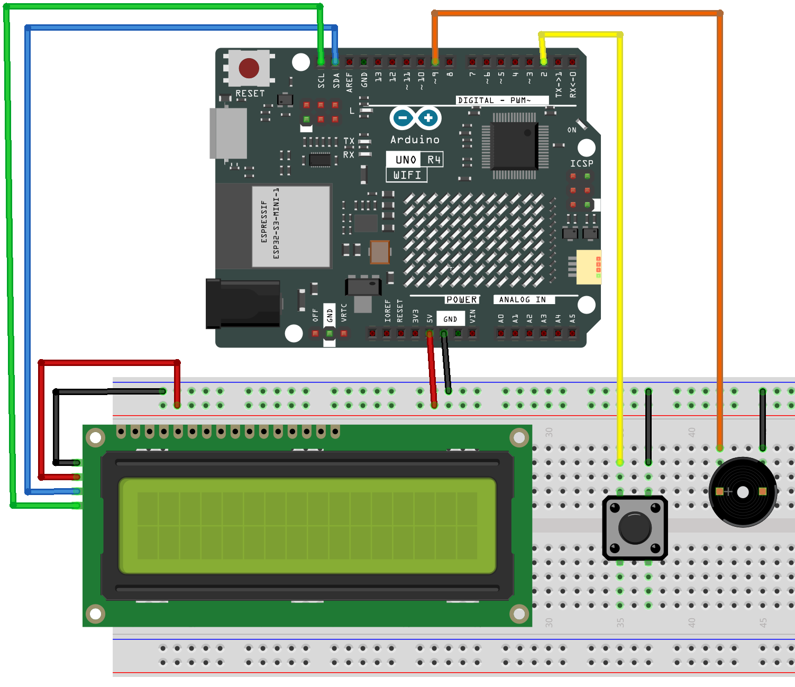

.. _slot_machine3.0:

Slot Machine 3.0
==============================================================

.. note::
  
  🌟 Welcome to the SunFounder Facebook Community! Whether you're into Raspberry Pi, Arduino, or ESP32, you'll find inspiration, help ideas here.
   
  - ✅ Be the first to get free learning resources. 
   
  - ✅ Stay updated on new products & exclusive giveaways. 
   
  - ✅ Share your creations and get real feedback.
   
  * 👉 Need faster updates or support? Click [|link_sf_facebook|] join our Facebook community 

  * 👉 Or join our WhatsApp group: Click [|link_sf_whatsapp|]
   
Kit purchase
------------------------

Looking for parts? Check out our all-in-one kits below — packed with components, beginner-friendly guides, and tons of fun.

.. image:: img/elite_explore_kit.png
   :width: 100%
   :align: center
   :target: https://www.sunfounder.com/collections/arduino-kits-bundles/products/sunfounder-elite-explorer-kit-with-official-arduino-uno-r4-wifi?ref=jbzmncle

.. raw:: html

     

.. list-table::
   :widths: 20 20 20
   :header-rows: 1

   * - Name
     - Includes Arduino board
     - PURCHASE LINK
   * - Elite Explorer Kit
     - Arduino Uno R4 WiFi
     - |link_elite_buy|
   * - Inventor Lab Kit
     - Arduino Uno R3
     - |link_inventorkit_buy|

Course Introduction
------------------------

In this lesson, you’ll learn how to use an I2C LCD, a button, and a buzzer with the Arduino R4 UNO WIFI to create a Slot Machine game 3.0.

The I2C LCD shows spinning reels with custom icons, the button starts the spin, and the buzzer plays sound effects for spinning, winning, or losing.

.. .. raw:: html

..  <iframe width="700" height="394" src="https://www.youtube.com/embed/dPAmdb7WiMs" title="YouTube video player" frameborder="0" allow="accelerometer; autoplay; clipboard-write; encrypted-media; gyroscope; picture-in-picture; web-share" referrerpolicy="strict-origin-when-cross-origin" allowfullscreen></iframe>

.. note::

  If this is your first time working with an Arduino project, we recommend downloading and reviewing the basic materials first.

  * :ref:`install_arduino`
  * :ref:`introduce_arduino`

**Required Components**

In this project, we need the following components:

.. list-table::
    :widths: 5 20 5 20
    :header-rows: 1

    *   - SN
        - COMPONENT INTRODUCTION	
        - QUANTITY
        - PURCHASE LINK

    *   - 1
        - Arduino UNO R4 Wifi
        - 1
        - |link_unor4_wifi_buy|
    *   - 2
        - USB Type-C cable
        - 1
        - 
    *   - 3
        - Breadboard
        - 1
        - |link_breadboard_buy|
    *   - 4
        - Wires
        - Several
        - |link_wires_buy|
    *   - 5
        - Button
        - 1
        - |link_button_buy|
    *   - 6
        - I2C LCD 1602
        - 1
        - |link_i2clcd1602_buy|
    *   - 7
        - Active Buzzer
        - 1
        - 

**Wiring**

**Common Connections:**

* **I2C LCD 1602**

  - **SDA:** Connect to **SDA** on the Arduino.
  - **SCL:** Connect to **SCL** on the Arduino.
  - **GND:** Connect to breadboard’s negative power bus.
  - **VCC:** Connect to breadboard’s red power bus.

* **Button**

  - Connect to breadboard’s negative power bus.
  - Connect to **2** on the Arduino.

* **Active Buzzer**

  - Connect to breadboard’s negative power bus.
  - Connect to **9** on the Arduino.

**Writing the Code**

.. note::

    * You can copy this code into **Arduino IDE**. 
    * To install the library, use the Arduino Library Manager and search for **Adafruit SSD1306** and **Adafruit GFX** and install it.
    * Don't forget to select the board(Arduino UNO R4 WIFI) and the correct port before clicking the **Upload** button.

.. code-block:: arduino

      #include <Wire.h>
      #include <LiquidCrystal_I2C.h>

      // ==============================
      // LCD
      // ==============================
      LiquidCrystal_I2C lcd(0x27, 16, 2);

      // ==============================
      // Pins
      // ==============================
      #define BTN_PIN     2
      #define BUZZER_PIN  9

      // ==============================
      // Slot symbols
      // ==============================
      enum Symbol {
        CHERRY = 0,
        STAR,
        LEMON,
        HEART,
        SEVEN
      };

      const int ICON_COUNT = 5;

      int reels[3] = {
        CHERRY,
        STAR,
        LEMON
      };

      // ==============================
      // LCD custom characters
      // ==============================

      // Cherry
      byte cherryChar[8] = {
        B00100,
        B00110,
        B00101,
        B01010,
        B10101,
        B10101,
        B01010,
        B00000
      };

      // Star
      byte starChar[8] = {
        B00100,
        B10101,
        B01110,
        B11111,
        B01110,
        B10101,
        B00100,
        B00000
      };

      // Lemon
      byte lemonChar[8] = {
        B00000,
        B00110,
        B01111,
        B11111,
        B11111,
        B11110,
        B01100,
        B00000
      };

      // Heart
      byte heartChar[8] = {
        B00000,
        B01010,
        B11111,
        B11111,
        B11111,
        B01110,
        B00100,
        B00000
      };

      // Seven
      byte sevenChar[8] = {
        B11111,
        B00001,
        B00010,
        B00100,
        B01000,
        B01000,
        B01000,
        B00000
      };

      // ==============================
      // Sound effects
      // ==============================

      void playWinJingle() {
        int notes[] = {
          784,
          988,
          1175,
          1568
        };

        int durations[] = {
          120,
          120,
          120,
          220
        };

        for (int i = 0; i < 4; i++) {
          tone(
            BUZZER_PIN,
            notes[i],
            durations[i]
          );

          delay(durations[i] + 40);
        }

        noTone(BUZZER_PIN);
      }

      // Lose sound
      void playLoseBeep() {
        tone(BUZZER_PIN, 420, 100);
        delay(130);

        tone(BUZZER_PIN, 360, 100);
        delay(130);

        noTone(BUZZER_PIN);
      }

      // Start sound
      void playStartChirp() {
        tone(BUZZER_PIN, 900, 80);
        delay(90);

        tone(BUZZER_PIN, 1200, 90);
        delay(110);

        noTone(BUZZER_PIN);
      }

      // Spin tick
      void spinTick() {
        tone(BUZZER_PIN, 950, 18);
      }

      // ==============================
      // LCD symbol drawing
      // ==============================

      void printSymbol(int symbol) {
        switch (symbol) {

          case CHERRY:
            lcd.write(byte(0));
            break;

          case STAR:
            lcd.write(byte(1));
            break;

          case LEMON:
            lcd.write(byte(2));
            break;

          case HEART:
            lcd.write(byte(3));
            break;

          case SEVEN:
            lcd.write(byte(4));
            break;
        }
      }

      // ==============================
      // Display three reels
      // ==============================

      void showReels() {

        lcd.setCursor(1, 1);

        lcd.print("[");

        printSymbol(reels[0]);

        lcd.print("] ");

        lcd.print("[");

        printSymbol(reels[1]);

        lcd.print("] ");

        lcd.print("[");

        printSymbol(reels[2]);

        lcd.print("]");
      }

      // ==============================
      // Jackpot detection
      // ==============================

      bool isJackpot() {

        return (
          reels[0] == reels[1] &&
          reels[1] == reels[2]
        );
      }

      // ==============================
      // Idle screen
      // ==============================

      void showIdle() {

        lcd.clear();

        lcd.setCursor(0, 0);
        lcd.print("SLOT - PRESS BTN");

        showReels();
      }

      // ==============================
      // Spinning screen
      // ==============================

      void drawSpinScreen() {

        lcd.setCursor(0, 0);
        lcd.print("   SPINNING...  ");

        showReels();
      }

      // ==============================
      // Spin
      // ==============================

      void spinAndStop() {

        playStartChirp();

        unsigned long startTime =
          millis();

        unsigned long stopAt[3] = {
          startTime + 700,
          startTime + 1100,
          startTime + 1500
        };

        int stepDelay[3] = {
          80,
          110,
          140
        };

        bool stopped[3] = {
          false,
          false,
          false
        };

        unsigned long lastStep[3] = {
          0,
          0,
          0
        };

        unsigned long lastTick = 0;

        while (
          !(stopped[0] &&
            stopped[1] &&
            stopped[2])
        ) {

          unsigned long now =
            millis();

          bool changed = false;

          for (int r = 0; r < 3; r++) {

            if (!stopped[r]) {

              if (now >= stopAt[r]) {

                stopped[r] = true;

                reels[r] =
                  random(ICON_COUNT);

                changed = true;

              } else {

                if (
                  now - lastStep[r] >=
                  (unsigned long)stepDelay[r]
                ) {

                  lastStep[r] = now;

                  reels[r] =
                    (reels[r] + 1) %
                    ICON_COUNT;

                  changed = true;
                }
              }
            }
          }

          if (
            changed &&
            now - lastTick >= 50
          ) {

            spinTick();

            lastTick = now;
          }

          drawSpinScreen();

          delay(10);
        }
      }

      // ==============================
      // Result screen
      // ==============================

      void showResult() {

        lcd.clear();

        if (isJackpot()) {

          lcd.setCursor(1, 0);
          lcd.print("JACKPOT! WIN!");

          showReels();

          playWinJingle();

        } else {

          lcd.setCursor(3, 0);
          lcd.print("TRY AGAIN");

          showReels();

          playLoseBeep();
        }

        delay(2000);
      }

      // ==============================
      // Setup
      // ==============================

      void setup() {

        pinMode(
          BTN_PIN,
          INPUT_PULLUP
        );

        pinMode(
          BUZZER_PIN,
          OUTPUT
        );

        noTone(BUZZER_PIN);

        // Start I2C
        Wire.begin();

        // Initialize LCD
        lcd.init();

        // Turn on backlight
        lcd.backlight();

        // Create custom symbols
        lcd.createChar(
          0,
          cherryChar
        );

        lcd.createChar(
          1,
          starChar
        );

        lcd.createChar(
          2,
          lemonChar
        );

        lcd.createChar(
          3,
          heartChar
        );

        lcd.createChar(
          4,
          sevenChar
        );

        // Random seed
        randomSeed(
          analogRead(A0)
        );

        showIdle();
      }

      // ==============================
      // Main loop
      // ==============================

      void loop() {

        if (
          digitalRead(BTN_PIN) ==
          LOW
        ) {

          delay(25);

          if (
            digitalRead(BTN_PIN) ==
            LOW
          ) {

            spinAndStop();

            showResult();

            while (
              digitalRead(BTN_PIN) ==
              LOW
            ) {
              delay(10);
            }

            delay(150);

            showIdle();
          }
        }
      }