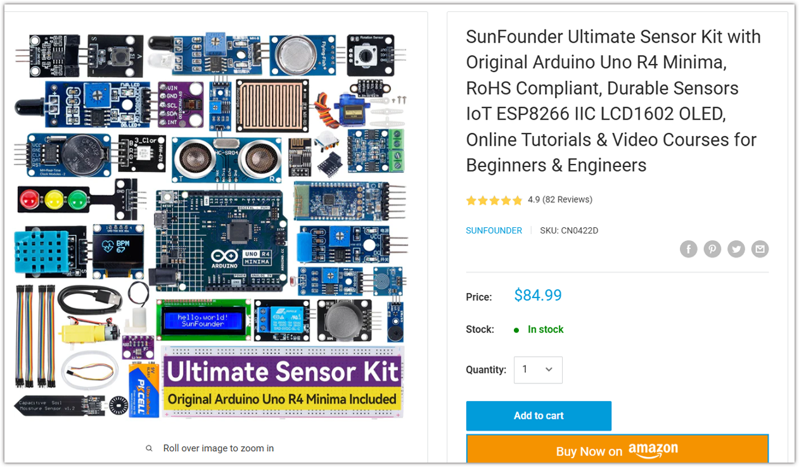
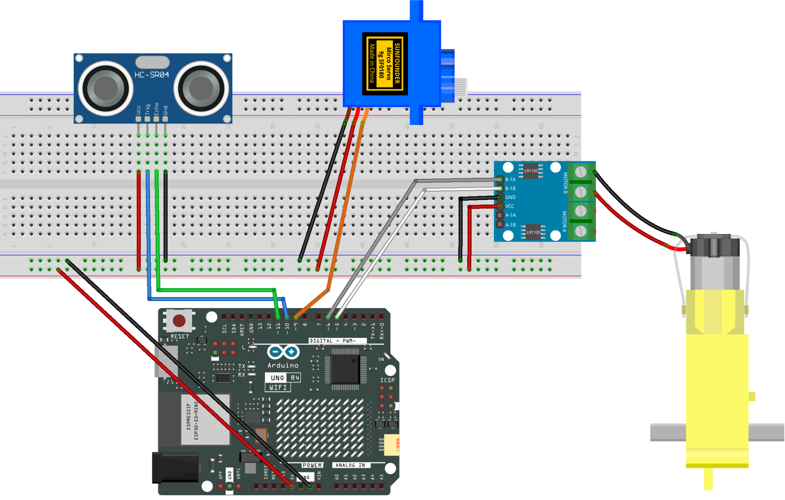

.. _smart_stop6:

Smart Stop 6.0
==============================================================

.. note::
  
  🌟 Welcome to the SunFounder Facebook Community! Whether you're into Raspberry Pi, Arduino, or ESP32, you'll find inspiration, help ideas here.
   
  - ✅ Be the first to get free learning resources. 
   
  - ✅ Stay updated on new products & exclusive giveaways. 
   
  - ✅ Share your creations and get real feedback.
   
  * 👉 Need faster updates or support? Click [|link_sf_facebook|] join our Facebook community 

  * 👉 Or join our WhatsApp group: Click [|link_sf_whatsapp|]
   
Kit purchase
------------------------

Looking for parts? Check out our all-in-one kits below — packed with components, beginner-friendly guides, and tons of fun.

.. raw:: html

     

.. list-table::
   :widths: 20 20 20
   :header-rows: 1

   * - Name
     - Includes Arduino board
     - PURCHASE LINK
   * - Elite Explorer Kit
     - Arduino Uno R4 WiFi
     - |link_elite_buy|
   * - 3 in 1 Ultimate Starter Kit
     - Arduino Uno R4 Minima
     - |link_arduinor4_buy|

Course Introduction
------------------------

In this lesson, you'll use an Ultrasonic Sensor, an L9110 Motor Driver, a TT Motor, and a Servo Motor with the Arduino UNO R4 to create a Smart Stop system.

As an obstacle gets closer, the motor gradually slows down and stops when it gets too close. The servo acts as a speed indicator, showing the motor's speed in real time.

.. .. raw:: html

..  <iframe width="700" height="394" src="https://www.youtube.com/embed/p4wyLYmnSwM?si=vwxgYFIztjkLlYXo" title="YouTube video player" frameborder="0" allow="accelerometer; autoplay; clipboard-write; encrypted-media; gyroscope; picture-in-picture; web-share" referrerpolicy="strict-origin-when-cross-origin" allowfullscreen></iframe>

.. note::

  If this is your first time working with an Arduino project, we recommend downloading and reviewing the basic materials first.
  
  * :ref:`install_arduino`
  * :ref:`introduce_arduino`

**Required Components**

In this project, we need the following components:

.. list-table::
    :widths: 5 20 5 20
    :header-rows: 1

    *   - SN
        - COMPONENT INTRODUCTION	
        - QUANTITY
        - PURCHASE LINK

    *   - 1
        - Arduino UNO R4 Minima/Arduino UNO R4 WIFI
        - 1
        - |link_unor4_wifi_buy|
    *   - 2
        - USB Cable
        - 1
        - 
    *   - 3
        - Breadboard
        - 1
        - |link_breadboard_buy|
    *   - 4
        - Wires
        - Several
        - |link_wires_buy|
    *   - 5
        - L9110 Motor Driver Module
        - 1
        - 
    *   - 6
        - Ultrasonic Sensor Module
        - 1
        - |link_ultrasonic_buy|
    *   - 7
        - TT Motor
        - 1
        - 
    *   - 8
        - Digital Servo Motor
        - 1
        - |link_motor_buy|

**Wiring**

**Common Connections:**

* **Ultrasonic Sensor Module**

  - **Trig:** Connect to **10** on the Arduino.
  - **Echo:** Connect to **11** on the Arduino.
  - **GND:** Connect to breadboard’s negative power bus.
  - **VCC:** Connect to breadboard’s red power bus.

* **TT Motor**

  -  Connect to **MOTOR B** on the L9110 Motor Driver Module.

* **L9110 Motor Driver Module**

  - **GND:** Connect to breadboard’s negative power bus.
  - **VCC:** Connect to breadboard’s red power bus.
  - **B-1B:** Connect to **5** on the Arduino.
  - **B-1A:** Connect to **6** on the Arduino.

* **Digital Servo Motor**

  - Connect to breadboard’s positive power bus.
  - Connect to breadboard’s negative power bus.
  - Connect to **9** on the Arduino.

**Writing the Code**

.. note::

    * You can copy this code into **Arduino IDE**. 
    * Don't forget to select the board(Arduino UNO R4 WiFi) and the correct port before clicking the **Upload** button.

.. code-block:: arduino

      #include <Servo.h>

      // Ultrasonic sensor pins
      const int echoPin = 11;
      const int trigPin = 10;

      // L9110 motor driver pins
      const int motorB_1A = 6;
      const int motorB_2A = 5;

      // Servo motor pin
      const int servoPin = 9;
      Servo speedServo;

      // Distance settings in centimeters
      const float STOP_DISTANCE = 5.0;
      const float RESUME_DISTANCE = 6.0;
      const float MAX_DISTANCE = 14.0;

      // Motor speed range
      const int MIN_RUNNING_PWM = 90;
      const int MAX_RUNNING_PWM = 255;

      // Servo angle range
      const int SERVO_MIN_ANGLE = 0;
      const int SERVO_MAX_ANGLE = 180;

      // Distance filter settings
      const float FILTER_ALPHA = 0.6;
      const int SAMPLE_COUNT = 3;

      // Store the filtered distance
      float filteredDistance = -1;

      // Track whether the motor is stopped
      bool motorStopped = true;

      void setup() {
        Serial.begin(9600);

        // Set up the ultrasonic sensor pins
        pinMode(trigPin, OUTPUT);
        pinMode(echoPin, INPUT);

        // Set up the motor driver pins
        pinMode(motorB_1A, OUTPUT);
        pinMode(motorB_2A, OUTPUT);

        // Connect the servo to its control pin
        speedServo.attach(servoPin);

        // Make sure the motor is stopped at startup
        analogWrite(motorB_1A, 0);
        analogWrite(motorB_2A, 0);

        // Move the speed pointer to the MIN position
        speedServo.write(180);

        delay(500);

        Serial.println("Smart Stop Started");
      }

      void loop() {
        // Read the distance and remove sudden measurement changes
        float measuredDistance = readMedianDistance();

        // Smooth the distance readings to reduce sensor noise
        if (measuredDistance >= 0) {

          if (filteredDistance < 0) {
            filteredDistance = measuredDistance;
          } else {
            filteredDistance += FILTER_ALPHA *
                                (measuredDistance - filteredDistance);
          }

        } else {
          // Use an invalid value if no reliable reading is available
          filteredDistance = -1;
        }

        // Calculate the motor speed based on the measured distance
        int motorSpeed = calculateMotorSpeed(filteredDistance);

        // Send the PWM signal to control the motor speed
        analogWrite(motorB_1A, motorSpeed);
        analogWrite(motorB_2A, 0);

        // Calculate the servo angle based on the motor speed
        int servoAngle = calculateServoAngle(motorSpeed);

        // Update the servo position to display the current speed
        speedServo.write(servoAngle);

        // Print sensor readings and control values to the Serial Monitor
        Serial.print("Raw Distance: ");

        if (measuredDistance < 0) {
          Serial.print("No Echo");
        } else {
          Serial.print(measuredDistance);
          Serial.print(" cm");
        }

        Serial.print(" | Filtered: ");
        Serial.print(filteredDistance);

        Serial.print(" | PWM: ");
        Serial.print(motorSpeed);

        Serial.print(" | Servo: ");
        Serial.print(servoAngle);
        Serial.println(" degrees");

        delay(20);
      }

      // Measure the distance using the ultrasonic sensor
      float readSensorData() {

        // Send a short pulse to trigger the ultrasonic sensor
        digitalWrite(trigPin, LOW);
        delayMicroseconds(2);

        digitalWrite(trigPin, HIGH);
        delayMicroseconds(10);

        digitalWrite(trigPin, LOW);

        // Measure how long the Echo pin stays HIGH
        unsigned long duration = pulseIn(echoPin, HIGH, 25000UL);

        // Return -1 if no echo is received within the timeout
        if (duration == 0) {
          return -1;
        }

        // Convert the echo time into distance in centimeters
        return duration / 58.0;
      }

      // Take three readings and return the middle value
      float readMedianDistance() {

        float readings[SAMPLE_COUNT];
        int validCount = 0;

        // Collect several readings to reduce measurement errors
        for (int i = 0; i < SAMPLE_COUNT; i++) {

          float distance = readSensorData();

          // Keep only valid distance readings
          if (distance > 0 && distance < 400) {
            readings[validCount] = distance;
            validCount++;
          }

          delay(5);
        }

        // Make sure at least two valid readings are available
        if (validCount < 2) {
          return -1;
        }

        // Sort the readings from smallest to largest
        for (int i = 0; i < validCount - 1; i++) {
          for (int j = i + 1; j < validCount; j++) {

            if (readings[i] > readings[j]) {
              float temp = readings[i];
              readings[i] = readings[j];
              readings[j] = temp;
            }
          }
        }

        // Return the middle reading to filter out unusual values
        return readings[validCount / 2];
      }

      // Calculate the motor speed based on the obstacle distance
      int calculateMotorSpeed(float distance) {

        // Stop the motor if the distance reading is invalid
        if (distance < 0) {
          motorStopped = true;
          return 0;
        }

        // Stop the motor when the obstacle gets too close
        if (distance <= STOP_DISTANCE) {
          motorStopped = true;
        }

        // Allow the motor to restart when the obstacle moves away
        else if (distance >= RESUME_DISTANCE) {
          motorStopped = false;
        }

        // Keep the motor stopped until the restart distance is reached
        if (motorStopped) {
          return 0;
        }

        // Run the motor at full speed when the obstacle is far away
        if (distance >= MAX_DISTANCE) {
          return MAX_RUNNING_PWM;
        }

        // Convert the distance into a value between 0 and 1
        float ratio = (distance - STOP_DISTANCE) /
                      (MAX_DISTANCE - STOP_DISTANCE);

        // Gradually increase the motor speed as the distance increases
        int motorSpeed = MIN_RUNNING_PWM +
                        ratio * (MAX_RUNNING_PWM - MIN_RUNNING_PWM);

        return motorSpeed;
      }

      // Convert the motor PWM value into a servo angle
      int calculateServoAngle(int motorSpeed) {

        // Keep the pointer at MIN when the motor is stopped
        if (motorSpeed == 0) {
          return SERVO_MAX_ANGLE;
        }

        // Move the pointer toward MAX as the motor speed increases
        return map(
          motorSpeed,
          MIN_RUNNING_PWM,
          MAX_RUNNING_PWM,
          SERVO_MAX_ANGLE,
          SERVO_MIN_ANGLE
        );
      }
