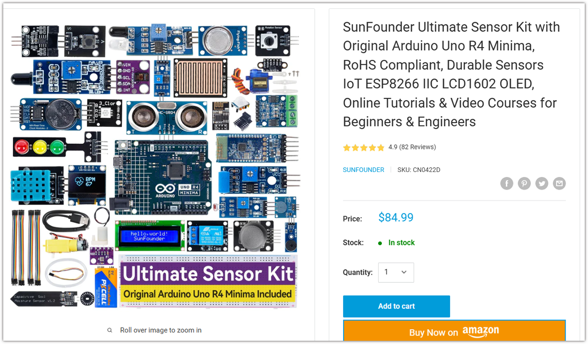
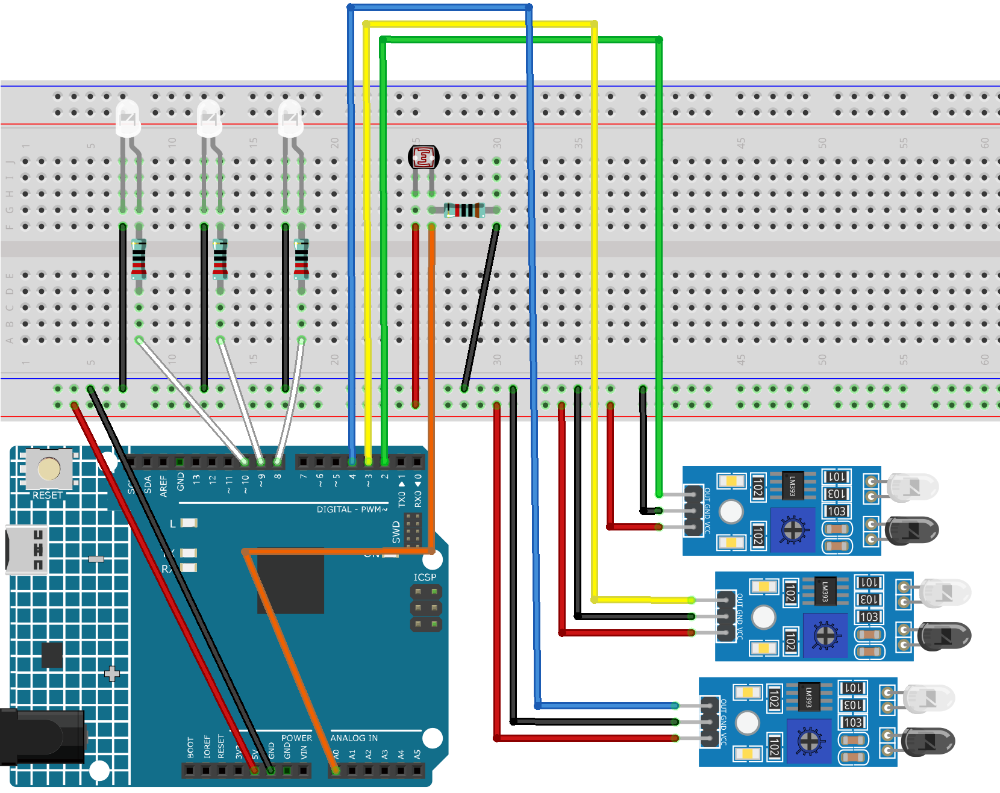

.. _smart_streetlight:

Smart Streetlight
==============================================================

.. note::
  
  🌟 Welcome to the SunFounder Facebook Community! Whether you're into Raspberry Pi, Arduino, or ESP32, you'll find inspiration, help ideas here.
   
  - ✅ Be the first to get free learning resources. 
   
  - ✅ Stay updated on new products & exclusive giveaways. 
   
  - ✅ Share your creations and get real feedback.
   
  * 👉 Need faster updates or support? Click [|link_sf_facebook|] join our Facebook community 

  * 👉 Or join our WhatsApp group: Click [|link_sf_whatsapp|]
   
Kit purchase
------------------------

Looking for parts? Check out our all-in-one kits below — packed with components, beginner-friendly guides, and tons of fun.

.. raw:: html

     

.. list-table::
   :widths: 20 20 20
   :header-rows: 1

   * - Name
     - Includes Arduino board
     - PURCHASE LINK
   * - Elite Explorer Kit
     - Arduino Uno R4 WiFi
     - |link_elite_buy|
   * - 3 in 1 Ultimate Starter Kit
     - Arduino Uno R4 Minima
     - |link_arduinor4_buy|

Course Introduction
------------------------

This Arduino project builds a smart street light system using an LDR, three IR sensors, and three LEDs with the Arduino UNO R4 WiFi.

During the day, the LEDs remain off. At night, the IR sensors detect nearby objects and automatically turn on the corresponding LEDs.

This system demonstrates how light and object detection can be combined to create an energy-efficient smart street lighting system.

.. .. raw:: html

..  <iframe width="700" height="394" src="https://www.youtube.com/embed/-hj8KFwjOeY?si=5sifg0iGkUBtQ73Z" title="YouTube video player" frameborder="0" allow="accelerometer; autoplay; clipboard-write; encrypted-media; gyroscope; picture-in-picture; web-share" referrerpolicy="strict-origin-when-cross-origin" allowfullscreen></iframe>

.. note::

  If this is your first time working with an Arduino project, we recommend downloading and reviewing the basic materials first.
  
  * :ref:`install_arduino`
  * :ref:`introduce_arduino`

**Required Components**

In this project, we need the following components:

.. list-table::
    :widths: 5 20 5 20
    :header-rows: 1

    *   - SN
        - COMPONENT INTRODUCTION	
        - QUANTITY
        - PURCHASE LINK

    *   - 1
        - Arduino UNO R4 Minima
        - 1
        - |link_unor4_buy|
    *   - 2
        - USB Type-C cable
        - 1
        - 
    *   - 3
        - Breadboard
        - 1
        - |link_breadboard_buy|
    *   - 4
        - Wires
        - Several
        - |link_wires_buy|
    *   - 5
        - LED
        - 3
        - |link_led_buy|
    *   - 6
        - Photoresistor
        - 1
        - |link_photoresistor_buy|
    *   - 7
        - IR Obstacle Avoidance Sensor Module
        - 3
        - |link_IR_module_buy|
    *   - 8
        - resistor
        - Several
        - |link_resistor_buy|

**Wiring**

**Common Connections:**

* **IR Obstacle Avoidance Sensor Module 1**

  - **OUT:** Connect to **2** on the Arduino.
  - **GND:** Connect to breadboard’s negative power bus.
  - **VCC:** Connect to breadboard’s red power bus.

* **IR Obstacle Avoidance Sensor Module 2**

  - **OUT:** Connect to **3** on the Arduino.
  - **GND:** Connect to breadboard’s negative power bus.
  - **VCC:** Connect to breadboard’s red power bus.

* **IR Obstacle Avoidance Sensor Module 3**

  - **OUT:** Connect to **4** on the Arduino.
  - **GND:** Connect to breadboard’s negative power bus.
  - **VCC:** Connect to breadboard’s red power bus.

* **LED 1**

 Connect the LED **anode** to a **220Ω resistor** then to **8** on the Arduino, and the **cathode** to  the negative power bus on the breadboard.

* **LED 2**

 Connect the LED **anode** to a **220Ω resistor** then to **9** on the Arduino, and the **cathode** to  the negative power bus on the breadboard.

* **LED 3**

 Connect the LED **anode** to a **220Ω resistor** then to **10** on the Arduino, and the **cathode** to  the negative power bus on the breadboard.

* **Photoresistor**

  -  Connect to a **10kΩ resistor** then to **A0** on the Arduino.
  -  **10kΩ resistor** to breadboard’s negative power bus.
  -  Connect to breadboard’s red power bus.

**Writing the Code**

.. note::

    * You can copy this code into **Arduino IDE**. 
    * Don't forget to select the board(Arduino UNO R4 Minima/WIFI) and the correct port before clicking the **Upload** button.

.. code-block:: arduino

      // =====================================================
      // Smart Street Light
      // Arduino UNO R4 WiFi
      // LDR + 3 IR Sensors + 3 LEDs
      // =====================================================

      // LDR voltage divider
      const int ldrPin = A0;

      // IR sensor pins
      const int ir1Pin = 2;
      const int ir2Pin = 3;
      const int ir3Pin = 4;

      // LED pins
      const int led1Pin = 8;
      const int led2Pin = 9;
      const int led3Pin = 10;

      // =====================================================
      // Light threshold
      // UNO R4 uses 14-bit ADC by default on analogRead()
      // typical range: 0 - 16383
      // Adjust this value after checking Serial Monitor
      // =====================================================
      const int DARK_THRESHOLD = 700;

      void setup() {
        Serial.begin(9600);

        pinMode(ir1Pin, INPUT);
        pinMode(ir2Pin, INPUT);
        pinMode(ir3Pin, INPUT);

        pinMode(led1Pin, OUTPUT);
        pinMode(led2Pin, OUTPUT);
        pinMode(led3Pin, OUTPUT);

        digitalWrite(led1Pin, LOW);
        digitalWrite(led2Pin, LOW);
        digitalWrite(led3Pin, LOW);
      }

      void loop() {

        // Read ambient light
        int lightValue = analogRead(ldrPin);

        Serial.print("Light Value: ");
        Serial.println(lightValue);

        // ===================================================
        // Night mode
        // ===================================================
        if (lightValue < DARK_THRESHOLD) {

          int ir1State = digitalRead(ir1Pin);
          int ir2State = digitalRead(ir2Pin);
          int ir3State = digitalRead(ir3Pin);

          // Most IR obstacle sensors output LOW
          // when an object is detected

          digitalWrite(
            led1Pin,
            ir1State == LOW ? HIGH : LOW
          );

          digitalWrite(
            led2Pin,
            ir2State == LOW ? HIGH : LOW
          );

          digitalWrite(
            led3Pin,
            ir3State == LOW ? HIGH : LOW
          );
        }

        // ===================================================
        // Day mode
        // ===================================================
        else {

          digitalWrite(led1Pin, LOW);
          digitalWrite(led2Pin, LOW);
          digitalWrite(led3Pin, LOW);
        }

        delay(50);
      }