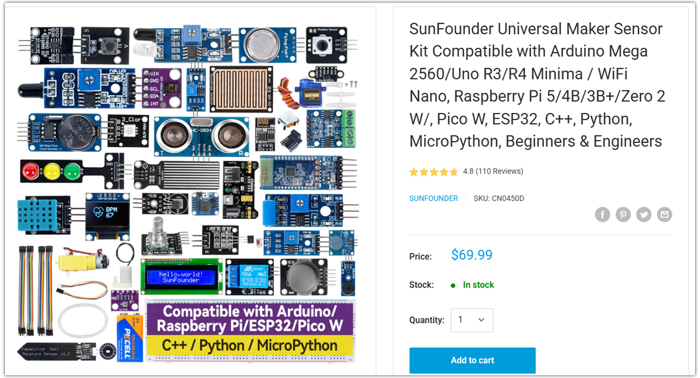
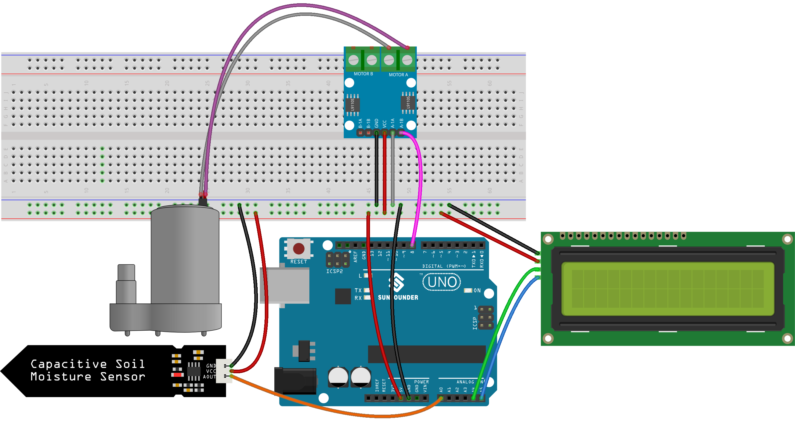

.. _soil_water:

Soil Watering
==============================================================

.. note::
  
  🌟 Welcome to the SunFounder Facebook Community! Whether you're into Raspberry Pi, Arduino, or ESP32, you'll find inspiration, help ideas here.
   
  - ✅ Be the first to get free learning resources. 
   
  - ✅ Stay updated on new products & exclusive giveaways. 

  - ✅ Share your creations and get real feedback.

  * 👉 Need faster updates or support? Click [|link_sf_facebook|] join our Facebook community 

  * 👉 Or join our WhatsApp group: Click [|link_sf_whatsapp|]

Kit purchase
------------------------

Looking for parts? Check out our all-in-one kits below — packed with components, beginner-friendly guides, and tons of fun.

.. raw:: html

     

.. list-table::
   :widths: 20 20 20
   :header-rows: 1

   * - Name
     - Includes Arduino board
     - PURCHASE LINK
   * - Elite Explorer Kit
     - Arduino Uno R4 WiFi
     - |link_elite_buy|
   * - 3 in 1 Ultimate Starter Kit
     - Arduino Uno R4 Minima
     - |link_arduinor4_buy|

Course Introduction
------------------------

In this lesson, you'll use a soil moisture sensor, a water pump with a motor driver, an I2C LCD1602 display, and Arduino UNO R4 to create an automatic plant watering system.

The sensor continuously monitors soil moisture, while the LCD displays the readings and pump status. When the soil is dry, the pump automatically turns on and stops when the soil is wet enough.

.. .. raw:: html
 
..  <iframe width="700" height="394" src="https://www.youtube.com/embed/YXSaHYLfrIU" title="YouTube video player" frameborder="0" allow="accelerometer; autoplay; clipboard-write; encrypted-media; gyroscope; picture-in-picture; web-share" referrerpolicy="strict-origin-when-cross-origin" allowfullscreen></iframe>

.. note::

  If this is your first time working with an Arduino project, we recommend downloading and reviewing the basic materials first.
  
  * :ref:`install_arduino`
  * :ref:`introduce_arduino`

**Required Components**

In this project, we need the following components:

.. list-table::
    :widths: 5 20 5 20
    :header-rows: 1

    *   - SN
        - COMPONENT INTRODUCTION	
        - QUANTITY
        - PURCHASE LINK

    *   - 1
        - Arduino UNO R4 WIFI
        - 1
        - |link_unor4_wifi_buy|
    *   - 2
        - USB Type-C cable
        - 1
        - 
    *   - 3
        - Breadboard
        - 1
        - |link_breadboard_buy|
    *   - 4
        - Wires
        - Several
        - |link_wires_buy|
    *   - 5
        - Power Supply
        - 1
        - |link_power_buy|
    *   - 6
        - I2C LCD 1602
        - 1
        - |link_i2clcd1602_buy|
    *   - 7
        - L9110 Motor Driver Module
        - 1
        - 
    *   - 8
        - Centrifugal Pump
        - 1
        - 
    *   - 9
        - Capacitive Soil Moisture Sensor Module
        - 1
        - |link_soil_buy|

**Wiring**

**Common Connections:**

* **Capacitive Soil Moisture Sensor Module**

  - **GND:** Connect to breadboard’s positive power bus.
  - **VCC:** Connect to breadboard’s negative power bus.
  - **AOUT:** Connect to **A0** on the Arduino.

* **L9110 Motor Driver Module**

  - **GND:** Connect to breadboard’s negative power bus.
  - **VCC:** Connect to breadboard’s red power bus.
  - **A-1A:** Connect to breadboard’s negative power bus.
  - **A-1B:** Connect to **8** on the Arduino.

* **Centrifugal Pump**

  -  Connect to **L9110 Motor Driver Module** MOTOR A.
  -  Connect to **L9110 Motor Driver Module** MOTOR A.

* **I2C LCD 1602**

  - **SDA:** Connect to **A4** on the Arduino.
  - **SCL:** Connect to **A5** on the Arduino.
  - **GND:** Connect to breadboard’s negative power bus.
  - **VCC:** Connect to breadboard’s red power bus.

**Writing the Code**

.. note::

    * You can copy this code into **Arduino IDE**. 
    * To install the library, use the Arduino Library Manager and search for **LiquidCrystal I2C** and install it.
    * Don't forget to select the board(Arduino UNO R4 Minima/WIFI) and the correct port before clicking the **Upload** button.

.. code-block:: arduino

      /*
        Automatic Plant Watering System

        Board: Arduino UNO R4
        Components:
        - Capacitive Soil Moisture Sensor
        - DC Water Pump with Motor Driver
        - I2C LCD1602 Display

        Dry soil: Pump ON
        Wet soil: Pump OFF
      */

      #include <Wire.h>
      #include <LiquidCrystal_I2C.h>

      // Define pins
      #define SOIL_MOISTURE_PIN A0
      #define WATER_PUMP_PIN 8

      // LCD settings
      LiquidCrystal_I2C lcd(0x27, 16, 2);

      // Moisture thresholds
      // Higher reading means drier soil
      const int DRY_THRESHOLD = 450;
      const int WET_THRESHOLD = 400;

      // Pump state
      bool pumpOn = false;

      // Read interval
      const unsigned long READ_INTERVAL = 500;
      unsigned long lastReadTime = 0;

      void setup() {
        Serial.begin(9600);

        // Initialize pins
        pinMode(SOIL_MOISTURE_PIN, INPUT);
        pinMode(WATER_PUMP_PIN, OUTPUT);

        // Keep the pump off at startup
        digitalWrite(WATER_PUMP_PIN, LOW);

        // Initialize LCD
        lcd.init();
        lcd.backlight();

        lcd.setCursor(0, 0);
        lcd.print("Auto Watering");
        lcd.setCursor(0, 1);
        lcd.print("System Ready");

        delay(1500);
        lcd.clear();

        Serial.println("Automatic Watering System Ready!");
      }

      void loop() {
        unsigned long now = millis();

        // Check soil moisture every 500 ms
        if (now - lastReadTime >= READ_INTERVAL) {
          lastReadTime = now;

          // Read soil moisture
          int soilMoisture = analogRead(SOIL_MOISTURE_PIN);

          // Turn on pump when soil is dry
          if (!pumpOn && soilMoisture > DRY_THRESHOLD) {
            pumpOn = true;
            digitalWrite(WATER_PUMP_PIN, HIGH);
          }

          // Turn off pump when soil is wet enough
          if (pumpOn && soilMoisture < WET_THRESHOLD) {
            pumpOn = false;
            digitalWrite(WATER_PUMP_PIN, LOW);
          }

          // Display soil moisture on LCD
          lcd.setCursor(0, 0);
          lcd.print("Soil: ");
          lcd.print(soilMoisture);
          lcd.print("     ");

          // Display pump status
          lcd.setCursor(0, 1);
          lcd.print("Pump: ");

          if (pumpOn) {
            lcd.print("ON ");
          } else {
            lcd.print("OFF");
          }

          lcd.print("        ");

          // Serial Monitor
          Serial.print("Soil Moisture: ");
          Serial.print(soilMoisture);

          Serial.print(" | Pump: ");

          if (pumpOn) {
            Serial.println("ON");
          } else {
            Serial.println("OFF");
          }
        }
      }
