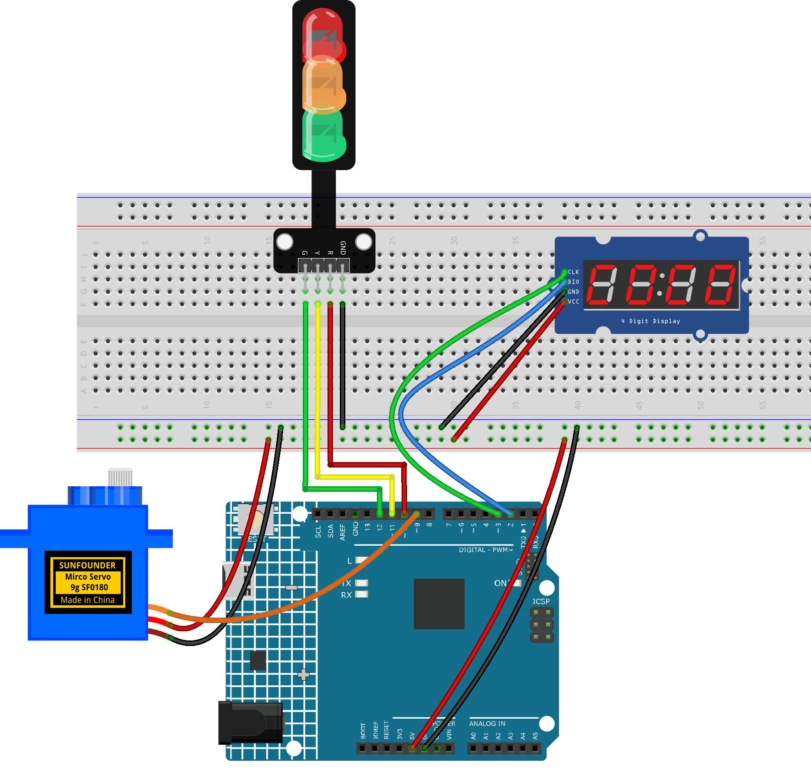

.. _traffic_light3.0:

Traffic light 3.0
==============================================================

.. note::
  
  🌟 Welcome to the SunFounder Facebook Community! Whether you're into Raspberry Pi, Arduino, or ESP32, you'll find inspiration, help ideas here.
   
  - ✅ Be the first to get free learning resources. 
   
  - ✅ Stay updated on new products & exclusive giveaways. 
   
  - ✅ Share your creations and get real feedback.
   
  * 👉 Need faster updates or support? Click [|link_sf_facebook|] join our Facebook community 

  * 👉 Or join our WhatsApp group: Click [|link_sf_whatsapp|]
   
Kit purchase
------------------------

Looking for parts? Check out our all-in-one kits below — packed with components, beginner-friendly guides, and tons of fun.

.. image:: img/ultimate_sensor_kit.png
   :width: 100%
   :align: center
   :target: https://www.sunfounder.com/collections/arduino-kits-bundles/products/sunfounder-ultimate-sensor-kit-with-original-arduino-uno-r4-minima?ref=jbzmncle

.. raw:: html

     

.. list-table::
   :widths: 20 20 20
   :header-rows: 1

   * - Name
     - Includes Arduino board
     - PURCHASE LINK
   * - Elite Explorer Kit
     - Arduino Uno R4 WiFi
     - |link_elite_buy|
   * - 3 in 1 Ultimate Starter Kit
     - Arduino Uno R4 Minima
     - |link_arduinor4_buy|

Course Introduction
------------------------

In this lesson, you’ll learn how to build a traffic light system with a safety barrier using the Arduino UNO R4 WiFi, a TM1637 4-digit display, a traffic light module, and a servo motor.

The display counts down the red and green light phases, while the servo automatically lowers the barrier during the red light and raises it during the green light.

.. .. raw:: html

..  <iframe width="700" height="394" src="https://www.youtube.com/embed/U99URknlMXM?si=u0b4J97iM9mtTUK5" title="YouTube video player" frameborder="0" allow="accelerometer; autoplay; clipboard-write; encrypted-media; gyroscope; picture-in-picture; web-share" referrerpolicy="strict-origin-when-cross-origin" allowfullscreen></iframe>

.. note::

  If this is your first time working with an Arduino project, we recommend downloading and reviewing the basic materials first.
  
  * :ref:`install_arduino`
  * :ref:`introduce_arduino`

**Required Components**

In this project, we need the following components:

.. list-table::
    :widths: 5 20 5 20
    :header-rows: 1

    *   - SN
        - COMPONENT INTRODUCTION	
        - QUANTITY
        - PURCHASE LINK

    *   - 1
        - Arduino UNO R4 Minima/Arduino UNO R4 WIFI
        - 1
        - |link_arduinor4_buy|
    *   - 2
        - USB Type-C cable
        - 1
        - 
    *   - 3
        - Breadboard
        - 1
        - |link_breadboard_buy|
    *   - 4
        - Wires
        - Several
        - |link_wires_buy|
    *   - 5
        - 4-Digit Segment Display Module
        - 1
        - |link_4segment_buy|
    *   - 6
        - Traffic Light LED
        - 1
        - |link_trafficlinght_buy|
    *   - 7
        - Digital Servo Motor
        - 1
        - |link_motor_buy|

**Wiring**

**Common Connections:**

* **Traffic light LED**

  - **R:** Connect to **10** on the Arduino.
  - **Y:** Connect to **11** on the Arduino.
  - **G:** Connect to **12** on the Arduino.
  - **GND:** Connect to breadboard’s negative power bus.

* **4-Digit Segment Display Module**

  - **CLK:** Connect to **3** on the Arduino.
  - **DIO:** Connect to **2** on the Arduino.
  - **GND:** Connect to breadboard’s negative power bus.
  - **VCC:** Connect to breadboard’s red power bus.

* **Digital Servo Motor**

  - Connect to breadboard’s positive power bus.
  - Connect to breadboard’s negative power bus.
  - Connect to **9** on the Arduino.

**Writing the Code**

.. note::

    * You can copy this code into **Arduino IDE**. 
    * To install the library, use the Arduino Library Manager and search for **TM1637Display** and install it.
    * Don't forget to select the board(Arduino UNO R4 Minima/WIFI) and the correct port before clicking the **Upload** button.

.. code-block:: arduino

      #include <TM1637Display.h>
      #include <Servo.h>

      // TM1637 pin definitions
      #define CLK 3
      #define DIO 2

      // Traffic light pins
      const int redPin = 10;
      const int greenPin = 12;

      // Servo pin
      const int servoPin = 9;

      // Create display object
      TM1637Display display(CLK, DIO);

      // Create servo object
      Servo barrierServo;

      void setup() {
        // Setup traffic light pins
        pinMode(redPin, OUTPUT);
        pinMode(greenPin, OUTPUT);

        // Initialize display
        display.setBrightness(7);

        // Initialize servo
        barrierServo.attach(servoPin);

        // Initial position: barrier raised
        barrierServo.write(0);

        delay(500);
      }

      void loop() {

        // =========================
        // Red light phase - 10s
        // =========================
        digitalWrite(redPin, HIGH);
        digitalWrite(greenPin, LOW);

        // Lower the barrier
        barrierServo.write(90);

        countdown(10);

        // =========================
        // Green light phase - 10s
        // =========================
        digitalWrite(redPin, LOW);
        digitalWrite(greenPin, HIGH);

        // Raise the barrier
        barrierServo.write(0);

        countdown(10);
      }

      // Countdown function
      void countdown(int seconds) {
        for (int i = seconds; i > 0; i--) {
          display.showNumberDec(i, true, 2, 2);
          delay(1000);
        }

        display.clear();
      }