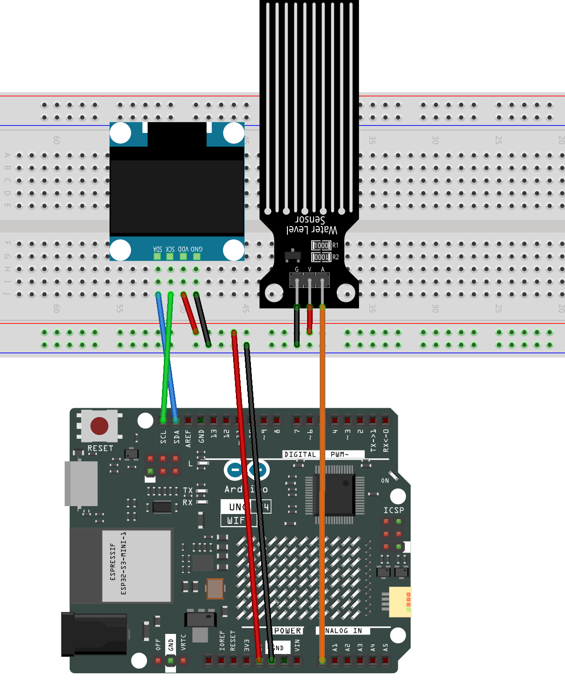

.. _water_level3.0:

Water Level 3.0
==============================================================

.. note::
  
  🌟 Welcome to the SunFounder Facebook Community! Whether you're into Raspberry Pi, Arduino, or ESP32, you'll find inspiration, help ideas here.
   
  - ✅ Be the first to get free learning resources. 
   
  - ✅ Stay updated on new products & exclusive giveaways. 
   
  - ✅ Share your creations and get real feedback.
   
  * 👉 Need faster updates or support? Click [|link_sf_facebook|] join our Facebook community 

  * 👉 Or join our WhatsApp group: Click [|link_sf_whatsapp|]
   
Kit purchase
------------------------

Looking for parts? Check out our all-in-one kits below — packed with components, beginner-friendly guides, and tons of fun.

.. image:: img/ultimate_sensor_kit.png
   :width: 100%
   :align: center
   :target: https://www.sunfounder.com/collections/arduino-kits-bundles/products/sunfounder-ultimate-sensor-kit-with-original-arduino-uno-r4-minima?ref=jbzmncle

.. raw:: html

     

.. list-table::
   :widths: 20 20 20
   :header-rows: 1

   * - Name
     - Includes Arduino board
     - PURCHASE LINK
   * - Elite Explorer Kit
     - Arduino Uno R4 WiFi
     - |link_elite_buy|
   * - 3 in 1 Ultimate Starter Kit
     - Arduino Uno R4 Minima
     - |link_arduinor4_buy|

Course Introduction
------------------------

In this lesson, you’ll learn how to build a water level monitor using an analog water level sensor and an SSD1306 OLED display with the Arduino UNO R4 WiFi.

As the water level changes, the OLED displays the real-time percentage, water level status, and an animated water tank to visualize the current level.

.. .. raw:: html

..  <iframe width="700" height="394" src="https://www.youtube.com/embed/0pQWDoPfSMM?si=UtsKJM_CrX4w-HsD" title="YouTube video player" frameborder="0" allow="accelerometer; autoplay; clipboard-write; encrypted-media; gyroscope; picture-in-picture; web-share" referrerpolicy="strict-origin-when-cross-origin" allowfullscreen></iframe>

.. note::

  If this is your first time working with an Arduino project, we recommend downloading and reviewing the basic materials first.
  
  * :ref:`install_arduino`
  * :ref:`introduce_arduino`

**Required Components**

In this project, we need the following components:

.. list-table::
    :widths: 5 20 5 20
    :header-rows: 1

    *   - SN
        - COMPONENT INTRODUCTION	
        - QUANTITY
        - PURCHASE LINK

    *   - 1
        - Arduino UNO R4 Minima/Arduino UNO R4 wifi
        - 1
        - |link_unor4_wifi_buy|
    *   - 2
        - USB Cable
        - 1
        - 
    *   - 3
        - Breadboard
        - 1
        - |link_breadboard_buy|
    *   - 4
        - Wires
        - Several
        - |link_wires_buy|
    *   - 5
        - Water Level Detection Module
        - 1
        - 
    *   - 6
        - OLED Display Module
        - 1
        - |link_oled_buy|

**Wiring**

**Common Connections:**

* **Water Level Detection Module**

  - **A:** Connect to **A0** on the Arduino.
  - **G:** Connect to breadboard’s negative power bus.
  - **V:** Connect to breadboard’s red power bus.

* **OLED Display Module**

  - **SDA:** Connect to **SDA** on the Arduino.
  - **SCK:** Connect to **SCL** on the Arduino.
  - **GND:** Connect to breadboard’s negative power bus.
  - **VCC:** Connect to breadboard’s red power bus.

**Writing the Code**

.. note::

    * You can copy this code into **Arduino IDE**. 
    * Don't forget to select the board(Arduino UNO R4 Minima/WIFI) and the correct port before clicking the **Upload** button.

.. code-block:: arduino

      #include <Wire.h>
      #include <Adafruit_GFX.h>
      #include <Adafruit_SSD1306.h>

      // =====================================================
      // OLED settings
      // =====================================================
      #define SCREEN_WIDTH 128
      #define SCREEN_HEIGHT 64
      #define OLED_RESET -1
      #define OLED_ADDRESS 0x3C

      Adafruit_SSD1306 display(
        SCREEN_WIDTH,
        SCREEN_HEIGHT,
        &Wire,
        OLED_RESET
      );

      // =====================================================
      // Water level sensor
      // =====================================================
      #define WATER_SENSOR_PIN A0

      // UNO R4 WiFi uses 12-bit ADC in this project
      // Range: 0 - 4095

      // Adjust these two values after calibration
      const int EMPTY_VALUE = 500;
      const int FULL_VALUE  = 2000;

      // Smoothed water level
      float filteredValue = 0;

      // Animation variable
      int waveOffset = 0;

      // =====================================================
      // Setup
      // =====================================================
      void setup() {

        Serial.begin(9600);

        // UNO R4 WiFi ADC resolution
        analogReadResolution(12);

        // Start I2C
        Wire.begin();

        // Initialize OLED
        if (!display.begin(
              SSD1306_SWITCHCAPVCC,
              OLED_ADDRESS
            )) {

          Serial.println("OLED not found!");

          while (true);
        }

        display.clearDisplay();

        display.setTextColor(SSD1306_WHITE);

        display.setTextSize(1);

        display.setCursor(24, 25);
        display.println("WATER MONITOR");

        display.display();

        delay(1500);

        // Initial sensor reading
        filteredValue =
          analogRead(WATER_SENSOR_PIN);
      }

      // =====================================================
      // Main loop
      // =====================================================
      void loop() {

        // Read water sensor
        int rawValue =
          analogRead(WATER_SENSOR_PIN);

        // Smooth the sensor reading
        filteredValue =
          filteredValue * 0.85 +
          rawValue * 0.15;

        // Convert sensor value to percentage
        int waterPercent =
          map(
            (int)filteredValue,
            EMPTY_VALUE,
            FULL_VALUE,
            0,
            100
          );

        // Limit percentage
        waterPercent =
          constrain(
            waterPercent,
            0,
            100
          );

        // Serial monitor
        Serial.print("Raw: ");
        Serial.print(rawValue);

        Serial.print("   Water Level: ");
        Serial.print(waterPercent);
        Serial.println("%");

        // Draw OLED interface
        drawWaterMonitor(
          waterPercent,
          rawValue
        );

        // Move wave
        waveOffset++;

        if (waveOffset > 5) {
          waveOffset = 0;
        }

        delay(100);
      }

      // =====================================================
      // Draw water monitor screen
      // =====================================================
      void drawWaterMonitor(
        int percent,
        int rawValue
      ) {

        display.clearDisplay();

        // ===================================================
        // Title
        // ===================================================
        display.setTextSize(1);
        display.setTextColor(SSD1306_WHITE);

        display.setCursor(29, 0);
        display.print("WATER LEVEL");

        // Divider
        display.drawLine(
          0,
          10,
          127,
          10,
          SSD1306_WHITE
        );

        // ===================================================
        // Water tank
        // ===================================================

        const int tankX = 8;
        const int tankY = 15;

        const int tankWidth = 64;
        const int tankHeight = 40;

        // Tank outline
        display.drawRoundRect(
          tankX,
          tankY,
          tankWidth,
          tankHeight,
          4,
          SSD1306_WHITE
        );

        // Inner tank dimensions
        int innerX = tankX + 3;
        int innerY = tankY + 3;

        int innerWidth =
          tankWidth - 6;

        int innerHeight =
          tankHeight - 6;

        // Calculate water height
        int waterHeight =
          map(
            percent,
            0,
            100,
            0,
            innerHeight
          );

        // Y position of water surface
        int waterY =
          innerY +
          innerHeight -
          waterHeight;

        // ===================================================
        // Draw water
        // ===================================================

        if (waterHeight > 0) {

          // Fill water body
          display.fillRect(
            innerX,
            waterY + 2,
            innerWidth,
            waterHeight - 2,
            SSD1306_WHITE
          );

          // -------------------------------------------------
          // Animated wave surface
          // -------------------------------------------------
          for (
            int x = innerX;
            x < innerX + innerWidth;
            x++
          ) {

            int pattern =
              (x + waveOffset) % 6;

            int waveY = waterY;

            if (
              pattern == 1 ||
              pattern == 2
            ) {
              waveY--;
            }

            if (
              pattern == 4 ||
              pattern == 5
            ) {
              waveY++;
            }

            // Keep wave inside tank
            if (
              waveY >= innerY &&
              waveY <
                innerY + innerHeight
            ) {

              display.drawPixel(
                x,
                waveY,
                SSD1306_WHITE
              );
            }
          }
        }

        // ===================================================
        // Percentage
        // ===================================================
        display.setTextSize(2);

        display.setCursor(80, 17);

        if (percent < 10) {
          display.print(" ");
        }

        display.print(percent);
        display.print("%");

        // ===================================================
        // Status
        // ===================================================
        display.setTextSize(1);

        display.setCursor(82, 39);

        if (percent < 25) {

          display.print("LOW");

        } else if (percent < 80) {

          display.print("SAFE");

        } else {

          display.print("HIGH");
        }

        // ===================================================
        // Small level label
        // ===================================================
        display.setCursor(80, 51);
        display.print("LEVEL");

        display.display();
      }