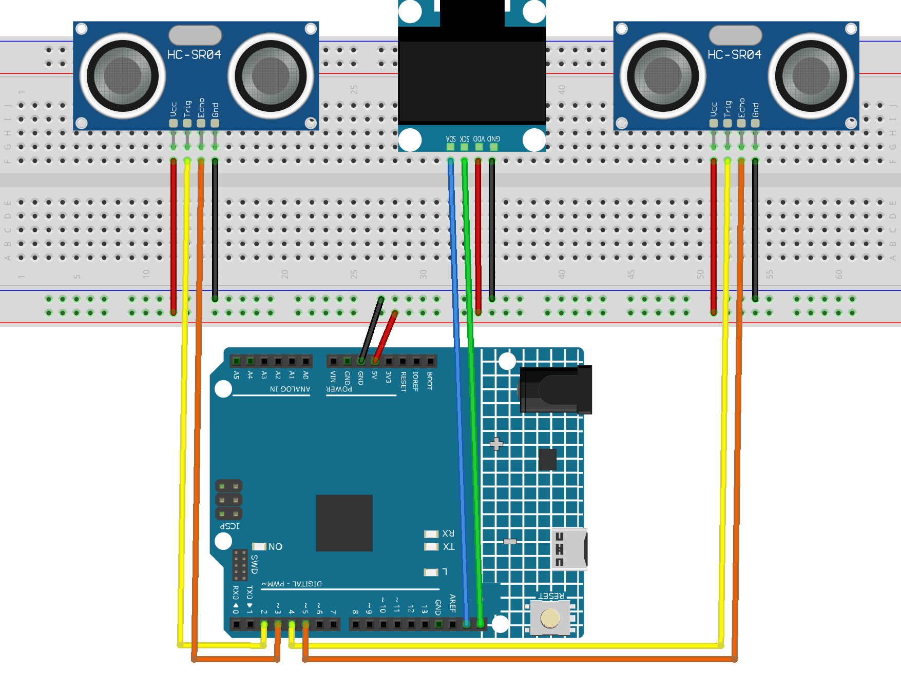

.. _width_scan_1.0:

Width Scan 1.0
==============================================================

.. note::
  
  🌟 Welcome to the SunFounder Facebook Community! Whether you're into Raspberry Pi, Arduino, or ESP32, you'll find inspiration, help ideas here.
   
  - ✅ Be the first to get free learning resources. 
   
  - ✅ Stay updated on new products & exclusive giveaways. 
   
  - ✅ Share your creations and get real feedback.
   
  * 👉 Need faster updates or support? Click [|link_sf_facebook|] join our Facebook community 

  * 👉 Or join our WhatsApp group: Click [|link_sf_whatsapp|]
   
Kit purchase
------------------------

Looking for parts? Check out our all-in-one kits below — packed with components, beginner-friendly guides, and tons of fun.

.. image:: img/elite_explore_kit.png
   :width: 100%
   :align: center
   :target: https://www.sunfounder.com/collections/arduino-kits-bundles/products/sunfounder-elite-explorer-kit-with-official-arduino-uno-r4-wifi?ref=jbzmncle

.. raw:: html

     

.. list-table::
   :widths: 20 20 20
   :header-rows: 1

   * - Name
     - Includes Arduino board
     - PURCHASE LINK
   * - Elite Explorer Kit
     - Arduino Uno R4 WiFi
     - |link_elite_buy|
   * - 3 in 1 Ultimate Starter Kit
     - Arduino Uno R4 Minima
     - |link_arduinor4_buy|

Course Introduction
------------------------

This Arduino project builds a basic object width measurement system using two Ultrasonic Sensor Modules and an OLED display.

The two sensors measure the distance from each side of an object to calculate its width. The OLED shows the scanning process and displays the measured width in real time.

.. .. raw:: html
 
..  <iframe width="700" height="394" src="https://www.youtube.com/embed/DjaRAb95ZrM?si=-6J8eeDYRfVzx9Xk" title="YouTube video player" frameborder="0" allow="accelerometer; autoplay; clipboard-write; encrypted-media; gyroscope; picture-in-picture; web-share" referrerpolicy="strict-origin-when-cross-origin" allowfullscreen></iframe>

.. note::

  If this is your first time working with an Arduino project, we recommend downloading and reviewing the basic materials first.
  
  * :ref:`install_arduino`
  * :ref:`introduce_arduino`

**Required Components**

In this project, we need the following components:

.. list-table::
    :widths: 5 20 5 20
    :header-rows: 1

    *   - SN
        - COMPONENT INTRODUCTION	
        - QUANTITY
        - PURCHASE LINK

    *   - 1
        - Arduino UNO R4 WIFI
        - 1
        - |link_unor4_wifi_buy|
    *   - 2
        - USB Type-C cable
        - 1
        - 
    *   - 3
        - Breadboard
        - 1
        - |link_breadboard_buy|
    *   - 4
        - Wires
        - Several
        - |link_wires_buy|
    *   - 5
        - OLED Display Module
        - 1
        - |link_oled_buy|
    *   - 6
        - Ultrasonic Sensor Module
        - 2
        - |link_ultrasonic_buy|

**Wiring**

**Common Connections:**

* **Ultrasonic Sensor Module Left**

  - **Trig:** Connect to **2** on the Arduino.
  - **Echo:** Connect to **3** on the Arduino.
  - **GND:** Connect to breadboard’s negative power bus.
  - **VCC:** Connect to breadboard’s red power bus.

* **Ultrasonic Sensor Module Right**

  - **Trig:** Connect to **4** on the Arduino.
  - **Echo:** Connect to **5** on the Arduino.
  - **GND:** Connect to breadboard’s negative power bus.
  - **VCC:** Connect to breadboard’s red power bus.

* **OLED Display Module**

  - **SDA:** Connect to **SDA** on the Arduino.
  - **SCK:** Connect to **SCL** on the Arduino.
  - **GND:** Connect to breadboard’s negative power bus.
  - **VCC:** Connect to breadboard’s red power bus.

**Writing the Code**

.. note::

    * You can copy this code into **Arduino IDE**. 
    * To install the library, use the Arduino Library Manager and search for **Adafruit_GFX.h** and **Adafruit_SSD1306.h** and install it.
    * Don't forget to select the board(Arduino UNO R4 Minima/WIFI) and the correct port before clicking the **Upload** button.

.. code-block:: arduino

      #include <Wire.h>
      #include <Adafruit_GFX.h>
      #include <Adafruit_SSD1306.h>

      // =====================================================
      // OLED
      // =====================================================
      #define SCREEN_WIDTH 128
      #define SCREEN_HEIGHT 64
      #define OLED_RESET -1
      #define OLED_ADDRESS 0x3C

      Adafruit_SSD1306 display(
        SCREEN_WIDTH,
        SCREEN_HEIGHT,
        &Wire,
        OLED_RESET
      );

      // =====================================================
      // Ultrasonic sensors
      // =====================================================
      #define LEFT_TRIG  2
      #define LEFT_ECHO  3

      #define RIGHT_TRIG 4
      #define RIGHT_ECHO 5

      // =====================================================
      // Calibration
      // =====================================================

      // Distance between the front faces of two HC-SR04 sensors
      const float SENSOR_GAP_CM = 10.0;

      // Minimum width to recognize an object
      const float MIN_OBJECT_WIDTH = 0.5;

      // Maximum valid single-side distance
      const float MAX_SIDE_DISTANCE = 10.0;

      // =====================================================
      // System state
      // =====================================================
      enum ScanState {
        READY,
        SCANNING,
        RESULT
      };

      ScanState state = READY;

      float objectWidth = 0;
      float leftDistance = 0;
      float rightDistance = 0;

      unsigned long resultTimer = 0;
      unsigned long animationTimer = 0;

      int readyAnimation = 0;

      bool objectWasPresent = false;

      // =====================================================
      // Setup
      // =====================================================
      void setup() {

        Serial.begin(9600);

        pinMode(LEFT_TRIG, OUTPUT);
        pinMode(LEFT_ECHO, INPUT);

        pinMode(RIGHT_TRIG, OUTPUT);
        pinMode(RIGHT_ECHO, INPUT);

        digitalWrite(LEFT_TRIG, LOW);
        digitalWrite(RIGHT_TRIG, LOW);

        // Start I2C on Arduino UNO R4 WiFi
        Wire.begin();

        // Initialize OLED
        if (!display.begin(
              SSD1306_SWITCHCAPVCC,
              OLED_ADDRESS
            )) {

          Serial.println("OLED not found!");

          while (true);
        }

        display.clearDisplay();
        display.setTextColor(SSD1306_WHITE);

        showStartup();

        delay(1500);

        drawReadyScreen();
      }

      // =====================================================
      // Main loop
      // =====================================================
      void loop() {

        switch (state) {

          case READY:
            readyMode();
            break;

          case SCANNING:
            scanObject();
            break;

          case RESULT:
            resultMode();
            break;
        }
      }

      // =====================================================
      // Ready mode
      // =====================================================
      void readyMode() {

        // Ready animation
        if (millis() - animationTimer >= 250) {

          animationTimer = millis();

          readyAnimation++;

          if (readyAnimation > 3) {
            readyAnimation = 0;
          }

          drawReadyScreen();
        }

        // Read left sensor
        float left = readDistance(
          LEFT_TRIG,
          LEFT_ECHO
        );

        delay(35);

        // Read right sensor
        float right = readDistance(
          RIGHT_TRIG,
          RIGHT_ECHO
        );

        // Calculate estimated width
        float width =
          SENSOR_GAP_CM -
          left -
          right;

        bool objectDetected =
          left > 0 &&
          right > 0 &&
          left < MAX_SIDE_DISTANCE &&
          right < MAX_SIDE_DISTANCE &&
          width > MIN_OBJECT_WIDTH &&
          width < SENSOR_GAP_CM;

        // Detect a newly inserted object
        if (
          objectDetected &&
          !objectWasPresent
        ) {

          objectWasPresent = true;

          delay(200);

          state = SCANNING;
        }

        if (!objectDetected) {
          objectWasPresent = false;
        }
      }

      // =====================================================
      // Scan object
      // =====================================================
      void scanObject() {

        const int SAMPLE_COUNT = 12;

        float leftTotal = 0;
        float rightTotal = 0;

        int validSamples = 0;

        for (
          int i = 0;
          i < SAMPLE_COUNT;
          i++
        ) {

          // Scanning animation
          drawScanningScreen(
            i,
            SAMPLE_COUNT
          );

          // Left sensor
          float left = readDistance(
            LEFT_TRIG,
            LEFT_ECHO
          );

          // Prevent ultrasonic interference
          delay(40);

          // Right sensor
          float right = readDistance(
            RIGHT_TRIG,
            RIGHT_ECHO
          );

          if (
            left > 0 &&
            right > 0 &&
            left < SENSOR_GAP_CM &&
            right < SENSOR_GAP_CM
          ) {

            leftTotal += left;
            rightTotal += right;

            validSamples++;
          }

          delay(70);
        }

        // ===================================================
        // Valid measurement
        // ===================================================
        if (validSamples >= 5) {

          leftDistance =
            leftTotal / validSamples;

          rightDistance =
            rightTotal / validSamples;

          objectWidth =
            SENSOR_GAP_CM -
            leftDistance -
            rightDistance;

          // Prevent invalid values
          objectWidth =
            constrain(
              objectWidth,
              0.0,
              SENSOR_GAP_CM
            );

          Serial.println("-------------------");

          Serial.print("Left: ");
          Serial.print(leftDistance, 1);
          Serial.println(" cm");

          Serial.print("Right: ");
          Serial.print(rightDistance, 1);
          Serial.println(" cm");

          Serial.print("Width: ");
          Serial.print(objectWidth, 1);
          Serial.println(" cm");

          drawResultScreen();
        }

        else {

          drawErrorScreen();
        }

        resultTimer = millis();

        state = RESULT;
      }

      // =====================================================
      // Result mode
      // =====================================================
      void resultMode() {

        // Keep result on screen for at least 4 seconds
        if (
          millis() - resultTimer >=
          4000
        ) {

          float left = readDistance(
            LEFT_TRIG,
            LEFT_ECHO
          );

          delay(40);

          float right = readDistance(
            RIGHT_TRIG,
            RIGHT_ECHO
          );

          float width =
            SENSOR_GAP_CM -
            left -
            right;

          // Return to READY after object is removed
          if (
            left <= 0 ||
            right <= 0 ||
            width < MIN_OBJECT_WIDTH
          ) {

            objectWasPresent = false;

            state = READY;

            drawReadyScreen();
          }
        }
      }

      // =====================================================
      // HC-SR04 distance measurement
      // =====================================================
      float readDistance(
        int trigPin,
        int echoPin
      ) {

        digitalWrite(trigPin, LOW);
        delayMicroseconds(3);

        digitalWrite(trigPin, HIGH);
        delayMicroseconds(10);

        digitalWrite(trigPin, LOW);

        unsigned long duration =
          pulseIn(
            echoPin,
            HIGH,
            25000
          );

        if (duration == 0) {
          return -1;
        }

        float distance =
          duration * 0.0343 / 2.0;

        return distance;
      }

      // =====================================================
      // Startup screen
      // =====================================================
      void showStartup() {

        display.clearDisplay();

        display.setTextSize(1);

        display.setCursor(28, 10);
        display.println("OBJECT WIDTH");

        display.setCursor(40, 23);
        display.println("SCANNER");

        // Scanner frame
        display.drawRoundRect(
          14,
          40,
          100,
          10,
          3,
          SSD1306_WHITE
        );

        display.fillRect(
          18,
          43,
          60,
          4,
          SSD1306_WHITE
        );

        display.display();
      }

      // =====================================================
      // Ready screen
      // =====================================================
      void drawReadyScreen() {

        display.clearDisplay();

        display.setTextSize(1);

        display.setCursor(27, 3);
        display.println("WIDTH SCANNER");

        display.drawLine(
          8,
          13,
          120,
          13,
          SSD1306_WHITE
        );

        // Center sensor/radar icon
        display.drawCircle(
          64,
          31,
          3,
          SSD1306_WHITE
        );

        display.fillCircle(
          64,
          31,
          1,
          SSD1306_WHITE
        );

        // Animated scanning waves
        if (readyAnimation >= 1) {

          display.drawCircle(
            64,
            31,
            7,
            SSD1306_WHITE
          );
        }

        if (readyAnimation >= 2) {

          display.drawCircle(
            64,
            31,
            11,
            SSD1306_WHITE
          );
        }

        if (readyAnimation >= 3) {

          display.drawCircle(
            64,
            31,
            15,
            SSD1306_WHITE
          );
        }

        // Cover top half to create radar-wave effect
        display.fillRect(
          45,
          15,
          38,
          16,
          SSD1306_BLACK
        );

        display.setCursor(27, 53);
        display.println("READY TO SCAN");

        display.display();
      }

      // =====================================================
      // Scanning screen
      // =====================================================
      void drawScanningScreen(
        int step,
        int total
      ) {

        display.clearDisplay();

        display.setTextSize(1);

        display.setCursor(21, 3);
        display.println("SCANNING OBJECT");

        // Scanner frame
        display.drawRoundRect(
          7,
          16,
          114,
          30,
          5,
          SSD1306_WHITE
        );

        int progress =
          map(
            step + 1,
            0,
            total,
            0,
            100
          );

        int barWidth =
          map(
            progress,
            0,
            100,
            0,
            104
          );

        // Scanning vertical lines
        for (
          int x = 12;
          x < 12 + barWidth;
          x += 4
        ) {

          display.drawLine(
            x,
            20,
            x,
            41,
            SSD1306_WHITE
          );
        }

        // Moving scan line
        int scannerX =
          12 + barWidth;

        scannerX =
          constrain(
            scannerX,
            12,
            115
          );

        display.drawLine(
          scannerX,
          18,
          scannerX,
          43,
          SSD1306_WHITE
        );

        // Progress
        display.setCursor(28, 53);

        display.print("SCANNING ");

        display.print(progress);

        display.print("%");

        display.display();
      }

      // =====================================================
      // Measurement result
      // =====================================================
      void drawResultScreen() {

        display.clearDisplay();

        display.setTextSize(1);

        display.setCursor(10, 2);
        display.println(
          "MEASUREMENT COMPLETE"
        );

        // Main box
        display.drawRoundRect(
          7,
          15,
          114,
          39,
          5,
          SSD1306_WHITE
        );

        display.setCursor(48, 19);
        display.println("WIDTH");

        // Large width number
        display.setTextSize(2);

        display.setCursor(28, 30);

        display.print(
          objectWidth,
          1
        );

        display.setTextSize(1);

        display.setCursor(82, 36);
        display.print("cm");

        // Measurement line
        display.drawLine(
          27,
          48,
          100,
          48,
          SSD1306_WHITE
        );

        display.drawLine(
          27,
          45,
          27,
          51,
          SSD1306_WHITE
        );

        display.drawLine(
          100,
          45,
          100,
          51,
          SSD1306_WHITE
        );

        display.setCursor(24, 57);
        display.println("WIDTH DETECTED");

        display.display();
      }

      // =====================================================
      // Error screen
      // =====================================================
      void drawErrorScreen() {

        display.clearDisplay();

        display.setTextSize(1);

        display.setCursor(34, 14);
        display.println("SCAN ERROR");

        display.drawLine(
          35,
          27,
          93,
          27,
          SSD1306_WHITE
        );

        display.setCursor(18, 39);
        display.println("REPOSITION OBJECT");

        display.display();
      }